# AI-native research workspace · PodOS

The application lives in [`tmp/podos`](tmp/podos/README.md). This checkout also
preserves the original architecture and handoff attachments under `tmp/`.

- [Run the platform](tmp/podos/docs/GETTING_STARTED.md)
- [Browse the documentation](tmp/podos/docs/README.md)
- [Understand the architecture](tmp/podos/docs/ARCHITECTURE.md)
- [Inspect chat evidence and background answers](tmp/podos/docs/CHAT_EVIDENCE_IMPLEMENTATION.md)
- [Review transcription results and limitations](tmp/podos/docs/CALLS_ACCURACY_RESEARCH.md)

```mermaid
---
config:
  theme: "base"
  themeVariables:
    fontFamily: "Arial, Helvetica, sans-serif"
    fontSize: "15px"
    primaryColor: "#dbeafe"
    primaryTextColor: "#172554"
    primaryBorderColor: "#3b82f6"
    secondaryColor: "#ccfbf1"
    secondaryTextColor: "#134e4a"
    secondaryBorderColor: "#14b8a6"
    tertiaryColor: "#ede9fe"
    tertiaryTextColor: "#4c1d95"
    tertiaryBorderColor: "#8b5cf6"
    lineColor: "#64748b"
    textColor: "#0f172a"
    mainBkg: "#eff6ff"
    clusterBkg: "#f8fafc"
    clusterBorder: "#cbd5e1"
    edgeLabelBackground: "#ffffff"
    actorBkg: "#ede9fe"
    actorBorder: "#8b5cf6"
    actorTextColor: "#4c1d95"
    actorLineColor: "#94a3b8"
    signalColor: "#475569"
    signalTextColor: "#0f172a"
    noteBkgColor: "#fef3c7"
    noteBorderColor: "#f59e0b"
    noteTextColor: "#78350f"
    activationBkgColor: "#ccfbf1"
    activationBorderColor: "#14b8a6"
  flowchart:
    curve: "basis"
    htmlLabels: false
    nodeSpacing: 30
    rankSpacing: 45
  sequence:
    mirrorActors: false
    showSequenceNumbers: true
  fontFamily: "Arial, Helvetica, sans-serif"
---
flowchart LR
    accTitle: Research workspace at a glance
    accDescr: The user workspace connects to governed agents with pod-scoped data, inspectable evidence and owned work.
Workspace["PodOS workspace"]:::interface --> Govern["Governed agents and tools"]:::service
    Govern --> Scope["Pod identity and authorization"]:::guard
    Scope --> Research["Research, Calls and saved evidence"]:::store
    Research --> Answer["Inspectable answers and owned work"]:::success
    %% podos-theme:start
    classDef interface fill:#dbeafe,stroke:#3b82f6,color:#172554,stroke-width:1.5px,rx:8px,ry:8px
    classDef service fill:#ede9fe,stroke:#8b5cf6,color:#4c1d95,stroke-width:1.5px,rx:8px,ry:8px
    classDef store fill:#ccfbf1,stroke:#14b8a6,color:#134e4a,stroke-width:1.5px,rx:8px,ry:8px
    classDef guard fill:#fef3c7,stroke:#f59e0b,color:#78350f,stroke-width:1.5px,rx:8px,ry:8px
    classDef success fill:#dcfce7,stroke:#22c55e,color:#14532d,stroke-width:1.5px,rx:8px,ry:8px
    classDef risk fill:#ffe4e6,stroke:#f43f5e,color:#881337,stroke-width:1.5px,rx:8px,ry:8px
    classDef neutral fill:#f1f5f9,stroke:#94a3b8,color:#334155,stroke-width:1.5px,rx:8px,ry:8px
    %% podos-theme:end
```


```sh
cd tmp/podos
make setup
make dev
```

This is a proof of concept with development credentials and fictional research
fixtures. Runtime audio, model caches, private environment files and generated
credentials are excluded from version control. See the application documentation
for prerequisites, validation commands and production gaps.
