# PodOS web developer guide

[Platform documentation](../../docs/README.md) · [UI review](../../docs/UI_REVIEW.md) ·
[Chat implementation](../../docs/CHAT_EVIDENCE_IMPLEMENTATION.md)

Next.js 16, React, TypeScript, Tailwind, shadcn/Base UI, assistant-ui, SWR and OpenUI.
Read [AGENTS.md](AGENTS.md) and the installed Next.js documentation before changing
framework behavior. The lockfile records exact package versions.

## Run and check

From the application root, `make dev` starts the API on 8400 and web on 3400.
To run only the web app, first start the backend stack, then from this directory:

```sh
npm ci
npm run dev -- --port 3400
npx tsc --noEmit
npm run lint
npx --yes tsx --test tests/chat-sessions.test.ts
npm run build
npm run start -- --port 3400
```

The start command uses a completed build. `NEXT_PUBLIC_API_URL` overrides the
browser's API URL at build time; the default is `http://localhost:8400`. Do not run
development and production web processes on the same port.

## State ownership

```mermaid
---
config:
  theme: "base"
  themeVariables:
    fontFamily: "Arial, Helvetica, sans-serif"
    fontSize: "15px"
    primaryColor: "#dbeafe"
    primaryTextColor: "#172554"
    primaryBorderColor: "#3b82f6"
    secondaryColor: "#ccfbf1"
    secondaryTextColor: "#134e4a"
    secondaryBorderColor: "#14b8a6"
    tertiaryColor: "#ede9fe"
    tertiaryTextColor: "#4c1d95"
    tertiaryBorderColor: "#8b5cf6"
    lineColor: "#64748b"
    textColor: "#0f172a"
    mainBkg: "#eff6ff"
    clusterBkg: "#f8fafc"
    clusterBorder: "#cbd5e1"
    edgeLabelBackground: "#ffffff"
    actorBkg: "#ede9fe"
    actorBorder: "#8b5cf6"
    actorTextColor: "#4c1d95"
    actorLineColor: "#94a3b8"
    signalColor: "#475569"
    signalTextColor: "#0f172a"
    noteBkgColor: "#fef3c7"
    noteBorderColor: "#f59e0b"
    noteTextColor: "#78350f"
    activationBkgColor: "#ccfbf1"
    activationBorderColor: "#14b8a6"
  flowchart:
    curve: "basis"
    htmlLabels: false
    nodeSpacing: 30
    rankSpacing: 45
  sequence:
    mirrorActors: false
    showSequenceNumbers: true
  fontFamily: "Arial, Helvetica, sans-serif"
---
flowchart LR
    accTitle: Frontend state ownership
    accDescr: The workspace owns per-pod caches, run subscriptions and the global player. Chat pages render that state and own their composer and evidence selection.
Layout["Pod workspace layout"]:::interface --> Cache["SWR cache per pod"]:::store
    Layout --> Runs["ChatSessions: workspace subscriptions"]:::service
    Layout --> Audio["Global call player"]:::service
    Runs --> Runtime["assistant-ui ExternalStore adapter"]:::service
    Runtime --> Page["Current chat view"]:::interface
    Page --> Composer["Composer and one call reference"]:::interface
    Page --> Evidence["Evidence panel / mobile sheet"]:::interface
    Runs --> SSE["API persisted events and completion"]:::store
    %% podos-theme:start
    classDef interface fill:#dbeafe,stroke:#3b82f6,color:#172554,stroke-width:1.5px,rx:8px,ry:8px
    classDef service fill:#ede9fe,stroke:#8b5cf6,color:#4c1d95,stroke-width:1.5px,rx:8px,ry:8px
    classDef store fill:#ccfbf1,stroke:#14b8a6,color:#134e4a,stroke-width:1.5px,rx:8px,ry:8px
    classDef guard fill:#fef3c7,stroke:#f59e0b,color:#78350f,stroke-width:1.5px,rx:8px,ry:8px
    classDef success fill:#dcfce7,stroke:#22c55e,color:#14532d,stroke-width:1.5px,rx:8px,ry:8px
    classDef risk fill:#ffe4e6,stroke:#f43f5e,color:#881337,stroke-width:1.5px,rx:8px,ry:8px
    classDef neutral fill:#f1f5f9,stroke:#94a3b8,color:#334155,stroke-width:1.5px,rx:8px,ry:8px
    %% podos-theme:end
```


`PodosRunsProvider` lives in `WorkspaceShell`, above routed pages. A page unmount
must not abort a workspace-owned run. A pod change disposes that pod's subscribers;
the server remains the run owner. Reopening an active chat replays ordered events.

## Routes and key modules

| Area | Source |
|---|---|
| Current routes | `app/[pod]/{ask,today,vault,calls,inbox}` |
| Shell, pod context, command menu | `components/shell/` |
| Workspace session manager | `lib/chat-sessions.ts` |
| Persisted/SSE message conversion | `lib/chat-messages.ts` |
| Runtime bridge | `components/ask/podos-runtime.tsx` |
| `@` call references | `components/ask/call-composer.tsx` |
| Citation inspector | `components/ask/evidence.tsx`, `citation.tsx`, `parts.tsx` |
| Fresh question handoffs | `lib/ask-handoff.ts` and the ask route client |
| Transcript and audio | `components/calls/`, `lib/calls.ts`, `lib/transcript-reader.ts` |
| OpenUI component contract | `lib/openui/spec.json` and `scripts/openui-prompt.mjs` |
| UI primitives | `components/ui/`, `components/assistant-ui/` |

There are no standalone Agents/Admin routes in the current app. Monitors and
Activity are tabs within Inbox. Do not rely on the older browser script or saved
screenshots as a current route specification.

## Rendering rules

- Render only pod-scoped API responses; UI selection is not authorization.
- Preserve sentence IDs and source snapshots when changing transcript presentation.
- Source reference numbers belong to one answer, not a global namespace.
- Early source registries resolve inline references; final cited-only snapshots
  replace them. Never label an uncited retrieved document as supporting evidence.
- Keep machine transcript / audio review status honest; no generic Verified badge.
- Use existing Base UI/shadcn APIs, accessible names, keyboard behavior and reduced
  motion. Restore focus when closing evidence and test at small viewport widths.
- Do not hand-edit the generated `config/openui/system-prompt.md`. Regenerate it
  from the component spec and run `npm run openui:check`.

Known limitations and manual browser checks are in [Testing](../../docs/TESTING.md).
