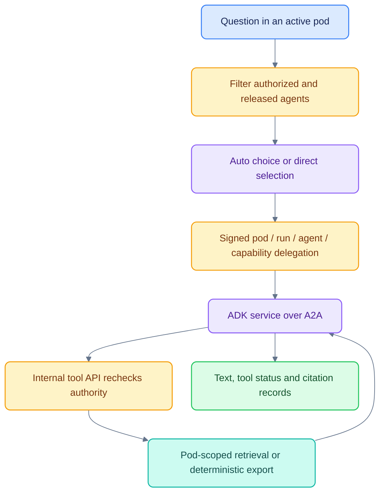
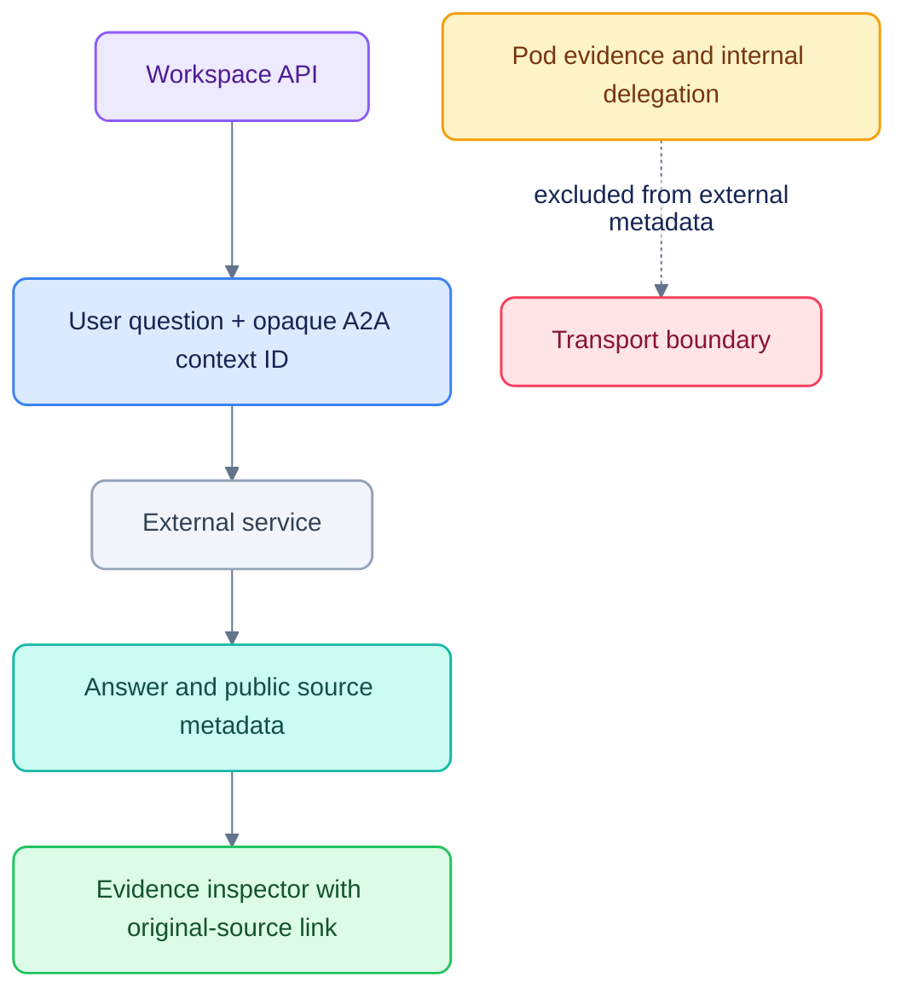

# Agent integration and governed tools

[Documentation](README.md) · [Architecture](ARCHITECTURE.md) · [Security](SECURITY.md)

An agent reasons about work; a capability performs an authorized operation.
Publishing an agent does not grant its users or service identity every capability.

## Internal invocation

Internal agent metadata may contain a delegation token, internal API address,
permitted capabilities, recent conversation, research case and selected call
context. The API reads call evidence under pod scope; the client supplies an ID,
not trusted source text.

`agentic.py` exposes only delegated tools to the model. `research_search` calls the
internal governed endpoint. Export tools submit typed specifications; deterministic
renderers produce DOCX/PPTX artifacts and keep binaries out of model context.

## Contracts and registration

External agents may return a named `court_availability` artifact containing a JSON
array of venues and slots. `podos_api.presentation` validates/bounds it, and the A2A
adapter emits a deduplicated `ui.result`. The API stamps the registered agent name
as its source and persists it in the ordinary run log. Unknown result types are
not executable UI. See [chat rendering](CHAT_EVIDENCE_IMPLEMENTATION.md#structured-results-and-retained-activity)
for the component contract and saved-answer behavior.

- Agent manifests: `config/manifests/agents/` and the contracts package.
- Deployment endpoint mapping: `config/endpoints.local.json` for local services.
- A2A serving: `agents/podos_agents/serve.py` and the Agent Card.
- Release policy: database-backed, with stage, cohort, flags and emergency disable.
- User/service access: pod-scoped OpenFGA grants, distinct from release policy.

The registry validates contracts and pins the Agent Card digest. Health and release
status affect availability. Auto cannot choose an agent outside the filtered set;
the API rechecks the chosen deployment before dispatch.

## External A2A deployment

External agent integration is supported through the admin API; the current web app
has no Admin console. Start the service independently and confirm its standard
`/.well-known/agent-card.json` is available with streaming capability. Then use
`POST /v1/admin/agents/connect`, publish/release the registered agent as appropriate,
and grant user access through `/v1/admin/access/*`. Follow the live OpenAPI schema
at [localhost:8400/docs](http://localhost:8400/docs) for request fields.

For local seed-time integration, inspect `config/external-agents.dev.json` before
setup. Registrations begin with their configured health/release state; a running
process alone does not imply user access.

External calls receive empty internal metadata and an opaque UUID-derived A2A
conversation identifier. Transport authentication may also be configured. They do
not receive the pod ID, internal API URL, private history/call context or internal
delegation token. The user's question itself is still sent to that service.

External progress and self-reported verification render as agent activity. They
are not independent platform verification. Public citations open the same evidence
inspector, with an explicit **Open original** action when an HTTP(S) URL exists.

## Event handling

| Agent output | Workspace treatment |
|---|---|
| Text delta | Persist and forward as `message.delta` |
| Tool progress/completion | Render activity; capability execution remains governed |
| `sources.available` | Early per-answer source registry for streaming references |
| Final `citations` | Used to persist the final citation snapshot on completion |
| External verification status | Display as the external agent's own reported check |
| `court_availability` JSON artifact | Validated `ui.result`, controlled OpenUI cards, persisted for reload |
| Failed transport/task | Run failure; only internal agents can fall back to another eligible internal agent |

The API normalizes A2A output into its own SSE protocol. This is not a certified
AG-UI adapter. ADK's A2A task store remains in memory; application runs/messages
and replay events are separately persisted by the API.

## Validate an integration

Use T2, T3 and T11 tests for routing, capabilities and the external boundary.
Verify denied access as well as successful rendering. Do not infer permission from
an Agent Card's advertised skill or a model's tool request. [Testing](TESTING.md)
contains commands and current UI navigation.
