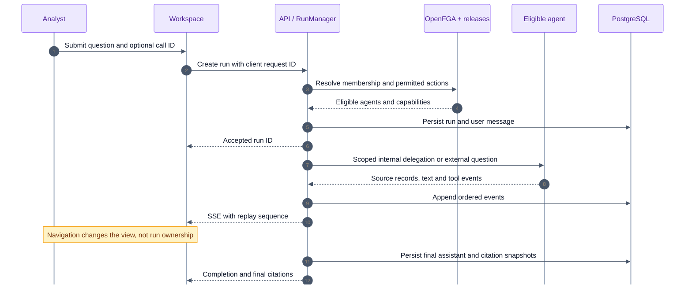

# Architecture of the current platform

[Documentation](README.md) · [Security](SECURITY.md) · [Original design](handoff/ARCHITECTURE.md)

This guide describes the code as of 24 October 2026. The original handoff remains
useful for target requirements; [Deviations](DEVIATIONS.md) explains departures.

## Runtime topology

```mermaid
---
config:
  theme: "base"
  themeVariables:
    fontFamily: "Arial, Helvetica, sans-serif"
    fontSize: "15px"
    primaryColor: "#dbeafe"
    primaryTextColor: "#172554"
    primaryBorderColor: "#3b82f6"
    secondaryColor: "#ccfbf1"
    secondaryTextColor: "#134e4a"
    secondaryBorderColor: "#14b8a6"
    tertiaryColor: "#ede9fe"
    tertiaryTextColor: "#4c1d95"
    tertiaryBorderColor: "#8b5cf6"
    lineColor: "#64748b"
    textColor: "#0f172a"
    mainBkg: "#eff6ff"
    clusterBkg: "#f8fafc"
    clusterBorder: "#cbd5e1"
    edgeLabelBackground: "#ffffff"
    actorBkg: "#ede9fe"
    actorBorder: "#8b5cf6"
    actorTextColor: "#4c1d95"
    actorLineColor: "#94a3b8"
    signalColor: "#475569"
    signalTextColor: "#0f172a"
    noteBkgColor: "#fef3c7"
    noteBorderColor: "#f59e0b"
    noteTextColor: "#78350f"
    activationBkgColor: "#ccfbf1"
    activationBorderColor: "#14b8a6"
  flowchart:
    curve: "basis"
    htmlLabels: false
    nodeSpacing: 30
    rankSpacing: 45
  sequence:
    mirrorActors: false
    showSequenceNumbers: true
  fontFamily: "Arial, Helvetica, sans-serif"
---
flowchart TB
    accTitle: Current runtime topology
    accDescr: The API mediates identity, storage and agent calls. Internal tools return through governed API endpoints, while the worker polls MCP sources and delivers work.
Browser["Next.js workspace"]:::interface --> API["FastAPI Workspace API"]:::service
    API --> FGA["OpenFGA: membership and grants"]:::guard
    API --> PG[("PostgreSQL: forced RLS")]:::store
    API --> Search[("OpenSearch: scoped indexes")]:::store
    API --> Objects[("MinIO: pod prefixes")]:::store
    API --> A2A["Internal ADK / A2A services"]:::service
    A2A --> Tools["Governed internal tools"]:::guard
    Tools --> API
    API --> External["External A2A service: question only"]:::neutral
    Worker["Worker and event router"]:::service --> API
    Worker --> MCP["MCP connector gateway"]:::service
    MCP --> EDGAR["SEC EDGAR source"]:::neutral
    Worker --> Mail["SMTP / Mailpit"]:::neutral
    %% podos-theme:start
    classDef interface fill:#dbeafe,stroke:#3b82f6,color:#172554,stroke-width:1.5px,rx:8px,ry:8px
    classDef service fill:#ede9fe,stroke:#8b5cf6,color:#4c1d95,stroke-width:1.5px,rx:8px,ry:8px
    classDef store fill:#ccfbf1,stroke:#14b8a6,color:#134e4a,stroke-width:1.5px,rx:8px,ry:8px
    classDef guard fill:#fef3c7,stroke:#f59e0b,color:#78350f,stroke-width:1.5px,rx:8px,ry:8px
    classDef success fill:#dcfce7,stroke:#22c55e,color:#14532d,stroke-width:1.5px,rx:8px,ry:8px
    classDef risk fill:#ffe4e6,stroke:#f43f5e,color:#881337,stroke-width:1.5px,rx:8px,ry:8px
    classDef neutral fill:#f1f5f9,stroke:#94a3b8,color:#334155,stroke-width:1.5px,rx:8px,ry:8px
    %% podos-theme:end
```

## Ownership and persistence

| Owner | State |
|---|---|
| Workspace API / PostgreSQL | Threads, messages, runs, ordered run events, cases, work items, releases, audit and outbox |
| OpenFGA | Relationship-based membership and grants |
| Agent service | Per-invocation reasoning; A2A task store is still in memory |
| Workspace layout | Pod-scoped chat subscriptions and local message/session cache |
| Chat page | Current view, composer, reference selection and evidence panel |
| Global call player | Current recording, playback position, rate and volume |
| Worker | Leased outbox work, scheduler and connector polling |
| Local Calls files | Prepared audio, transcript JSON and offline experiment artifacts |

A browser subscription is not the owner of a run. `RunManager.start` creates the
server task independently; leaving chat stops neither that task nor its workspace
subscriber. Reloading reconnects through persisted run events. An API process
restart interrupts in-process interactive execution; durable event replay is not
durable continuation of the agent's computation.

## Interactive request

Auto routing receives an already eligible set. The API validates and rechecks the
chosen agent before invocation. Fallback remains inside that set. Capabilities
are authorized again when executed, not merely when a button is displayed.

## Pod boundary

The trusted `PodContext` combines the signed-in subject, selected pod and live
OpenFGA resolution. The API sets `app.pod_id` inside each database transaction.
The runtime role is not the owner and cannot bypass forced RLS. Search users and
storage credentials are independently scoped to the pod's index or prefix.

The UI keeps a distinct SWR cache and chat-session manager per pod. This prevents
stale rendering; server-side authorization remains the actual access boundary.

## Event-driven work

```mermaid
---
config:
  theme: "base"
  themeVariables:
    fontFamily: "Arial, Helvetica, sans-serif"
    fontSize: "15px"
    primaryColor: "#dbeafe"
    primaryTextColor: "#172554"
    primaryBorderColor: "#3b82f6"
    secondaryColor: "#ccfbf1"
    secondaryTextColor: "#134e4a"
    secondaryBorderColor: "#14b8a6"
    tertiaryColor: "#ede9fe"
    tertiaryTextColor: "#4c1d95"
    tertiaryBorderColor: "#8b5cf6"
    lineColor: "#64748b"
    textColor: "#0f172a"
    mainBkg: "#eff6ff"
    clusterBkg: "#f8fafc"
    clusterBorder: "#cbd5e1"
    edgeLabelBackground: "#ffffff"
    actorBkg: "#ede9fe"
    actorBorder: "#8b5cf6"
    actorTextColor: "#4c1d95"
    actorLineColor: "#94a3b8"
    signalColor: "#475569"
    signalTextColor: "#0f172a"
    noteBkgColor: "#fef3c7"
    noteBorderColor: "#f59e0b"
    noteTextColor: "#78350f"
    activationBkgColor: "#ccfbf1"
    activationBorderColor: "#14b8a6"
  flowchart:
    curve: "basis"
    htmlLabels: false
    nodeSpacing: 30
    rankSpacing: 45
  sequence:
    mirrorActors: false
    showSequenceNumbers: true
  fontFamily: "Arial, Helvetica, sans-serif"
---
flowchart LR
    accTitle: Proactive work and human approval
    accDescr: Source events are copied into authorized watching pods, trigger monitor work, and reach the inbox through an outbox. Human approval is versioned before worker resume.
Source["MCP source or signed webhook"]:::neutral --> Event["Canonical event and dedupe"]:::service
    Event --> Router["Watchlist, dataset and feature checks"]:::guard
    Router --> Copy["One authorized copy per watching pod"]:::store
    Copy --> Monitor["Pod-owned monitor run"]:::service
    Monitor --> Outbox["Work item + transactional outbox"]:::store
    Outbox --> Inbox["Inbox and generic notification"]:::interface
    Inbox --> Decision["Eligible human decision + version check"]:::guard
    Decision --> Resume["Idempotent worker resume"]:::success
    Resume --> Artifact["Pod-private report or artifact"]:::store
    %% podos-theme:start
    classDef interface fill:#dbeafe,stroke:#3b82f6,color:#172554,stroke-width:1.5px,rx:8px,ry:8px
    classDef service fill:#ede9fe,stroke:#8b5cf6,color:#4c1d95,stroke-width:1.5px,rx:8px,ry:8px
    classDef store fill:#ccfbf1,stroke:#14b8a6,color:#134e4a,stroke-width:1.5px,rx:8px,ry:8px
    classDef guard fill:#fef3c7,stroke:#f59e0b,color:#78350f,stroke-width:1.5px,rx:8px,ry:8px
    classDef success fill:#dcfce7,stroke:#22c55e,color:#14532d,stroke-width:1.5px,rx:8px,ry:8px
    classDef risk fill:#ffe4e6,stroke:#f43f5e,color:#881337,stroke-width:1.5px,rx:8px,ry:8px
    classDef neutral fill:#f1f5f9,stroke:#94a3b8,color:#334155,stroke-width:1.5px,rx:8px,ry:8px
    %% podos-theme:end
```

The worker uses leases and `SKIP LOCKED` for claiming. Approval idempotency and
compare-and-set state transitions protect resume. A retried delivery is not a new
business decision. Today is currently assembled on request; personalized morning
LLM briefs and learned ranking remain roadmap work.

## Calls and evidence

Call records live in `call_events` under RLS, with JSON transcript/structure and
local audio paths. The API builds attached-call context from its own records;
it does not accept client-supplied transcript text as authoritative context.
Internal agents assign per-answer sentence references. Source snapshots retain
excerpt, speaker, timing and recorded provenance, then final citations select only
references actually used in the answer.

Source IDs and hashes make evidence inspectable and stable. The current system
has no semantic entailment gate, financial-fact engine or production ASR pipeline.
See [Calls](CALLS.md) and [chat implementation](CHAT_EVIDENCE_IMPLEMENTATION.md).

## Code entry points

| Concern | Source |
|---|---|
| Trusted context | `apps/api/podos_api/security/context.py`, `authz/pdp.py` |
| RLS transaction | `apps/api/podos_api/db.py` and `infra/migrations/` |
| Registry, releases, capability checks | `governance.py`, `releases.py`, `capabilities/service.py` |
| Runs and replay | `runs.py`, `routes/threads.py`, `a2a_adapter.py` |
| Agent tool loop | `agents/podos_agents/agentic.py` |
| Events and work | `events.py`, `background.py`, `workitems.py`, `connectors.py` |
| Workspace streams | `apps/web/lib/chat-sessions.ts`, `components/ask/podos-runtime.tsx` |
| Evidence and composer | `apps/web/components/ask/evidence.tsx`, `call-composer.tsx` |
