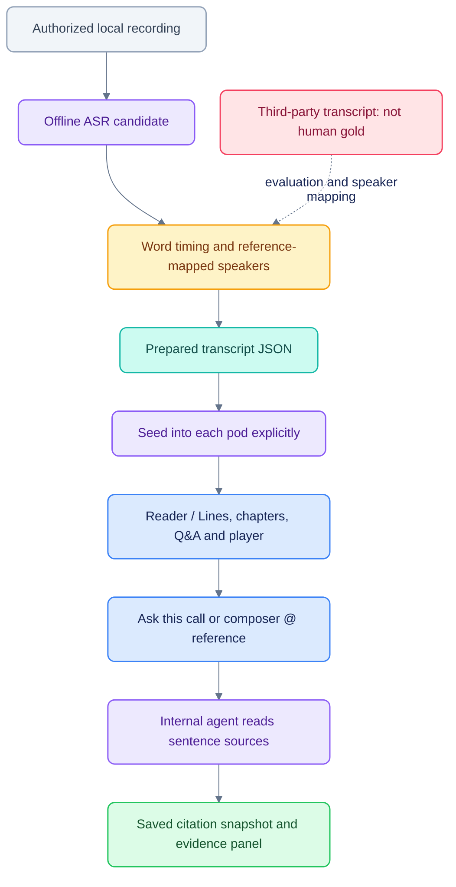
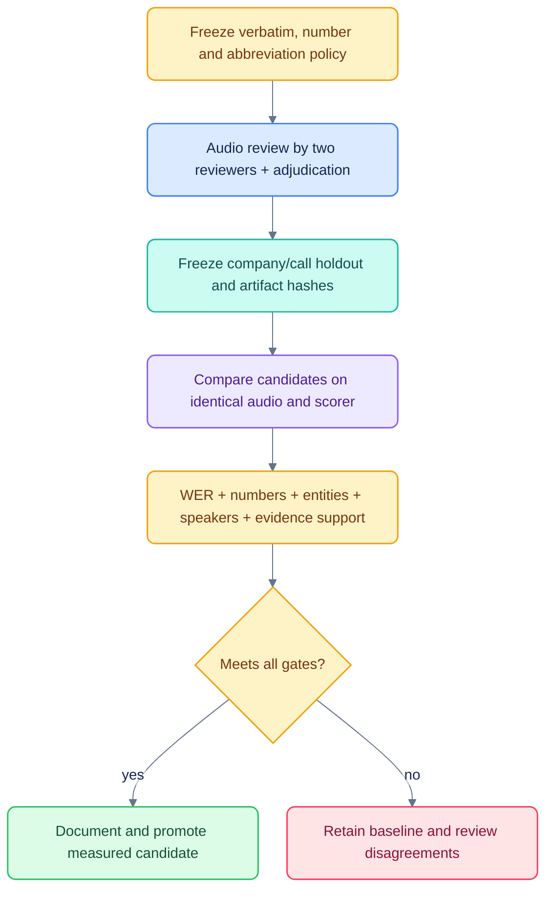

# Calls, transcription and answer evidence

[Documentation](README.md) · [Measured research](CALLS_ACCURACY_RESEARCH.md) ·
[Coverage audit](CALLS_IMPLEMENTATION_AUDIT.md) · [Chat implementation](CHAT_EVIDENCE_IMPLEMENTATION.md)

The Calls feature is a prototype with locally prepared recordings. It is not an
automated production earnings-ingestion service, and it has not demonstrated
industry parity or a human-gold WER below 4%.

## Current path


## Reader and chat

The library shows prepared calls; the stored examples are CoreWeave's JPM
conference interview and Aurora's Evercore forum, both in 2026. They are interviews,
not a representative earnings-call corpus. Transcript Reader/Lines, search,
chapters, consecutive-turn Q&A, insights and the global audio player are available.

The listening layout uses the workspace width, a larger DM Sans transcript, a
compact episode header and a wider chapter rail. On phones, chapter navigation is
a selector and the player stays compact. Model/reference details remain available
under **Transcript details** rather than occupying the primary listening controls.

Sentence highlights remain stable through timing gaps. Reading never follows the
audio automatically unless **Follow audio** is enabled; manual scrolling pauses
following. **Jump to current** returns to the current passage without enabling
follow. Search, chapter browsing and sentence citation IDs/times are preserved.
The paragraph/search/tap-to-play interaction takes cues from
[Apple Podcasts transcripts](https://support.apple.com/en-ie/127831).

**Ask this call** opens the main chat with a unique draft, a question prefill and a
composer reference. Type `@` to choose a call directly; one call may be attached
at a time. Citation controls open an inspector beside the answer on desktop or a
sheet on mobile. It shows saved text, speaker, role, start/end and recorded hashes,
with playback and the original reader available explicitly.

Machine-transcript labels and source hashes are not review badges. Missing
provenance remains missing rather than being inferred from confidence. Legacy
answers may have fewer fields than newly persisted citation snapshots.

## Local artifacts and seeding

| Path | Purpose |
|---|---|
| `var/calls/audio/` | Local recordings referenced by prepared packs |
| `var/calls/transcripts/*.json` | Prepared transcript packs loaded by `seed_calls.py` |
| `var/calls/experiments/2026-10-23/` | Local experiment manifests, candidates and reports |
| `docs/CALLS_ACCURACY_RESULTS.json` | Small committed result export |
| `infra/migrations/006_calls.sql` | Pod-scoped `call_events` schema |

`var/` is ignored and not recreated by cloning. Obtain permitted recordings and
build compatible packs before seeding. The current seeder copies **every prepared
pack into every seeded pod**; it is development setup, not a licensing-aware
production ingest API. Do not place private single-pod material there expecting
automatic source entitlement filtering.

```sh
uv run python -m podos_api.seed_calls
```

The seeder upserts local call records. Existing citations retain their saved
passage/hash, but opening the reader uses the current stored transcript. A changed
recording hash disables playback from an old citation in the evidence inspector.

## Offline tools

| Tool | Responsibility / limit |
|---|---|
| `calls_transcribe_local.py` | MLX Whisper/Parakeet candidates; optional independent vocabulary; no reference prompting |
| `calls_align.py` | Preserve recognized words/timing and map speakers from reference timing; not independent diarization |
| `calls_enrich.py` | Generate structure and resolve insight quotes to stored sentences; inspect model/environment requirements |
| `calls_qa.py` | Deterministic consecutive-turn Q&A construction |
| `calls_quality.py` | Repetition diagnostics; passing does not establish accuracy |
| `calls_consensus.py` | Experimental baseline-anchored token vote; not production reconciliation or full ROVER |
| `calls_evaluate.py` | Hash-checked reference disagreement, pinned normalizers and S/D/I reports |

These scripts are offline utilities, not durable pipeline stages. Some need Apple
Silicon/MLX and downloaded models; inspect their inline script dependencies and
`--help` before selecting an engine. Large artifacts, models and licensed content
should stay outside Git.

## How WER was calculated

`WER = (S + D + I) / N`, where `N` is normalized reference-word count. The displayed
historical scores use `calls_align.py`'s lowercase/punctuation policy against
cached published transcripts: **8.72% CoreWeave**, **8.57% Aurora**. These do not
have an independently reviewed golden source.

The reference text was cached from the StockAnalysis transcript pages carrying
Quartr event/audio data. The [research report](CALLS_ACCURACY_RESEARCH.md#evaluation-integrity-and-path-to-4)
records the precise pages and explains provenance/normalization limitations.
New experiment manifests pin reference/audio hashes. Do not call the generic
Quartr homepage a golden source or assume the reference transcript is error-free.

| Two-call aggregate | Legacy normalization | Whisper-derived English normalization |
|---|---:|---:|
| Existing displayed transcripts | 8.64198% | 6.50636% |
| Raw baseline / word-preserving alignment | 8.56075% | 6.39635% |

These are **reference disagreement** results on the same two-call corpus.
Normalization changes a score without improving acoustic recognition. The real
alignment fix preserves 34 recognized point-timestamp words for future alignment
runs; production sentence IDs and citations were not regenerated. Tested engines,
vocabulary and token voting did not establish a better replacement or sub-4% gate.

## Reproduce a recorded comparison

When the ignored local artifacts are available:

```sh
uv run scripts/calls_evaluate.py   var/calls/experiments/2026-10-23/parakeet-manifest.json   --output var/calls/experiments/2026-10-23/recheck-report.json
```

The evaluator checks input hashes and refuses overwrite. A clean clone does not
contain those experiment inputs, so do not invent missing artifacts to make the
command pass. Scorer integrity tests use controlled fixtures and run separately.

## Required next accuracy gate


That gate is planned. Current citations are traceable but do not validate quote
wording, numbers, units, periods, arithmetic or semantic claim support. Matching
filings/slides, typed financial facts, deterministic calculation rendering and
cross-source conflict handling remain work described by the coverage audit.
