# Transcription accuracy and financial grounding research

[Documentation](README.md) · [Calls guide](CALLS.md) · [Implementation audit](CALLS_IMPLEMENTATION_AUDIT.md)

Documentation update, 24 October: source inspection and background chat are now
implemented; see [the implementation record](CHAT_EVIDENCE_IMPLEMENTATION.md).
The experiments and measurements below remain the dated 23 October evaluation.

```mermaid
---
config:
  theme: "base"
  themeVariables:
    fontFamily: "Arial, Helvetica, sans-serif"
    fontSize: "15px"
    primaryColor: "#dbeafe"
    primaryTextColor: "#172554"
    primaryBorderColor: "#3b82f6"
    secondaryColor: "#ccfbf1"
    secondaryTextColor: "#134e4a"
    secondaryBorderColor: "#14b8a6"
    tertiaryColor: "#ede9fe"
    tertiaryTextColor: "#4c1d95"
    tertiaryBorderColor: "#8b5cf6"
    lineColor: "#64748b"
    textColor: "#0f172a"
    mainBkg: "#eff6ff"
    clusterBkg: "#f8fafc"
    clusterBorder: "#cbd5e1"
    edgeLabelBackground: "#ffffff"
    actorBkg: "#ede9fe"
    actorBorder: "#8b5cf6"
    actorTextColor: "#4c1d95"
    actorLineColor: "#94a3b8"
    signalColor: "#475569"
    signalTextColor: "#0f172a"
    noteBkgColor: "#fef3c7"
    noteBorderColor: "#f59e0b"
    noteTextColor: "#78350f"
    activationBkgColor: "#ccfbf1"
    activationBorderColor: "#14b8a6"
  flowchart:
    curve: "basis"
    htmlLabels: false
    nodeSpacing: 30
    rankSpacing: 45
  sequence:
    mirrorActors: false
    showSequenceNumbers: true
  fontFamily: "Arial, Helvetica, sans-serif"
---
flowchart LR
    accTitle: Accuracy experiment interpretation
    accDescr: Candidates are scored on frozen inputs with pinned normalization. The resulting reference disagreement does not establish independently reviewed acoustic accuracy.
Inputs["Same recordings and frozen reference hashes"]:::store --> Candidates["Baseline and experimental ASR outputs"]:::service
    Candidates --> Score["Pinned legacy / English normalizers + S, D, I"]:::guard
    Score --> Report["Reference-disagreement reports"]:::store
    Report --> Review["Inspect numbers, names, omissions and repetition"]:::interface
    Review --> Outcome["No demonstrated sub-4 percent human-gold result"]:::risk
    %% podos-theme:start
    classDef interface fill:#dbeafe,stroke:#3b82f6,color:#172554,stroke-width:1.5px,rx:8px,ry:8px
    classDef service fill:#ede9fe,stroke:#8b5cf6,color:#4c1d95,stroke-width:1.5px,rx:8px,ry:8px
    classDef store fill:#ccfbf1,stroke:#14b8a6,color:#134e4a,stroke-width:1.5px,rx:8px,ry:8px
    classDef guard fill:#fef3c7,stroke:#f59e0b,color:#78350f,stroke-width:1.5px,rx:8px,ry:8px
    classDef success fill:#dcfce7,stroke:#22c55e,color:#14532d,stroke-width:1.5px,rx:8px,ry:8px
    classDef risk fill:#ffe4e6,stroke:#f43f5e,color:#881337,stroke-width:1.5px,rx:8px,ry:8px
    classDef neutral fill:#f1f5f9,stroke:#94a3b8,color:#334155,stroke-width:1.5px,rx:8px,ry:8px
    %% podos-theme:end
```


Researched and tested 23 October 2026. This is a development evaluation on two
conference interviews, not a representative earnings-call gold benchmark.

## Findings from leading products

**Quartr + Kepler:** Quartr's published customer case describes joining transcripts
and slides with shared event identifiers. Kepler retrieves the corresponding
filing, transcript and slides together, and links claims to filing lines,
transcript passages with speakers, and phrases on slides. The important design
lesson is consistent primary-source identity and precise evidence, rather than a
larger prompt containing loosely related documents. These are vendor descriptions,
not an independent audit of product accuracy.

Source: [Quartr's Kepler case study](https://quartr.com/customers/how-kepler-made-every-ai-answer-traceable-to-a-primary-source-powered-by-quartr).

**Kepler's technical architecture:** its platform describes ingest-time fact
extraction, entity and period resolution, permission-aware lexical/dense retrieval
with reranking, and calculations over XBRL facts in code. It renders numbers from
fact references and checks quotes against source text. These mechanisms address
wrong scales, wrong periods, fabricated quotes and arithmetic errors that lower
WER alone cannot fix.

Source: [Kepler platform](https://kepler.ai/platform/).

**AlphaSense:** its financial research product combines filings, transcripts,
research and expert interviews, with retrieval and exact source-sentence
citations. This supports building cross-document retrieval and traceable
synthesis into our analysis layer.

Source: [AlphaSense financial research platform](https://www.alpha-sense.com/solutions/financial-research-platform/).

**Speech providers:** domain vocabulary is a supported acoustic-decoding feature,
not just post-hoc spell checking. Deepgram documents keyterm prompting for names,
products and industry terms; ElevenLabs documents context-aware keyterm prompting
for Scribe. Neither establishes that our recordings will reach a particular WER.
Quartr's internal ASR model, ensemble and correction implementation were not
established by the primary sources reviewed; do not attribute an undisclosed
recipe to it.

Sources: [Deepgram keyterms](https://developers.deepgram.com/docs/keyterm),
[ElevenLabs keyterms](https://elevenlabs.io/docs/eleven-api/guides/how-to/speech-to-text/batch/keyterm-prompting).

**Directly relevant research:** ConEC benchmarks earnings-call contextual ASR
using real releases, presentations and participant affiliations. Its authors
explicitly distinguish noisy real context from synthetic context containing
ground-truth words. This is a useful additional evaluation set for our context-pack
work, alongside a company-held-out internal gold set. A handpicked vocabulary of
known errors is a development experiment, not evidence of held-out generalization.
Sources: [ConEC paper and author summary](https://www.amazon.science/publications/conec-earnings-call-dataset-with-real-world-contexts-for-benchmarking-contextual-speech-recognition),
[authors' dataset repository](https://github.com/huangruizhe/ConEC).

Audio prosody and Q&A dynamics are possible later analysis inputs, alongside
text and slides. FinCall-Surprise is a research benchmark covering those three
modalities. Such work motivates controlled experiments, not a claim that our
product can infer honesty or investment outcomes from tone. Prioritize faithful
transcription, speaker attribution and evidence verification first.
Source: [FinCall-Surprise paper](https://arxiv.org/abs/2510.03965).

## What is missing in our implementation

| Priority | Change | Why it should improve results | Current state |
|---|---|---|---|
| 1 | Event evidence pack: transcript, release, presentation, 10-Q/10-K and XBRL | Supplies reported values, definitions, units and management context together | No complete joined pack in attached-call chat |
| 1 | Company/CIK, event, fiscal period, publication time and revision keys | Prevents wrong-quarter and future-information joins; distinguishes as-filed from restated | Call metadata exists; no consistent cross-document identity/point-in-time contract |
| 1 | Typed financial facts and deterministic calculations | Preserves currency, scale, basis points, GAAP/non-GAAP, segment and actual/guidance meaning | No verified KPI executor in call chat |
| 1 | Exact quotes and numeric claims rendered from stored evidence references | Source-link validity alone does not prove the generated wording or number | Sentence links exist; no complete answer verifier |
| 1 | Human-audited, frozen audio gold set | Makes the <4% target testable rather than a score against another machine/edited transcript | Two published reference transcripts only |
| 2 | Independent document vocabulary before ASR | Helps names such as Brannin McBee and David Maday without supplying reference answers | New optional local prompt-file experiment adapter |
| 2 | Second-engine disagreement and audio-review queue | Routes uncertain names, numbers, negations and overlap to focused review | Independent local engine tested; no calibrated review system |
| 2 | Genuine diarization and speaker-role resolution | Avoids attributing an analyst's question or assumption to management | Current labels are transferred from reference timing |
| 2 | Hybrid sentence/paragraph retrieval plus reranking and coverage tests | Improves long-call and cross-quarter evidence selection | Main attachment includes full short calls or heuristic excerpts |
| 3 | Topic, guidance-change and sentiment analysis with cited spans | Makes analysis consistent and auditable across periods | Navigation chapters and insights exist; no measured taxonomy/change pipeline |

For document grounding, keep two distinct facts: **what the speaker said** and
**what the company reported**. A document mismatch should create a linked warning
or review task. Never silently rewrite a spoken figure to match a release. Compare
only after matching entity, metric, period, currency, unit/scale, GAAP basis,
segment and actual/guidance status. A conference interview may cite several
periods; it has no automatically correct single earnings-report join.

Concrete example: CoreWeave's Q1 release reports $99.4 billion of revenue backlog
as of March 31, 2026. A speaker saying “nearly $100 billion” should retain that
wording in the transcript while analysis can cite the precise reported value.
Source: [CoreWeave Q1 2026 release filed with the SEC](https://www.sec.gov/Archives/edgar/data/1769628/000176962826000220/coreweave1q26earningspress.htm).
Aurora's Q2 letter distinguishes $2 million of quarterly revenue from $14–16
million of full-year revenue guidance; a verifier must preserve that distinction.
Source: [Aurora Q2 2026 shareholder letter](https://ir.aurora.tech/sec-filings/all-sec-filings/content/0001828108-26-000075/aurora26q2shareholderlet.htm).

Preserve the original recording and raw ASR. Keep an edited reading transcript
separate from verbatim text; quotations and audio citations must identify the
version they use. A confident token can still be wrong, so confidence thresholds
need calibration against reviewed labels.

Audio-specific work still missing includes input-quality checks (clipping,
dropouts and channel layout), speech-aware overlapping chunk boundaries,
silence/hallucination checks, and forced alignment after any approved text
correction. Preserve channel separation when speakers actually have separate
channels; stereo alone does not establish that. Denoising and source separation
must be tested against unchanged audio because processing can remove phonetic
detail. Language/accent and overlap strata need separate evaluation.

Local checks found highly correlated stereo channels (CoreWeave 0.99991,
Aurora 0.98896) and no samples at/above full scale after ffmpeg decoding and
16 kHz resampling. This narrow check does not establish clean audio, absence of
source clipping, independent speaker channels, or overlap correctness.

For a future server ASR backend, NeMo documents decoding-time domain language
models, rescoring and phrase boosting without retraining. These are additional
candidates to test; the MLX Parakeet run here used its documented default greedy
decoder, without NeMo-specific boosting.
Source: [NVIDIA ASR customization](https://docs.nvidia.com/nemo-framework/user-guide/latest/nemotoolkit/asr/asr_language_modeling_and_customization.html).

## Reproduced baseline and actual pipeline fix

Historical scores were 8.72% (CoreWeave) and 8.57% (Aurora), from
`scripts/calls_align.py`: lowercase, remove most punctuation, then word edit
distance. They were not Whisper-normalized or human-gold scores.

| Same two-call corpus | Legacy normalization | Whisper-derived English normalization |
|---|---:|---:|
| Existing displayed transcript | 8.64198% | 6.50636% |
| Original raw Whisper output | 8.56075% | 6.39635% |
| Alignment preserving recognized words | 8.56075% | 6.39635% |
| Turbo with independent company/name vocabulary | 8.56075% | 6.40421% |
| Independent Parakeet v3, greedy, 120s/15s chunking | 15.56205% | 10.49819% |

Aggregate = sum of substitutions, deletions and insertions divided by summed
reference-word count; not an unweighted average of per-call percentages.

Changing normalization explains much of the numerical difference but does not
improve recognition. The **actual fix** preserves 34 recognized words previously
discarded solely because their start/end timestamps were identical (26 CoreWeave,
8 Aurora). Point estimates retain their original time and carry a review flag.
It also preserves decoder order at tied timestamps and rejects invalid/nonfinite
timing. Re-generated candidates now match raw-output WER under both policies.
Production transcript files, sentence IDs and existing citations are unchanged;
the fix applies to subsequent alignment runs.

Normalized legacy Whisper raw scores are 7.53710% on CoreWeave and 5.37970% on
Aurora. Much of the residual disagreement is fillers/interjections; for example,
the CoreWeave comparison includes 71 standalone `yeah` deletions, while Aurora
includes 44 standalone `so` insertions. These are disagreements, not independently
confirmed audio errors. Do not remove fillers merely to match the reference.

Parakeet was tested from audio with no reference text. It performed worse against
these references and is not promoted. Different verbatim policies and acronym
renderings contribute; its score does not prove all those differences are acoustic
recognition errors. A newer model is not automatically a better replacement.

Vocabulary prompting corrected Aurora's CFO name in the opening, but its full-call
normalized score was 5.64720%, versus the existing raw 5.37970%. Across both calls
the vocabulary run was effectively tied with the baseline (slightly worse under
the English normalizer). It is not promoted as a general accuracy improvement.

### Full-model and consensus follow-up: Aurora only

| Candidate on the same complete Aurora recording | Legacy WER | English-normalized WER |
|---|---:|---:|
| Existing raw turbo output | 8.54454% | 5.37970% |
| Full large-v3, conditioning reset + temperature fallback + vocabulary | 9.33374% | 5.72150% |
| Three-way token vote: existing turbo, Parakeet, recovered full large-v3 | 9.19715% | 5.61748% |

The full-model and vote follow-ups cover **one call**, not the two-call aggregate
above. Neither improved on the Aurora baseline. The vote uses two correlated
Whisper variants and one Parakeet model; it is a simple baseline-anchored vote,
not full ROVER or three independent acoustic families. Text-only voting would
also need forced alignment before it could support playback.

An earlier large-v3 configuration (temperature fixed at zero with prior-text
conditioning) entered a runaway phrase loop. Its 113.20% normalized WER is a
rejected decoding failure, not a reasonable model-quality benchmark. The first
diagnostic vote included that failed parent and is rejected as well. Re-running
with conditioning reset and fallback eliminated this observed loop but did not
beat turbo. This does not establish that those settings prevent every hallucination.

`scripts/calls_quality.py` now flags dominant repeated phrases and repetition
inside decoder/time windows, including loops split across short sentence segments.
The transcriber preserves flagged output and exits with review-required status;
the consensus CLI rejects such inputs. These checks apply to the offline tools.
Production ingestion still needs to wire in quarantine/review handling. Passing
the heuristics does not prove accuracy, and no text is silently removed.

The measured experiments do **not** demonstrate <4%. Keep the existing acoustic
baseline while adding the word-preservation fix for future alignments. Prioritize
reviewed gold data, evidence packs and critical-number verification over promoting
the tested replacement engines or token vote.

## Evaluation integrity and path to <4%

References are the cached StockAnalysis embedded transcript data for
[CoreWeave's JPM conference](https://stockanalysis.com/stocks/crwv/transcripts/671041-j-p-morgan-54th-annual-global-technology-media-and-communications-conference/)
and [Aurora's Evercore forum](https://stockanalysis.com/stocks/aur/transcripts/737723-evercore-s-9th-annual-adas-av-ai-forum/).
Those pages carry Quartr event/audio data. The cached reference's generic
`source_page=https://quartr.com/` is inadequate provenance; new experiment manifests
record the exact pages and SHA-256 hashes of the reference and audio bytes.
No person has validated these whole references against audio.

`scripts/calls_evaluate.py` pins jiwer 4.0.0 and whisper-normalizer 0.1.15,
records script/normalizer/input hashes, decomposes S/D/I, emits disagreement review
items and labels incomplete candidate coverage. Its Whisper-derived normalizer is
**not** Artificial Analysis's custom normalizer, so these are not AA-WER scores.
It deliberately cannot declare the human-gold target passed.

The pinned normalizer also has limitations around punctuation-heavy numerical
expressions and ranges. Always inspect the original surface text for financial
verification. Normalized WER tokens are not a canonical financial fact store.

Artificial Analysis's cleaned Earnings22 dataset explains that original reference
errors required manual correction and documents its extra normalization rules.
This reinforces the need to validate our references and freeze our own policy.
Source: [Earnings22-Cleaned-AA dataset](https://huggingface.co/datasets/ArtificialAnalysis/Earnings22-Cleaned-AA).

Recommended acceptance sequence:

1. Build an independently audio-reviewed set across actual earnings calls,
   conference interviews, accents, line quality, overlaps and number-heavy Q&A.
   Separate development and untouched test companies/calls. Fix verbatim/filler,
   abbreviation and number conventions before tuning. Use two reviewers and
   adjudication for ambiguous regions; timestamp/label unintelligible audio.
2. Benchmark the existing turbo model, full large-v3, document-vocabulary decoding
   and a second engine on identical audio and scorer. Keep each model's raw output,
   revision, prompt, costs and runtime. Cloud providers are additional candidates,
   not measured winners on our data.
3. Route engine disagreements and critical quantities/entities to replay/review.
   Use audio-backed corrections with immutable provenance; do not use the scoring
   reference as an ASR prompt. Fit any reconciliation rule on development data.
4. Measure WER alongside number/unit/period accuracy, entity errors, negation
   preservation, speaker DER/attribution, timestamp error and downstream answer
   evidence precision/recall. Ordinary WER weights `so` and `billion` equally.
5. Accept <4% only on the frozen human-gold holdout, with per-call results and
   call-level bootstrap uncertainty. Verify no critical-metric regression and
   publish whether the score is automatic or includes reviewed corrections.

## Reproduce

Artifacts live under `var/calls/experiments/2026-10-23/` (local generated data).
`baseline-report.json`, `alignment-report.json` and `parakeet-report.json` contain
the exact inputs, scores and token disagreements.

Evaluation/consensus integrity plus the related call-chat/agent regressions:
27 tests passed. Ruff checks passed for the changed Python scripts and tests.

`final-v3-report.json` includes all follow-ups, quality flags and explicit rejected
candidate status. `docs/CALLS_ACCURACY_RESULTS.json` is a compact export. ASR
elapsed times are not controlled latency benchmarks because some runs overlapped.
Early experiments did not capture a random seed; saved output supports exact
rescoring, while future runner invocations seed MLX and record the seed.

```sh
uv run scripts/calls_evaluate.py \
  var/calls/experiments/2026-10-23/parakeet-manifest.json \
  --output var/calls/experiments/2026-10-23/recheck-report.json
uv run scripts/calls_transcribe_local.py \
  var/calls/audio/aur-evercore-2026.mp3 \
  var/calls/experiments/new-run/aur.json --engine parakeet
```

Outputs refuse overwrite. Candidate ASR reads audio and optional independent
vocabulary only; it does not load reference transcripts or promote itself.
