# Transcript answer provenance: Kepler comparison

[Documentation](README.md) · [Implemented behavior](CHAT_EVIDENCE_IMPLEMENTATION.md) ·
[Remaining Calls gates](CALLS_IMPLEMENTATION_AUDIT.md)

**Adoption status:** the inspector, snapshot provenance, early source records,
valid-only final citations, `@` composer references and background answers are now
implemented. Typed facts, arithmetic/claim validation and cross-document conflicts
remain planned. The comparison below preserves its pre-change observations.

```mermaid
---
config:
  theme: "base"
  themeVariables:
    fontFamily: "Arial, Helvetica, sans-serif"
    fontSize: "15px"
    primaryColor: "#dbeafe"
    primaryTextColor: "#172554"
    primaryBorderColor: "#3b82f6"
    secondaryColor: "#ccfbf1"
    secondaryTextColor: "#134e4a"
    secondaryBorderColor: "#14b8a6"
    tertiaryColor: "#ede9fe"
    tertiaryTextColor: "#4c1d95"
    tertiaryBorderColor: "#8b5cf6"
    lineColor: "#64748b"
    textColor: "#0f172a"
    mainBkg: "#eff6ff"
    clusterBkg: "#f8fafc"
    clusterBorder: "#cbd5e1"
    edgeLabelBackground: "#ffffff"
    actorBkg: "#ede9fe"
    actorBorder: "#8b5cf6"
    actorTextColor: "#4c1d95"
    actorLineColor: "#94a3b8"
    signalColor: "#475569"
    signalTextColor: "#0f172a"
    noteBkgColor: "#fef3c7"
    noteBorderColor: "#f59e0b"
    noteTextColor: "#78350f"
    activationBkgColor: "#ccfbf1"
    activationBorderColor: "#14b8a6"
  flowchart:
    curve: "basis"
    htmlLabels: false
    nodeSpacing: 30
    rankSpacing: 45
  sequence:
    mirrorActors: false
    showSequenceNumbers: true
  fontFamily: "Arial, Helvetica, sans-serif"
---
flowchart LR
    accTitle: Traceability versus verification
    accDescr: Saved sources make a claim inspectable. Financial correctness and semantic support require separate fact and validation mechanisms.
Claim["Answer claim with inline reference"]:::interface --> Snapshot["Saved source passage"]:::store
    Snapshot --> Inspect["Inspect speaker, time and original"]:::success
    Snapshot -. "does not prove" .-> Truth["Claim entailment or arithmetic"]:::risk
    Facts["Planned typed facts and calculations"]:::guard --> Checks["Independent validation gates"]:::guard
    Checks --> Truth
    %% podos-theme:start
    classDef interface fill:#dbeafe,stroke:#3b82f6,color:#172554,stroke-width:1.5px,rx:8px,ry:8px
    classDef service fill:#ede9fe,stroke:#8b5cf6,color:#4c1d95,stroke-width:1.5px,rx:8px,ry:8px
    classDef store fill:#ccfbf1,stroke:#14b8a6,color:#134e4a,stroke-width:1.5px,rx:8px,ry:8px
    classDef guard fill:#fef3c7,stroke:#f59e0b,color:#78350f,stroke-width:1.5px,rx:8px,ry:8px
    classDef success fill:#dcfce7,stroke:#22c55e,color:#14532d,stroke-width:1.5px,rx:8px,ry:8px
    classDef risk fill:#ffe4e6,stroke:#f43f5e,color:#881337,stroke-width:1.5px,rx:8px,ry:8px
    classDef neutral fill:#f1f5f9,stroke:#94a3b8,color:#334155,stroke-width:1.5px,rx:8px,ry:8px
    %% podos-theme:end
```

Implementation update: the source inspector, composer call references and background
answers are now implemented. See [implementation and limits](CHAT_EVIDENCE_IMPLEMENTATION.md).
The assessment below records the pre-implementation findings.

Evaluated 23 October 2026. Recommendation: adopt claim-level evidence inspection
inside our existing Auto chat. Keep the playable transcript deep links already
implemented. This is a recommendation based on public product materials and our
code, not a completed usability study or a test of Kepler's authenticated app.

## What Kepler publicly documents

Quartr's Kepler case study describes fetching the filing, transcript and slides
for the matching reporting period together. Transcript claims link to precise
passages with speaker identity; financial figures and slide references have
document-specific anchors. This provides a useful model for cross-source answers.
Source: [Quartr case study](https://quartr.com/customers/how-kepler-made-every-ai-answer-traceable-to-a-primary-source-powered-by-quartr).

Kepler's platform page describes rendering figures from fact references, keeping
calculation inputs and formulas, and checking quoted wording against source text.
Its finance page shows number-to-source inspection and describes surfacing
disagreements between documents. These are vendor claims, not independently
verified performance results.
Sources: [Kepler platform](https://kepler.ai/platform/),
[Kepler finance](https://kepler.ai/finance/).

Kepler's public API example returns an answer alongside a `figures` array with a
value, formula and source. That suggests evidence should be a structured part of
the answer contract, rather than a list assembled from prose afterward.
Source: [Kepler API example](https://kepler.ai/build/).

Browser navigation succeeded, but two Kepler snapshot attempts returned
`Preview automation snapshot timed out after 15000ms.` Public web content was
available. No authenticated workflow, interaction latency or accessibility result
for Kepler is claimed here.

## Our current experience

Code inspected:

- `agents/podos_agents/agentic.py`: attached transcript sentences get stable
  per-answer numeric references, and source records retain the sentence text,
  speaker, role and start time. The model is asked to cite supporting sentences.
- `apps/web/components/ask/citation.tsx`: numbered chips provide source tooltips;
  transcript clicks navigate to the sentence/time. The tooltip is supplementary
  and cannot replace a touch-accessible evidence view.
- `apps/web/components/ask/parts.tsx`: compact source cards include speaker/time
  and the same playable deep links. They do not explain which claim each card
  supports or distinguish reported figures, derived calculations and inference.
- `apps/web/lib/types.ts`: no claim-support, verification, transcript-version,
  source-region or derived-fact contract on the current Citation type.

This is already more useful than document-level footnotes alone. The remaining
gap is whether a claim is supported, and how easily a user can inspect that support
without losing their question and answer.

## Confirmed trust problems

Read-only probes of `Sources.cited()` with two retrieved sources showed:

| Answer | Returned source references | Implication |
|---|---|---|
| No inline reference | Both sources | Retrieved material can look like cited support |
| Unknown `[999]` only | Both sources | Invalid references do not fail closed |
| Changed figure with valid `[1]` | Source 1 | Valid identifier does not establish support for the figure |

The last probe demonstrates absent validation, not a measured hallucination rate.
`Sources.cited()` selects reference IDs; it does not assess entailment, quote
exactness or numerical correctness. Citation metadata is emitted after streamed
answer text. A footer source list cannot be treated as a verified-answer indicator.

First implementation priority: return only actually cited, valid references;
keep any additional retrieved documents in a separately labeled optional view.
Detect unknown references and unsupported factual claims before treating the
answer as supported. Do not silently attach all sources as a fallback.

## Recommended interaction

1. **Answer first.** Keep the answer concise, with small citation controls next to
   individual factual claims. Group citations that support the same claim.
2. **Inspect without leaving chat.** A tap/click opens a docked evidence panel on
   desktop and a sheet on mobile. Show the exact passage highlighted in context,
   source type, company, date/period, speaker/role when applicable, and location.
3. **Replay or open the original.** For a transcript, expose start/end and an
   explicit play-region control using the existing global player. Also keep
   "Open transcript" for the full reader. Filings/slides need page/region anchors.
4. **Distinguish evidence from interpretation.** Use useful labels such as
   Transcript, Reported figure, Calculated and Interpretation. These are claim
   types, not generic trust scores. Calculations expand to formula and cited
   inputs; interpretation links to its supporting evidence and is not formatted
   as a source quote.
5. **Use precise verification labels.** "Quote matches stored text" is narrower
   than "Audio reviewed". A source link is not a verified fact. Never display a
   generic Verified badge based only on a valid citation or high ASR confidence.
6. **Disclose disagreements where they matter.** Preserve both source values and
   their units/periods. Distinguish rounding, period differences, guidance versus
   actuals, and unresolved conflicts. Do not automatically replace speech with a
   number from a release.
7. **Keep deeper provenance collapsed.** Version/hash, extraction method, review
   history, source revisions and retrieval details belong under an advanced
   disclosure. Default evidence should remain readable.

An actual example from our stored CoreWeave call shows why this matters: sentence
`s9` at 18.54–20.36 seconds is attributed to **Mark Murphy of JPMorgan**, the
interviewer, and refers to nearly $100 billion of backlog. It must not become a
quote attributed to CoreWeave management. The Q1 release separately reports
$99.4 billion as of March 31, 2026. A rounded comparison is an interpretation,
not proof that the call states an exact updated balance. Our speaker labels are
reference-timing mappings, not independently validated voice identities.
Source: [CoreWeave Q1 release, additional financial highlights](https://www.sec.gov/Archives/edgar/data/1769628/000176962826000220/coreweave1q26earningspress.htm).

## Why this is likely better for users

The expected benefit is lower verification effort: a user sees the passage in
place, hears the relevant audio, and understands whether the claim is spoken,
reported or derived. It should also make mistaken attribution and period/unit
errors easier to notice. These are design hypotheses until measured.

The tradeoffs are extra interface density and the risk that authoritative-looking
badges encourage overtrust. Keep inspection optional, support keyboard/touch,
label machine transcripts accurately, and preserve position when opening or
closing evidence. Do not expose internal reasoning traces as provenance: source
records, calculations and checks are what users can independently verify.

## Implementation contract

Add a structured claim/evidence layer to the existing chat, rather than another
chat surface. Each claim should carry a stable ID, claim type, supporting source
IDs and verification results. Each source should carry its canonical ID/version,
content hash, source type and company/period metadata. Transcript anchors need
sentence IDs, word/character spans where available, start/end, speaker and speaker
attribution method. Document anchors need page/region or HTML/table/XBRL locations.
Derived facts need formula, typed inputs, units, scale, rounding and execution
result. Persist that snapshot with the answer so subsequent transcript edits do
not silently change its evidence. Apply pod permissions when retrieving, opening,
replaying and exporting sources; do not expose private source existence.

Stream source records before the claims that reference them. Render verbatim
quotes and computed figures from referenced records; validate those elements
before emission. A valid source ID is a separate check from semantic support for
an interpretation. Show a supported partial answer or an explicit gap when
evidence is insufficient.

## How to decide whether it is better

Compare the current jump-to-transcript flow against the proposed inspector with
the same answers, evidence and questions; this isolates UX from model quality.
Counterbalance task order across research users. Include correct answers and
controlled flaws: interviewer/management confusion, altered quotes, wrong-period
figures, missing citations, unit errors and conflicting sources.

Measure verification time, source-location success, error-detection rate,
incorrect acceptance/rejection, task completion and interruption of reading
position. Ask for confidence after each task and check whether it tracks actual
correctness. Assess keyboard and touch use separately. Then measure the verifier
backend's citation-support precision/recall, quote exactness and calculation
correctness on an independently labeled set.

No usability improvement or citation-accuracy percentage has yet been measured.
Adopt the pattern incrementally: citation correctness first, in-chat evidence
inspection next, then cross-document facts and verified calculations.
