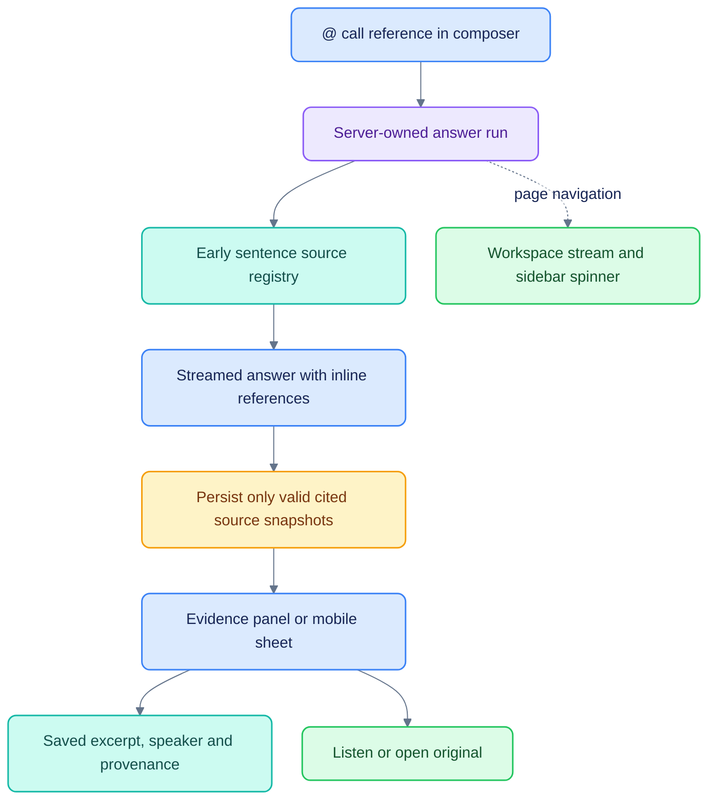

# Chat evidence and background answers

[Documentation](README.md) · [Architecture](ARCHITECTURE.md) · [Testing](TESTING.md)

This is implemented behavior. Planned verified financial facts/calculations are
separate from source inspection.

Implemented 23–24 October 2026 in the existing Auto chat. Design rationale and public
Kepler references are in [CALLS_CITATION_UX_EVALUATION.md](CALLS_CITATION_UX_EVALUATION.md).

## Behavior

- Inline references and source cards open a docked evidence panel on desktop and
  a full-width sheet on mobile. Opening evidence does not navigate away from chat.
- The panel shows the saved excerpt, source title/type/date, speaker/role and
  start/end time. It offers playback from the timestamp and the original reader.
  Adjacent transcript sentences are available under a disclosure, with the cited
  sentence highlighted. Changed wording is disclosed separately from the snapshot.
- Provenance includes transcript/audio SHA-256 and recorded ASR/speaker-attribution
  metadata. Machine transcripts are not labeled verified. Playback is disabled if
  the current recording's hash differs from the cited recording.
- Source records stream before the text that refers to them. At completion, only
  valid, actually cited references remain and are persisted with the answer.
  Missing/unknown references never fall back to attaching every retrieved source.
  Vault citations save the excerpt supplied to the model; legacy answers without
  snapshots offer the original source without claiming a saved quote.
- The source footer initially shows four entries and can expand. It does not list
  hundreds of retrieved transcript sentences as if they were cited documents.
- Type `@` in the composer to filter and select a call with the keyboard or mouse.
  The selected call appears inside the composer and on the sent user message.
  Removing it sends an explicit null so follow-ups do not silently inherit it.
  This release supports one call reference at a time.
- Call, case, Today and agent handoffs carry a distinct draft identity so a cached
  unsent draft cannot retain the wrong company, question or agent.
- Workspace-owned subscriptions keep streaming when a chat page is left. The
  server remains the owner of execution, including across reloads. The chat list
  combines local active state with server run state and shows a loading spinner.
  Reopening an active chat replays persisted events without resubmitting the user
  question. Stop is an explicit cancel action; navigation does not send cancel.
- Suggested questions remain; the cross-pod test suggestion has been removed.

## Verification

Validation: 28 backend tests and five browser-session model tests pass; TypeScript,
targeted lint and the production build pass. The existing Next.js build reports a
security advisory for the installed framework version; upgrading it remains separate
from this change.

Automated coverage exercises concurrent chats, page-independent subscriptions,
active-run replay, event deduplication, explicit stop, effect cleanup/resume,
source-registry replacement, valid-only references, snapshot persistence,
source-before-text order, background server completion, and pod isolation.

Browser checks cover keyboard `@` selection, composer attachment placement,
call-to-chat prefilling, leaving a generating answer, two concurrent sidebar
spinners, active-run recovery after a full reload, citation inspection without a
route change, audio playback, Escape/focus restoration, and responsive layouts.

## Limits

This implements source inspection and traceability. It does not implement
Kepler-style typed financial facts, XBRL/table/page anchors, deterministic
calculation rendering, semantic claim verification, automated cross-document
conflict resolution, or independently reviewed speaker identification. A matching
citation identifier establishes a source location, not the truth of a model claim.

No WER improvement or sub-4% accuracy is claimed by these UI changes. Those
experiments and reference-set limitations remain documented separately in
[CALLS_ACCURACY_RESEARCH.md](CALLS_ACCURACY_RESEARCH.md).
