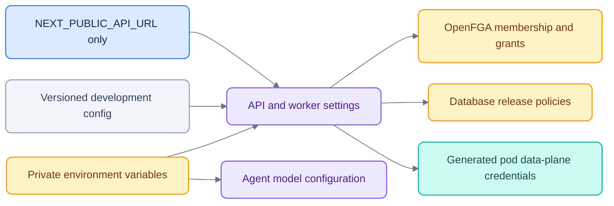

# Configuration

[Documentation](README.md) · [Setup](GETTING_STARTED.md) · [Security](SECURITY.md)

Backend defaults are defined in [`settings.py`](../apps/api/podos_api/settings.py).
Model settings are read by [`llm.py`](../agents/podos_agents/llm.py).
`scripts/dev.sh` loads the application-root `.env` before launching child processes.
Running a Python module directly does not automatically load that file.

## Configuration boundaries

## Model access

Use `.env` locally, keep permissions restrictive, and set the real key through a
private secret mechanism. The following names describe the supported settings;
the model strings are **code defaults**, not a verified provider availability list.

| Variable | Default / behavior |
|---|---|
| `OPENROUTER_API_KEY` | Unset: deterministic mode; set: live model path is available |
| `PODOS_LLM_MODE` | `auto`; set `off` to force deterministic agents |
| `PODOS_LLM_MODEL` | `anthropic/claude-sonnet-5.5` |
| `PODOS_LLM_FAST_MODEL` | `anthropic/claude-haiku-5.5` for routing/short summaries |
| `PODOS_AGENT_TIMEOUT` | API default `30` seconds; tune separately from the model HTTP timeout |

Requests ask OpenRouter for `provider.data_collection = "deny"`. That request does
not replace contractual approval for private research or MNPI. Production requires
a firm-approved endpoint and suitable identity, retention and cost controls.

## Service settings

| Variable | Development default / purpose |
|---|---|
| `PODOS_ENV` | `dev`; development login allowed only in `dev`/`test` |
| `PODOS_DATABASE_URL` | Runtime `podos_app` role on localhost:55432 / `podos` |
| `PODOS_OWNER_DATABASE_URL` | Owner role used for schema/setup, never the runtime app role |
| `PODOS_FGA_URL` / `PODOS_FGA_STORE` | localhost:58080 / `podos` |
| `PODOS_FGA_API_KEY` | Development-only preshared key; replace in shared deployments |
| `PODOS_PUBLIC_API_URL` | `http://localhost:8400` |
| `PODOS_INTERNAL_API_URL` | `http://127.0.0.1:8400`, passed only to internal agents |
| `PODOS_WEB_ORIGINS` | localhost and 127.0.0.1 on port 3400, comma separated |
| `PODOS_SEARCH_BACKEND` | `opensearch`; alternative adapter is for development/testing |
| `PODOS_OPENSEARCH_URL` | `https://127.0.0.1:59200` |
| `PODOS_OPENSEARCH_VERIFY` | `false` for the local demo certificate; use a trusted CA in production |
| `PODOS_OBJECT_BACKEND` | `s3`; local adapter also exists |
| `PODOS_S3_ENDPOINT` / `PODOS_S3_BUCKET` | `127.0.0.1:59100` / `podos-artifacts` |
| `PODOS_S3_SECURE` | `0` locally; configure TLS for shared infrastructure |
| `PODOS_INDEX_NAMESPACE` | Empty; tests use `test-` |
| `PODOS_EMAIL_BACKEND` | `smtp`; Mailpit is the local sink |
| `NEXT_PUBLIC_API_URL` | Frontend default `http://localhost:8400`; applied at build time |

Session, delegation, download and per-workload signing secrets have development
stand-ins. See `settings.py` for the complete set. Keep owner credentials and
service signing keys out of browser bundles and agent prompts.

## Versioned files versus runtime state

| File or location | Role |
|---|---|
| `config/iam.json` | Mock directory used when seeding |
| `config/access-template.json` | Seed template for OpenFGA grants |
| `config/policy.json` | Operational quotas; not the authorization source of truth |
| `config/releases/` | Seed release policies; runtime decisions use database state |
| `config/manifests/` | Agent/capability contracts |
| `config/endpoints.local.json` | Local agent endpoint mapping |
| `config/connectors.local.json` | MCP source configuration |
| `config/external-agents.dev.json` | Optional external development registrations |
| `config/data_plane.dev.json` | Generated per-pod credentials; gitignored |
| `.env`, `var/`, model caches | Private/generated runtime material; gitignored |

Changing a seed file does not imply a live grant changed. Use the authorized admin
API for runtime access/release changes; rerunning seed/reset changes local data.

## Connector and ASR settings

`PODOS_EDGAR_MODE` selects `mock` or `sec` in the launcher. Live SEC access requires
an appropriate contact-bearing User-Agent; consult the connector CLI and source.
ASR tools have their own command-line arguments and optional MLX dependencies;
see [Calls](CALLS.md). They are not enabled by a model API key.
