# Current demo walkthrough

[Documentation](README.md) · [Setup](GETTING_STARTED.md) · [Testing](TESTING.md)

Allow 10–15 minutes. Start the stack with `make dev` after setup. No model key is
needed for deterministic research; call synthesis requires the live internal model
path and locally prepared call data. Do not reset valuable data for a demo.

```mermaid
---
config:
  theme: "base"
  themeVariables:
    fontFamily: "Arial, Helvetica, sans-serif"
    fontSize: "15px"
    primaryColor: "#dbeafe"
    primaryTextColor: "#172554"
    primaryBorderColor: "#3b82f6"
    secondaryColor: "#ccfbf1"
    secondaryTextColor: "#134e4a"
    secondaryBorderColor: "#14b8a6"
    tertiaryColor: "#ede9fe"
    tertiaryTextColor: "#4c1d95"
    tertiaryBorderColor: "#8b5cf6"
    lineColor: "#64748b"
    textColor: "#0f172a"
    mainBkg: "#eff6ff"
    clusterBkg: "#f8fafc"
    clusterBorder: "#cbd5e1"
    edgeLabelBackground: "#ffffff"
    actorBkg: "#ede9fe"
    actorBorder: "#8b5cf6"
    actorTextColor: "#4c1d95"
    actorLineColor: "#94a3b8"
    signalColor: "#475569"
    signalTextColor: "#0f172a"
    noteBkgColor: "#fef3c7"
    noteBorderColor: "#f59e0b"
    noteTextColor: "#78350f"
    activationBkgColor: "#ccfbf1"
    activationBorderColor: "#14b8a6"
  flowchart:
    curve: "basis"
    htmlLabels: false
    nodeSpacing: 30
    rankSpacing: 45
  sequence:
    mirrorActors: false
    showSequenceNumbers: true
  fontFamily: "Arial, Helvetica, sans-serif"
---
flowchart LR
    accTitle: Demo journey
    accDescr: Walk through Today, sourced chat, Calls, background answers and Inbox, then verify pod separation.
Today["Today: inspect what changed"]:::interface --> Chat["Chat: question and source inspection"]:::interface
    Chat --> Call["Calls: read, listen and attach"]:::interface
    Call --> Background["Navigate while answers generate"]:::service
    Background --> Inbox["Inbox: review and decide"]:::guard
    Inbox --> Pod["Switch pod and verify separation"]:::store
    %% podos-theme:start
    classDef interface fill:#dbeafe,stroke:#3b82f6,color:#172554,stroke-width:1.5px,rx:8px,ry:8px
    classDef service fill:#ede9fe,stroke:#8b5cf6,color:#4c1d95,stroke-width:1.5px,rx:8px,ry:8px
    classDef store fill:#ccfbf1,stroke:#14b8a6,color:#134e4a,stroke-width:1.5px,rx:8px,ry:8px
    classDef guard fill:#fef3c7,stroke:#f59e0b,color:#78350f,stroke-width:1.5px,rx:8px,ry:8px
    classDef success fill:#dcfce7,stroke:#22c55e,color:#14532d,stroke-width:1.5px,rx:8px,ry:8px
    classDef risk fill:#ffe4e6,stroke:#f43f5e,color:#881337,stroke-width:1.5px,rx:8px,ry:8px
    classDef neutral fill:#f1f5f9,stroke:#94a3b8,color:#334155,stroke-width:1.5px,rx:8px,ry:8px
    %% podos-theme:end
```

## 1. Enter a pod

Sign in as Alice for Alpha or Dana to switch between Alpha and Beta. The visible
navigation is New chat, Today, Research, Calls and Inbox. Open the command menu
with Cmd/Ctrl+K to find chats, research cases and available agents.

## 2. Inspect research and ask

Open Research, choose a case, and inspect its notes/documents. Start a chat and ask
“What is our NWSC thesis and its key risks?” Select Auto or an available direct
agent from the chat header. Watch activity, streamed text and inline citations.
Select a source to inspect the evidence and explicitly open the original document.

Suggested questions are normal research prompts. The old “Try to read another
pod” suggestion was removed. Isolation attacks remain covered by API tests; they
are not a product onboarding prompt.

## 3. Attach and inspect a call

If local prepared calls are present, open Calls and select CoreWeave or Aurora.
Try Reader/Lines, transcript search, a chapter, Q&A and the global player. Choose
**Ask this call**: the main composer contains an `@` call chip and an editable
question, without a top-of-page attachment banner.

Alternatively type `@crwv` or `@aur` in the composer and press Enter to select the
matching call. Remove the chip to clear context explicitly. Open another call's
handoff before sending: the new draft must contain the correct company/question.

## 4. Inspect answer provenance

Send a call question. Click a numbered citation to open the desktop evidence
panel; on mobile it becomes a full-width sheet. Check saved passage, speaker,
role and timestamp. Play from that point or open the transcript. Expand context
and provenance only when needed. Escape closes evidence and restores focus.

Explain that a saved machine-transcript excerpt is traceability, not automatic
claim verification. The WER shown on the call is disagreement with a published
reference, not a score against independently reviewed gold.

## 5. Leave an answer running

Start a question, immediately navigate to Calls or Today, and observe the spinner
on its chat row. Start a second chat to demonstrate concurrent answers. Return to
one mid-stream or reload its page: it reconnects without sending the question
again. The explicit Stop control cancels; navigation does not.

## 6. Show exports and approvals

Alice/Arjun can request a small research deck when their capability grant permits
it. Ben's Beta role lacks the PowerPoint entitlement. In Inbox, use the Monitors
tab for a seeded monitor and Activity for run history. Review an approval's source
and draft, then approve/reject using its versioned decision controls. The worker
creates the ready artifact and generic email preview; Mailpit is at
[localhost:58025](http://localhost:58025).

## 7. Verify pod separation

As Dana, switch Alpha/Beta. Research, chats, inbox and available agents must reflect
the selected pod. As Pat, use the admin API to review control-plane state without
pod research access. There is currently no standalone Admin or Agents web page.

## Optional API demonstrations

Use the live [OpenAPI schema](http://localhost:8400/docs) and an authorized admin
identity for registry publication, release preview, canary, emergency disable or
access changes. These are real API capabilities; screenshots of the old console
are historical. T1/T5/T7/T11 suites provide repeatable checks of their boundaries.

The legacy `make e2e` walkthrough needs migration to this navigation before it can
be used as the current browser acceptance gate. See [Testing](TESTING.md).
