# Deviations from the architecture (and why)

Reviewed 24 October 2026. This compares the original target architecture with the
current proof of concept. For the running system, start with [Architecture](ARCHITECTURE.md)
and [Security](SECURITY.md); the original numbered requirements remain historical.

```mermaid
---
config:
  theme: "base"
  themeVariables:
    fontFamily: "Arial, Helvetica, sans-serif"
    fontSize: "15px"
    primaryColor: "#dbeafe"
    primaryTextColor: "#172554"
    primaryBorderColor: "#3b82f6"
    secondaryColor: "#ccfbf1"
    secondaryTextColor: "#134e4a"
    secondaryBorderColor: "#14b8a6"
    tertiaryColor: "#ede9fe"
    tertiaryTextColor: "#4c1d95"
    tertiaryBorderColor: "#8b5cf6"
    lineColor: "#64748b"
    textColor: "#0f172a"
    mainBkg: "#eff6ff"
    clusterBkg: "#f8fafc"
    clusterBorder: "#cbd5e1"
    edgeLabelBackground: "#ffffff"
    actorBkg: "#ede9fe"
    actorBorder: "#8b5cf6"
    actorTextColor: "#4c1d95"
    actorLineColor: "#94a3b8"
    signalColor: "#475569"
    signalTextColor: "#0f172a"
    noteBkgColor: "#fef3c7"
    noteBorderColor: "#f59e0b"
    noteTextColor: "#78350f"
    activationBkgColor: "#ccfbf1"
    activationBorderColor: "#14b8a6"
  flowchart:
    curve: "basis"
    htmlLabels: false
    nodeSpacing: 30
    rankSpacing: 45
  sequence:
    mirrorActors: false
    showSequenceNumbers: true
  fontFamily: "Arial, Helvetica, sans-serif"
---
flowchart LR
    accTitle: Target and implementation gaps
    accDescr: The proof of concept implements isolation and governance while retaining local stand-ins and uncompleted production gates.
Target["Original production target"]:::neutral --> Current["Implemented proof of concept"]:::service
    Current --> Boundary["Pod isolation and governed operations"]:::success
    Current --> Standins["Mock identity, in-process runs and local artifacts"]:::guard
    Standins --> Work["Identity, durability, accuracy and scale gates"]:::risk
    %% podos-theme:start
    classDef interface fill:#dbeafe,stroke:#3b82f6,color:#172554,stroke-width:1.5px,rx:8px,ry:8px
    classDef service fill:#ede9fe,stroke:#8b5cf6,color:#4c1d95,stroke-width:1.5px,rx:8px,ry:8px
    classDef store fill:#ccfbf1,stroke:#14b8a6,color:#134e4a,stroke-width:1.5px,rx:8px,ry:8px
    classDef guard fill:#fef3c7,stroke:#f59e0b,color:#78350f,stroke-width:1.5px,rx:8px,ry:8px
    classDef success fill:#dcfce7,stroke:#22c55e,color:#14532d,stroke-width:1.5px,rx:8px,ry:8px
    classDef risk fill:#ffe4e6,stroke:#f43f5e,color:#881337,stroke-width:1.5px,rx:8px,ry:8px
    classDef neutral fill:#f1f5f9,stroke:#94a3b8,color:#334155,stroke-width:1.5px,rx:8px,ry:8px
    %% podos-theme:end
```


| # | Architecture says | POC does | Reason / production path |
|---|---|---|---|
| 1 | Existing Google ADK agents | New ADK `BaseAgent`s behind `to_a2a`. They reason with an LLM via **OpenRouter** (OpenAI-compatible tool calling, `agents/podos_agents/llm.py` + `agentic.py`) and fall back to a deterministic path without a key | No existing agents were available, and CI must not need LLM keys. The tool loop is our own rather than `LlmAgent` so that tool bindings come from the platform delegation and every tool call is a governed API call. The deterministic agents are **deliberately naive** about prompt injection, so the tests prove that the *platform*, not the agent, enforces scope. |
| 1b | No MNPI to third-party model endpoints without approved controls (§7.3) | OpenRouter with `provider.data_collection=deny`, fictional research fixtures plus locally prepared public call evidence | Production must point `llm.py` at a firm-approved model endpoint. |
| 2 | ADK `to_a2a` in-memory stores must be replaced | Still in-memory | Agents are stateless per invocation: conversation, run and event state is persisted by the Workspace API under RLS. Supply `task_store=DatabaseTaskStore(...)` before relying on A2A task resumption (noted in `agents/podos_agents/serve.py`). |
| 3 | AG-UI compatible SSE | Our own normalised SSE event set (§8.2 names) consumed by an assistant-ui ExternalStore runtime | assistant-ui's ExternalStore runtime gives full control over pod-scoped persistence and replay. The event names follow §8.2; an AG-UI adapter can be added at the edge without changing the backend. |
| 4 | Signed workload identity / mTLS | HS256 JWT per workload (`config/workload_secrets.dev.json`); delegations and sessions are also HS256 with separate keys and audiences | Local stand-in for K8s workload identity / SPIFFE. Each agent has its own key; no universal credential. |
| 5 | OIDC/Entra | Mock OIDC picker (`/v1/auth/dev-login`, disabled outside `dev`/`test`) | `pod_memberships` is the directory (IdP) mirror and is synced into OpenFGA; every decision, including membership, is answered by OpenFGA on every request. |
| 6 | `release_policies.agent_id NOT NULL` (starter SQL) | Nullable, plus `kind` (`agent`/`capability`) and `capability_id` with a check constraint | Capability releases (`cap.document.export.pptx`, …) need the same flag and kill-switch machinery without an agent. |
| 7 | Release example JSON | Extended schema `release-policy.schema.json` adds `kind`, `stage`, `capability_enabled` | The handoff example lacks them; a test asserts the example fails the stricter schema until they're added. |
| 8 | OpenFeature + JSON provider | Custom OpenFeature provider reading release policies from Postgres per request (snapshot bound via ContextVar) | Live changes and kill switch with no redeploy; flagd can replace the provider later. |
| 9 | Download via short-lived signed link | API-issued 60 s token bound to subject + pod + artifact. The API re-checks membership at redemption and streams from MinIO | A pre-signed S3 URL cannot re-check membership at redemption (T1 "revoked membership invalidates outstanding downloads"). |
| 10 | OpenSearch DLS caution | Separate index per pod **and** a separate OpenSearch user per pod (role restricted to `research-<pod>` and `test-research-<pod>`) | Stronger than index naming alone: OpenSearch itself returns 403 to another pod's credential. |
| 11 | Novu / Temporal / agentgateway | Not deployed (per the anti-goals). **OpenFGA is now deployed** (see #15). The outbox and worker implement durable approval and resume; `run_monitor` and `resume_workflow` are the activity boundaries reserved for Temporal | As specified in §11 "no mandatory … service in the first slice". |
| 12 | MinIO image | `cgr.dev/chainguard/minio` | `minio/minio` is no longer published on Docker Hub. MinIO server is AGPL-3.0: it runs unmodified as a separate service and is swappable for S3/GCS. |
| 13 | Pod quotas incl. tokens/cost | Run rate, concurrency and tool-call budget are enforced; token and cost budgets are not, including when live LLM mode is enabled | Hook point: `RunManager.start` and `routes/internal._budget`. |
| 14 | Rate limiter | In-process sliding window per pod | A multi-replica API needs Redis or Postgres-backed counters. |
| 15 | Versioned JSON policy provider (§9.5), "replaceable by OpenFGA" | **OpenFGA** decides membership, roles, groups and grants for agents, capabilities, datasets, features and pod actions (`infra/openfga/model.fga`, `apps/api/podos_api/authz/`). `config/policy.json` now holds quotas only; `config/access-template.json` seeds the graph | Every grant object is pod-scoped and intersected with live membership (`grantee and member from pod`), so a mis-scoped tuple cannot cross pods (model test). Resolved once per request into `PodContext.entitlements` with `HIGHER_CONSISTENCY`; outage fails closed (503). Service grants (agent → tool) are cached for 2 s. Grants are no longer hot-reloaded from a file: they are changed directly in OpenFGA (or its dev Playground) and recorded in `access_changes`. |
| 16 | Data connectors (plan §9) | Pull connectors are MCP servers (`connectors/podos_connectors`); only the connector gateway is an MCP client. Public filings are **copied into each watching pod's vault** (copy-per-pod) rather than kept in a shared index | Keeps per-pod OpenSearch credentials and RLS exactly as they are (open decision 1 in `docs/PLAN_PROACTIVE.md`, chosen here as the safer default). Watched tickers (no pod ids) are sent to the source when polling. |
| 17 | Today briefing (plan §2) | Built on request from the pod's own data, deterministic ranking (yours first, newest first) | A scheduled, LLM-written morning brief and learned ranking come with §4/§5 (phase B). |
| 18 | (not in the architecture) Generative UI | Agents may add one ```openui-lang block (OpenUI Lang, [openui.com](https://www.openui.com)) to an answer; the chat renders it with `@openuidev/react-lang` | Curated component subset in `apps/web/lib/openui/spec.json` (charts, tables, KPI cards, callouts, tabs, tags, follow-up buttons). Excluded on purpose: images, image list items and markdown images (a prompt-injected document could exfiltrate pod data through an image URL), forms, and modals. No `toolProvider`, so `Query()`/`Mutation()` reach nothing; `@OpenUrl` is stripped from the prompt and ignored by the renderer; markdown images are blocked in chat too. The agent prompt is generated from the same spec (`npm run openui:prompt`, checked in `make lint`). Every charted number must be in a cited source (prompt rule; deterministic path only charts numbers it finds; T10 checks it). `@openuidev/react-ui` declares a `zustand@^4` peer; an npm override points it at the app's zustand 5 (the APIs it uses are unchanged in v5). |
| 19 | (styling) Linear/Grok/ChatGPT-blend light UI | A light-only system that blends Linear, Grok and ChatGPT: near-black ink `#0d0d0d` on a white canvas `#ffffff`, white cards, 8% ink hairlines (`#00000014`), indigo `#5e6ad2` for links, focus rings and accent tints, and a Quantexa-violet purple scale (base `#3a1961`) on primary/secondary actions; status hues blue `#035ADE`, green `#00BF6F`, amber `#FFAB00`, red `#FF2D55` as one base colour at stepped opacity (`app/openrouter.css`; `--color-ink` is the single theme-flip knob); 8 px controls, 10 px cards, a soft focus shadow with no hard composer border. Type: **Inter** (400 text / 510 controls / 590 emphasis / 680 tight headings) and Geist Mono. | Structure follows Linear, ink follows Grok, canvas and cards follow ChatGPT; PodOS keeps its own logo and name, and nothing of those products' branding is copied. The purple family is Quantexa's deep violet rather than a generic violet. OpenUI charts are themed through the package-root library because `@openuidev/react-ui/genui-lib` bundles a separate theme context. |

## Current UI and evidence deviations

The current web app exposes Today, Research, Calls, Inbox and chat. Agents are
selected from chat/command search; Monitors/Activity are Inbox tabs. The original
standalone admin/agent screens are no longer routes, although their backend APIs
remain implemented.

Calls use prepared local packs rather than durable licensed ingestion. Speaker
labels are reference-timing transfers, not independent diarization. Chat now saves
citation excerpts/hashes, supports in-composer `@` call references and continues
answers across navigation/reload. These improve traceability and continuity; they
do not close the financial-fact, semantic-support or reviewed-gold accuracy gaps.
See [Calls](CALLS.md) and [chat implementation](CHAT_EVIDENCE_IMPLEMENTATION.md).

The older browser script and screenshots predate this UI. Test/runtime details
in [Testing](TESTING.md) supersede old total counts and navigation instructions.
