# Documentation and diagram style

[Documentation](README.md) · [Testing](TESTING.md)

Documentation should help a new reader run, understand, change and verify the
platform. Explain implemented behavior first; label historical designs, hypotheses
and missing gates explicitly. Keep measured scores with their corpus, date,
normalizer, reference provenance and limitations.

## Structure and links

- Use a single descriptive H1, short sections, direct language and copyable commands.
- State the working directory and prerequisites for commands. Separate ordinary
  startup from destructive resets and opt-in provider calls.
- Use repository-relative links for files. Prefer tables for component/setting maps.
- Link to dated research rather than presenting vendor claims as measured results.
- Preserve original handoff requirements; update their status/navigation wrappers.
- Do not hand-edit generated OpenUI prompts or framework-managed AGENTS blocks.
- Do not commit private environment files, generated credentials or runtime audio.

## Colorful Mermaid, consistently

The shared palette is in [`mermaid-theme.json`](mermaid-theme.json). Every diagram
embeds its configuration, so rendering does not require a site stylesheet. Flowchart
classes also carry explicit fill/stroke/text colors. These keep meaning visible in
hosts that override part of a theme. No external image service is used.

| Class | Fill / border | Meaning |
|---|---|---|
| `interface` | Blue `#dbeafe` / `#3b82f6` | User, browser or visible workflow |
| `service` | Violet `#ede9fe` / `#8b5cf6` | Application processing or orchestration |
| `store` | Teal `#ccfbf1` / `#14b8a6` | Data, source evidence or persisted state |
| `guard` | Amber `#fef3c7` / `#f59e0b` | Authorization, review or acceptance gate |
| `success` | Green `#dcfce7` / `#22c55e` | Implemented continuation or successful outcome |
| `risk` | Rose `#ffe4e6` / `#f43f5e` | Missing capability, denial or measured limitation |
| `neutral` | Slate `#f1f5f9` / `#94a3b8` | External input or historical source |

```mermaid
---
config:
  theme: "base"
  themeVariables:
    fontFamily: "Arial, Helvetica, sans-serif"
    fontSize: "15px"
    primaryColor: "#dbeafe"
    primaryTextColor: "#172554"
    primaryBorderColor: "#3b82f6"
    secondaryColor: "#ccfbf1"
    secondaryTextColor: "#134e4a"
    secondaryBorderColor: "#14b8a6"
    tertiaryColor: "#ede9fe"
    tertiaryTextColor: "#4c1d95"
    tertiaryBorderColor: "#8b5cf6"
    lineColor: "#64748b"
    textColor: "#0f172a"
    mainBkg: "#eff6ff"
    clusterBkg: "#f8fafc"
    clusterBorder: "#cbd5e1"
    edgeLabelBackground: "#ffffff"
    actorBkg: "#ede9fe"
    actorBorder: "#8b5cf6"
    actorTextColor: "#4c1d95"
    actorLineColor: "#94a3b8"
    signalColor: "#475569"
    signalTextColor: "#0f172a"
    noteBkgColor: "#fef3c7"
    noteBorderColor: "#f59e0b"
    noteTextColor: "#78350f"
    activationBkgColor: "#ccfbf1"
    activationBorderColor: "#14b8a6"
  flowchart:
    curve: "basis"
    htmlLabels: false
    nodeSpacing: 30
    rankSpacing: 45
  sequence:
    mirrorActors: false
    showSequenceNumbers: true
  fontFamily: "Arial, Helvetica, sans-serif"
---
flowchart LR
    accTitle: Documentation palette example
    accDescr: Blue marks interfaces, violet services, amber gates, teal data, green outcomes and rose gaps. Labels and edge text carry meaning independently of color.
Person["User interface"]:::interface --> Process["Application service"]:::service
    Process --> Gate["Authorization or review"]:::guard
    Gate --> Source["Persisted evidence"]:::store
    Source --> Good["Successful outcome"]:::success
    Gate -. "not accepted" .-> Gap["Explicit gap or denial"]:::risk
    %% podos-theme:start
    classDef interface fill:#dbeafe,stroke:#3b82f6,color:#172554,stroke-width:1.5px,rx:8px,ry:8px
    classDef service fill:#ede9fe,stroke:#8b5cf6,color:#4c1d95,stroke-width:1.5px,rx:8px,ry:8px
    classDef store fill:#ccfbf1,stroke:#14b8a6,color:#134e4a,stroke-width:1.5px,rx:8px,ry:8px
    classDef guard fill:#fef3c7,stroke:#f59e0b,color:#78350f,stroke-width:1.5px,rx:8px,ry:8px
    classDef success fill:#dcfce7,stroke:#22c55e,color:#14532d,stroke-width:1.5px,rx:8px,ry:8px
    classDef risk fill:#ffe4e6,stroke:#f43f5e,color:#881337,stroke-width:1.5px,rx:8px,ry:8px
    classDef neutral fill:#f1f5f9,stroke:#94a3b8,color:#334155,stroke-width:1.5px,rx:8px,ry:8px
    %% podos-theme:end
```


Use the classic `base` theme with custom variables, soft fills, readable dark text
and restrained curved connectors. Sequence diagrams share actor/note/message
colors. Keep diagrams small enough to read and split a complex system across views.
Use quoted labels, accessible `accTitle`/`accDescr`, and named colors/classes rather
than color alone. Avoid diagrams that imply a planned capability is already shipped.

## Maintain and validate

```sh
npm --prefix docs ci
npm --prefix docs run check
# After changing the central palette:
npm --prefix docs run sync-theme
npm --prefix docs run check
```

The checker scans repository Markdown, resolves local links/anchors, checks the
shared frontmatter and flowchart styles, and renders all diagrams with the pinned
Mermaid CLI. Generated SVGs and a source inventory go to ignored `var/docs/` for
visual inspection. `--links-only` skips the browser renderer when only checking
links; use the full check before publishing diagram changes.

The CLI's Puppeteer dependency may download a browser at install time. In a
managed environment set `PODOS_DOCS_BROWSER` to an approved Chromium executable.
Do not set an executable path merely to mask a diagram error.

GitHub supports fenced Mermaid blocks; individual editors may need an extension,
and hosted Mermaid versions differ. This repository uses established flowchart and
sequence syntax rather than newly introduced diagram types. Verify the rendered
result when publishing to another host.

References: [Mermaid theme configuration](https://mermaid.js.org/config/theming.html),
[frontmatter configuration](https://mermaid.js.org/config/configuration.html),
[GitHub diagram support](https://docs.github.com/en/get-started/writing-on-github/working-with-advanced-formatting/creating-diagrams).
