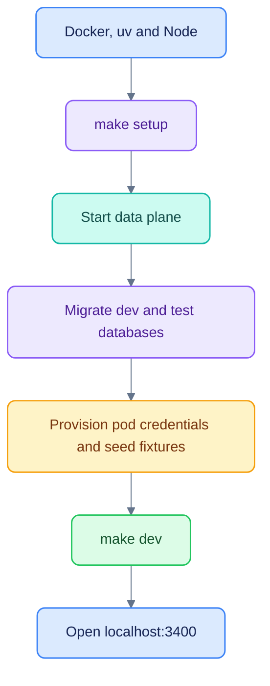

# Getting started

[Documentation](README.md) · [Configuration](CONFIGURATION.md) · [Troubleshooting](OPERATIONS.md)

All commands below run from the **repository root** (`ai-native-workspace`), unless noted.

## Prerequisites

- Docker with Compose and enough memory for OpenSearch and the other local services.
- `uv` with Python **3.12**; `pyproject.toml` excludes Python 3.13 and later.
- Node.js and npm compatible with the locked frontend. The documentation renderer
  requires Node.js **22.13 or later**.
- Free local ports listed in the [application README](../README.md).


## First run

```sh
make setup
make dev
```

`make setup` starts Docker services, synchronizes Python dependencies, migrates the
`podos` and `podos_test` databases, provisions per-pod search/storage credentials,
seeds development records and installs web packages. OpenSearch and OpenFGA may
need time to become healthy. Setup seeds data; do not treat it as a production
migration command.

`make dev` runs the agents, MCP connector, API, worker and web process. Stop that
foreground stack with Ctrl+C. Docker data services remain running. Logs are in
`var/log/`; the script prints the local service URLs.

Open [the workspace](http://localhost:3400), select an identity, and choose a pod.
Without a model key, agents use the deterministic implementation. This is suitable
for the core isolation demo and acceptance tests.

## Development identities

| Identity | Pod access | Useful scenario |
|---|---|---|
| Yasir Khalid | Alpha, PM | Main external demo; research, exports, approvals and exclusive Sportscanner access |
| Alice Chen | Alpha, PM | Research, exports and approvals |
| Arjun Patel | Alpha, analyst | Analyst workflow and exports |
| Bianca Rossi | Beta, PM | Beta decisions |
| Ben Okafor | Beta, analyst | Research without PowerPoint entitlement |
| Dana Kim | Alpha and Beta | Pod switching and cache separation |
| Pat Morgan | Platform administration; no pod membership | Admin API; no research access |

For an external presentation, use Yasir as the main account, Bianca to demonstrate
pod isolation, and Pat for platform administration. The other accounts remain
available as permission and workflow test fixtures.

Sportscanner is connected as an external A2A agent at `http://127.0.0.1:8001`.
Only `yasir.khalid` has its pod-scoped grant in `config/access-template.json`;
other users cannot discover or invoke it, including by sending its ID directly.
Select Sportscanner in the Ask composer and try “Badminton near E1 2AD tomorrow
evening.” The separate Sportscanner service must be running. This local endpoint
currently has authentication disabled for development; shared deployments need
a Sportscanner bearer credential configured through an agent secret reference.
PodOS sends the question and a conversation key, without its session token,
pod research or permission metadata.

These accounts come from the development identity directory. The login picker is
disabled outside `dev`/`test`; this is not an enterprise SSO implementation.

## Optional live models

Create the ignored `.env` in the application root, set `OPENROUTER_API_KEY` privately,
and restart `make dev`. Model overrides and the data-handling boundary are in
[Configuration](CONFIGURATION.md). Do not commit the file or copy a real key into
a documentation example.

## Optional call library

The prepared audio/transcript files and ASR model caches live in ignored `var/`
paths. They are not distributed with the source. A fresh install may have an empty
Calls library until locally authorized artifacts are prepared and seeded.
[Calls](CALLS.md) explains the expected paths, available scripts and limitations.
The core workspace does not require ASR tooling or a GPU.

## First checks

```sh
make test
make lint
(cd apps/web && npx --yes tsx --test tests/chat-sessions.test.ts)
```

Tests use a separate database and service namespaces. Never point the test harness
at production. See [Testing](TESTING.md) before running a reset or older browser
walkthrough against data you care about.

## Next steps

Follow the [current demo](DEMO.md), inspect the [architecture](ARCHITECTURE.md), or
use the [operations guide](OPERATIONS.md) for production builds and recovery.
