# Implementation status and milestones

[Documentation](README.md) · [Architecture](ARCHITECTURE.md) · [Calls audit](CALLS_IMPLEMENTATION_AUDIT.md)

Status reviewed **24 October 2026** against the code. This is a proof of concept,
with implemented trust boundaries and interactive workflows, not production parity.

```mermaid
---
config:
  theme: "base"
  themeVariables:
    fontFamily: "Arial, Helvetica, sans-serif"
    fontSize: "15px"
    primaryColor: "#dbeafe"
    primaryTextColor: "#172554"
    primaryBorderColor: "#3b82f6"
    secondaryColor: "#ccfbf1"
    secondaryTextColor: "#134e4a"
    secondaryBorderColor: "#14b8a6"
    tertiaryColor: "#ede9fe"
    tertiaryTextColor: "#4c1d95"
    tertiaryBorderColor: "#8b5cf6"
    lineColor: "#64748b"
    textColor: "#0f172a"
    mainBkg: "#eff6ff"
    clusterBkg: "#f8fafc"
    clusterBorder: "#cbd5e1"
    edgeLabelBackground: "#ffffff"
    actorBkg: "#ede9fe"
    actorBorder: "#8b5cf6"
    actorTextColor: "#4c1d95"
    actorLineColor: "#94a3b8"
    signalColor: "#475569"
    signalTextColor: "#0f172a"
    noteBkgColor: "#fef3c7"
    noteBorderColor: "#f59e0b"
    noteTextColor: "#78350f"
    activationBkgColor: "#ccfbf1"
    activationBorderColor: "#14b8a6"
  flowchart:
    curve: "basis"
    htmlLabels: false
    nodeSpacing: 30
    rankSpacing: 45
  sequence:
    mirrorActors: false
    showSequenceNumbers: true
  fontFamily: "Arial, Helvetica, sans-serif"
---
flowchart LR
    accTitle: Delivery status
    accDescr: Core workspace and governance slices are implemented. Calls remain a partial prototype, with production ingestion and verified facts still outstanding.
P0["P0: pod isolation and contracts"]:::success --> P1["P1: governed conversations"]:::success
    P1 --> P2["P2: capabilities and research vault"]:::success
    P2 --> P3["P3: worker, inbox and approvals"]:::success
    P3 --> P4["P4: registry and release APIs"]:::success
    P4 --> PhaseA["Phase A: events, Today and OpenFGA"]:::success
    PhaseA --> Calls["Calls UI and offline experiments"]:::service
    Calls --> Evidence["Evidence inspection and background chat"]:::success
    Evidence --> Next["Production ingestion, reviewed accuracy and verified facts"]:::guard
    %% podos-theme:start
    classDef interface fill:#dbeafe,stroke:#3b82f6,color:#172554,stroke-width:1.5px,rx:8px,ry:8px
    classDef service fill:#ede9fe,stroke:#8b5cf6,color:#4c1d95,stroke-width:1.5px,rx:8px,ry:8px
    classDef store fill:#ccfbf1,stroke:#14b8a6,color:#134e4a,stroke-width:1.5px,rx:8px,ry:8px
    classDef guard fill:#fef3c7,stroke:#f59e0b,color:#78350f,stroke-width:1.5px,rx:8px,ry:8px
    classDef success fill:#dcfce7,stroke:#22c55e,color:#14532d,stroke-width:1.5px,rx:8px,ry:8px
    classDef risk fill:#ffe4e6,stroke:#f43f5e,color:#881337,stroke-width:1.5px,rx:8px,ry:8px
    classDef neutral fill:#f1f5f9,stroke:#94a3b8,color:#334155,stroke-width:1.5px,rx:8px,ry:8px
    %% podos-theme:end
```

## Delivered and bounded

| Slice | Implemented | Limits |
|---|---|---|
| P0 trust boundary | Forced RLS, runtime role, live OpenFGA, scoped search/storage, delegation and audit | Development identity/keys; no completed production security review |
| P1 chat | Auto/direct eligibility, SSE/replay, stored threads/messages, idempotent requests | Interactive execution is still an in-process API task |
| P2 research/capabilities | Cases, documents, search, typed DOCX/PPTX rendering and private artifacts | Data/vendor approval and production ingestion remain separate |
| P3 work delivery | Leased outbox, scheduler, monitors, inbox, versioned approval and idempotent resume | No Temporal deployment or measured delivery SLA |
| P4 releases | Registry validation, pinned Agent Cards, releases/cohorts/canary/kill switch and admin APIs | The old web admin console is absent from current routes |
| P5 operational controls | Rate/concurrency/tool limits, failure handling and orphan recovery | Token/cost quotas and multi-replica shared limits are missing |
| Phase A | MCP EDGAR, signed webhooks, watchlists, copy-per-pod routing, Today, access APIs and eval facade | Later memory/ranking/delivery phases remain planned |
| OpenUI | Curated charts/tables/cards and follow-up actions with generated prompt checks | Not a financial arithmetic or claim-entailment verifier |
| Calls | Prepared library, reader/lines, player, chapters/Q&A/insights and main-chat references | No production ingest/diarization/financial-fact pipeline |
| Evidence and background chat | Saved excerpts/hashes, inspector, `@` reference, isolated draft handoffs, workspace streams and server-backed loading state | One attached call; no automatic claim/calculation verification |

## Validation recorded in this documentation pass

- `make test`: **131 passed, five skipped**; skipped live-model tests are opt-in.
- OpenFGA: **23 checks**, five model tests and one ListObjects check passed.
- `make lint`: Ruff, generated OpenUI prompt, TypeScript and ESLint passed.
- Documentation: 28 Markdown files, 149 local links and 34 themed Mermaid diagrams checked; all diagrams rendered to accessible SVG.
- Chat-session lifecycle: **five tests** passed in the implementation pass.
- Real browser: navigation during generation, concurrent spinners, reload recovery,
  call handoffs, keyboard references, evidence/audio/focus and mobile layout checked.

Commands and scope are in [Testing](TESTING.md). These totals describe a recorded
run, not a contract for future test counts. Documentation rendering is checked
separately. The installed Next.js dependency still reports a security advisory.

## Accuracy and parity

Two conference-interview references are not a reviewed earnings gold set.
Historical displayed WERs are 8.72% and 8.57%; normalization changes the comparison
score. Offline replacement/consensus experiments did not demonstrate the <4%
target. Speaker labels were transferred from reference timing. No measured DER,
validated financial-fact system or downstream evidence-quality gate is complete.

See the [accuracy research](CALLS_ACCURACY_RESEARCH.md),
[experiment export](CALLS_ACCURACY_RESULTS.json) and [Calls audit](CALLS_IMPLEMENTATION_AUDIT.md).

## Next implementation gates

1. Resolve deployment identity, secret, TLS and dependency gaps before shared use.
2. Build reproducible licensed ingestion and immutable stage artifacts.
3. Establish independent audio-reviewed gold and critical financial/attribution metrics.
4. Add matched reporting-period documents, typed facts and deterministic calculations.
5. Validate support/quote correctness and conflicting evidence before verified labels.
6. Measure workload scale, latency, cost, retention and recovery before production claims.

The original P0–P5 and proactive plans remain under [handoff](handoff/ARCHITECTURE.md)
and [PLAN_PROACTIVE.md](PLAN_PROACTIVE.md). Implemented backend control-plane
features should not be confused with the current reduced web navigation.
