# Operations and troubleshooting

[Documentation](README.md) · [Configuration](CONFIGURATION.md) · [Testing](TESTING.md)

Commands run from the application root. These procedures describe the local proof
of concept, not a production runbook with measured availability guarantees.

## Start and stop

```sh
docker compose up -d
make dev
```

Ctrl+C stops the foreground launcher and its children. Docker services continue
until `docker compose stop` or `docker compose down`. Named volumes persist unless
explicitly removed. Do not run a second launcher against ports already in use.

For a production-mode **local frontend** while keeping backend development services:

```sh
./scripts/dev.sh --no-web
# In another terminal, from apps/web:
npm run build
npm run start -- --port 3400
```

`NEXT_PUBLIC_API_URL` must be correct when building the browser bundle. This still
uses development identity/secrets unless the backend is separately configured.
The installed Next.js version reports a security advisory; a successful build does
not resolve it.

## Run recovery

```mermaid
---
config:
  theme: "base"
  themeVariables:
    fontFamily: "Arial, Helvetica, sans-serif"
    fontSize: "15px"
    primaryColor: "#dbeafe"
    primaryTextColor: "#172554"
    primaryBorderColor: "#3b82f6"
    secondaryColor: "#ccfbf1"
    secondaryTextColor: "#134e4a"
    secondaryBorderColor: "#14b8a6"
    tertiaryColor: "#ede9fe"
    tertiaryTextColor: "#4c1d95"
    tertiaryBorderColor: "#8b5cf6"
    lineColor: "#64748b"
    textColor: "#0f172a"
    mainBkg: "#eff6ff"
    clusterBkg: "#f8fafc"
    clusterBorder: "#cbd5e1"
    edgeLabelBackground: "#ffffff"
    actorBkg: "#ede9fe"
    actorBorder: "#8b5cf6"
    actorTextColor: "#4c1d95"
    actorLineColor: "#94a3b8"
    signalColor: "#475569"
    signalTextColor: "#0f172a"
    noteBkgColor: "#fef3c7"
    noteBorderColor: "#f59e0b"
    noteTextColor: "#78350f"
    activationBkgColor: "#ccfbf1"
    activationBorderColor: "#14b8a6"
  flowchart:
    curve: "basis"
    htmlLabels: false
    nodeSpacing: 30
    rankSpacing: 45
  sequence:
    mirrorActors: false
    showSequenceNumbers: true
  fontFamily: "Arial, Helvetica, sans-serif"
---
flowchart LR
    accTitle: Recovery boundaries
    accDescr: Browser navigation preserves an interactive run, but API restart does not resume agent computation. Outbox work uses a separate lease-based retry mechanism.
Active["Interactive run active"]:::service --> Leave["User navigates away"]:::interface
    Leave --> Continue["Server task continues"]:::success
    Continue --> Reload["Browser reload or reconnect"]:::interface
    Reload --> Replay["Read active run and replay events"]:::store
    Active --> Restart["API process restarts"]:::risk
    Restart --> Orphan["Startup marks orphaned runs failed"]:::guard
    Orphan --> Retry["User explicitly starts another run"]:::interface
    Work["Leased outbox work interrupted"]:::service --> Lease["Lease expires; worker retries"]:::guard
    %% podos-theme:start
    classDef interface fill:#dbeafe,stroke:#3b82f6,color:#172554,stroke-width:1.5px,rx:8px,ry:8px
    classDef service fill:#ede9fe,stroke:#8b5cf6,color:#4c1d95,stroke-width:1.5px,rx:8px,ry:8px
    classDef store fill:#ccfbf1,stroke:#14b8a6,color:#134e4a,stroke-width:1.5px,rx:8px,ry:8px
    classDef guard fill:#fef3c7,stroke:#f59e0b,color:#78350f,stroke-width:1.5px,rx:8px,ry:8px
    classDef success fill:#dcfce7,stroke:#22c55e,color:#14532d,stroke-width:1.5px,rx:8px,ry:8px
    classDef risk fill:#ffe4e6,stroke:#f43f5e,color:#881337,stroke-width:1.5px,rx:8px,ry:8px
    classDef neutral fill:#f1f5f9,stroke:#94a3b8,color:#334155,stroke-width:1.5px,rx:8px,ry:8px
    %% podos-theme:end
```


A dropped SSE connection is a subscription failure, not an instruction to cancel.
The workspace retries with the last event sequence. After repeated connection
failure, reopening the chat reconnects to an active run or adopts the persisted
completed answer. Do not resubmit the same question as a reconnect mechanism.

API startup calls `recover_orphans` for interrupted in-process runs. Background
outbox delivery retries after lease expiry; approval/resume idempotency protects
business effects. These are different recovery mechanisms.

## Useful diagnostics

```sh
docker compose ps
curl --fail http://localhost:8400/healthz
tail -n 50 var/log/api.log
tail -n 50 var/log/worker.log
tail -n 50 var/log/agent-equity-research-1.0.0.log
```

The health endpoint is a liveness aid, not a complete check of every dependency or
agent. Use authorization-aware API checks and the current UI journey as well.
Never paste a private `.env`, bearer token or generated credential file into logs.

| Symptom | Inspect / next action |
|---|---|
| Setup waits for OpenSearch/OpenFGA | `docker compose ps` and service logs; verify Docker memory and port availability |
| API cannot authorize | OpenFGA health, configured store and seed/provision state; do not bypass authorization |
| Agent unavailable | Endpoint mapping, Agent Card, health and release eligibility; inspect agent/API logs |
| A factual answer has no citations | Inspect actual model references; the platform no longer attaches all retrieved sources as fallback |
| Call audio is missing | Confirm the prepared pack's `audio_path` exists under `var/calls/` |
| Calls library is empty | Local prepared artifacts may be absent; seeding source code alone does not create recordings |
| Stream disconnected | Reopen the chat and inspect server run state; do not confuse it with a cancelled run |
| Spinner persists | Check active run state and API/agent logs; test transport recovery before resubmitting |
| An action is denied | Inspect live membership, grant, release and capability/service scope; UI visibility is not authority |
| Type/build error after dependency changes | Use lockfiles, regenerate the OpenUI prompt only from its spec, and rerun `make lint` |
| Mermaid does not render in an editor | Use a compatible Mermaid extension or the pinned local renderer; explicit class colors are embedded |

## Reset development data

`make reset` invokes `scripts/reset-demo.sh` and restores the canonical development
seed. It is a data-reset command, not a repair to run on valuable data. `make setup`
also seeds development state. Back up data you intend to keep before either.

Generated credentials and call artifacts are ignored by Git. A source commit is
not a backup of PostgreSQL volumes, object storage, local audio or experiment data.

## Shared deployment checklist

Replace development identity and keys, resolve dependency advisories, configure
TLS and approved model/data providers, define backup/retention and licensing,
measure service budgets, and provide shared quotas/durable interactive execution
before scaling replicas. [Security](SECURITY.md) and [Deviations](DEVIATIONS.md)
record the implementation limits; there is no supported production deployment in
this repository yet.
