# Plan: from "user asks" to "work arrives" + an access admin panel

[Documentation](README.md) · [Current architecture](ARCHITECTURE.md) · [Milestones](MILESTONES.md)

Status clarification, 24 October: Phase A event/briefing/access **backend** work is
implemented. The old Admin web panel is absent from current routes; use the admin
API. Sections describing later phases are proposals, not shipped behavior.

```mermaid
---
config:
  theme: "base"
  themeVariables:
    fontFamily: "Arial, Helvetica, sans-serif"
    fontSize: "15px"
    primaryColor: "#dbeafe"
    primaryTextColor: "#172554"
    primaryBorderColor: "#3b82f6"
    secondaryColor: "#ccfbf1"
    secondaryTextColor: "#134e4a"
    secondaryBorderColor: "#14b8a6"
    tertiaryColor: "#ede9fe"
    tertiaryTextColor: "#4c1d95"
    tertiaryBorderColor: "#8b5cf6"
    lineColor: "#64748b"
    textColor: "#0f172a"
    mainBkg: "#eff6ff"
    clusterBkg: "#f8fafc"
    clusterBorder: "#cbd5e1"
    edgeLabelBackground: "#ffffff"
    actorBkg: "#ede9fe"
    actorBorder: "#8b5cf6"
    actorTextColor: "#4c1d95"
    actorLineColor: "#94a3b8"
    signalColor: "#475569"
    signalTextColor: "#0f172a"
    noteBkgColor: "#fef3c7"
    noteBorderColor: "#f59e0b"
    noteTextColor: "#78350f"
    activationBkgColor: "#ccfbf1"
    activationBorderColor: "#14b8a6"
  flowchart:
    curve: "basis"
    htmlLabels: false
    nodeSpacing: 30
    rankSpacing: 45
  sequence:
    mirrorActors: false
    showSequenceNumbers: true
  fontFamily: "Arial, Helvetica, sans-serif"
---
flowchart LR
    accTitle: Proactive roadmap status
    accDescr: Phase A foundations are delivered in the backend. Later phases remain planned and retain pod-isolation and authorization requirements.
A["Delivered Phase A: events, watchlists and Today"]:::success --> B["Planned B: instructions, memory and ranking"]:::guard
    B --> C["Planned C: portfolio/calendar context and richer review"]:::guard
    C --> D["Planned D: channels, connectors and measured trust"]:::guard
    All["Pod scope and explicit grants at every phase"]:::store -.-> A
    All -.-> B
    All -.-> C
    All -.-> D
    %% podos-theme:start
    classDef interface fill:#dbeafe,stroke:#3b82f6,color:#172554,stroke-width:1.5px,rx:8px,ry:8px
    classDef service fill:#ede9fe,stroke:#8b5cf6,color:#4c1d95,stroke-width:1.5px,rx:8px,ry:8px
    classDef store fill:#ccfbf1,stroke:#14b8a6,color:#134e4a,stroke-width:1.5px,rx:8px,ry:8px
    classDef guard fill:#fef3c7,stroke:#f59e0b,color:#78350f,stroke-width:1.5px,rx:8px,ry:8px
    classDef success fill:#dcfce7,stroke:#22c55e,color:#14532d,stroke-width:1.5px,rx:8px,ry:8px
    classDef risk fill:#ffe4e6,stroke:#f43f5e,color:#881337,stroke-width:1.5px,rx:8px,ry:8px
    classDef neutral fill:#f1f5f9,stroke:#94a3b8,color:#334155,stroke-width:1.5px,rx:8px,ry:8px
    %% podos-theme:end
```

Status: **Phase A built** (F1–F5, §1 triggers, §2 Today, §11 access admin on **OpenFGA**, chosen over the in-house store); see `docs/MILESTONES.md`. Phases B–D are still plans. Open decision 1 was taken as copy-per-pod; 2 as OpenFGA. Each section says what the user sees, what we build, how it stays
pod-isolated, and how we test it (including against MCP servers and agents). Sizes are relative (S ≈ a few days,
M ≈ 1–2 weeks, L ≈ 3+ weeks for one engineer) and assume the current POC codebase.

The rule that holds for every feature: **nothing new gets its own path around the trust boundary.** New work enters
through the existing ingress (`workitems`), new data goes through the per-pod data plane (RLS, per-pod OpenSearch and
MinIO credentials), new agent actions go through `governance.require_capability`, and new UI only reads what the
Workspace API already scoped.

---

## 0. Foundations (build once, used by everything below)

| Foundation | What it is | Why first |
|---|---|---|
| **F1 Event bus** | A Postgres `events` table + outbox fan-out (we already have lease-based outbox workers). Every external signal becomes an `Event {source, type, subject (ticker/entity), occurred_at, payload_ref, dedupe_key}`. Firm-wide events carry **no pod id**; routing to pods is a separate step. | Triggers, the morning brief, memory and ranking all consume events. |
| **F2 Connector gateway (MCP)** | One service that talks to data sources over **MCP** (Model Context Protocol). Each connector is an MCP server (EDGAR, news, transcripts, prices, calendar, positions). The gateway holds the source credentials; agents never do. It exposes two things: *pull* tools to agents (through capabilities) and *push* subscriptions to the event bus. | Lets us swap the mock sources for licensed vendors without touching agents. |
| **F3 Mock MCP servers** | Deterministic FastMCP servers in `docker-compose` with fixtures and a control API ("emit an 8-K for LGS now"). | Every feature below is tested against these first, then against a real source. |
| **F4 Entity model** | `entities` (ticker, issuer CIK, aliases) and per-pod `watchlists` (ticker → pod, reason: position / thesis / monitor). | Needed to route firm-wide events to the pods that care. |
| **F5 Eval harness** | Scripted scenarios + an **LLM judge** and a **simulated-user agent** (details in §12). | Lets us measure proactive quality, not just correctness. |

Size: L overall (F1 S, F2 M, F3 M, F4 S, F5 M).

---

## 1. Real triggers (event-driven monitors)

**User sees:** a monitor fires within a minute of an 8-K landing, not on the next 5-minute poll. The monitor card shows
"Last triggered by: 8-K filed 09:42" instead of "Last run".

**Build**
- Connectors (F2) for EDGAR (8-K, 10-Q, 10-K, Form 4), transcripts, news, prices (threshold moves), and internal notes
  (a change to the pod's own documents is just another event source).
- A **trigger router**: for each event, look up `watchlists` (F4) → the set of pods watching that entity → for each pod
  create a work item through the **existing ingress**, with that pod's monitor configuration and the monitor owner's
  delegated identity (the subscriber's permissions, as in Glean's Triggers API).
- Monitor config grows `triggers: [{source: "edgar", forms: ["8-K"]}, {source: "price", move_pct: 5}]`; the schedule
  stays as a fallback sweep.
- Webhook ingress for push sources: signed (HMAC), replay-protected (timestamp + nonce), and idempotent on `dedupe_key`.

**Isolation:** the router is the only component that sees firm-wide events, and it only writes pod-scoped work items.
Agents for pod A never see that pod B also watches the ticker. Test T1-style: an event for a ticker only Beta watches
must create zero Alpha rows.

**Tests**
- Unit: dedupe, signature check, replay rejection, routing table.
- Acceptance: mock EDGAR MCP emits an 8-K → exactly one work item per watching pod, within N seconds, exactly-once
  under worker crash (kill the worker mid-claim).
- MCP: the same suite runs against the mock server and, behind a flag, against the real SEC EDGAR feed (read-only,
  rate-limited, with the SEC-required User-Agent).

Size: **M**. Depends on F1–F4.

---

## 2. "Today" briefing as the home page

**User sees:** landing on a pod opens **Today**, not an empty chat: overnight changes per position/thesis, upcoming
catalysts, decisions waiting, theses that haven't been touched in N weeks. Each card has *Open*, *Ask about this*,
*Delegate to…*, *Dismiss* and *More/less like this*.

**Build**
- A `briefing` background workflow per (pod, user), scheduled for the user's morning (timezone in preferences) and
  re-run on demand. It reads the last 24h of events routed to the pod, inbox state, the calendar (§7) and memory (§4),
  and produces a typed `Briefing {sections: [{kind, items: [{title, why, sources, actions}]}]}`. It produces a
  **typed spec, not free text**, same as decks today.
- Cards are rendered by the web app from the typed spec (assistant-ui-style components); "Ask about this" opens a chat
  pre-grounded in the card's sources.
- Feedback actions write `attention_events` (§5), which feed ranking.

**Isolation:** one briefing per pod membership. A multi-pod user gets one per pod, never a merged view. (A cross-pod
"my day" would need an explicit architecture decision; it's out of scope.)

**Tests**
- Golden-file tests on the typed spec from fixed fixtures.
- LLM-judge eval: for a scripted night of events, does the brief include the 3 material items and exclude the 5
  immaterial ones? Track precision/recall over time.
- Simulated-user agent clicks "dismiss" on one category for 3 days → that category's rank drops.

Size: **M**. Depends on §1 (useful with only inbox + monitors, much better with triggers).

---

## 3. Standing instructions in plain language

**User sees:** in chat, "Watch NWSC; if guidance changes or the CFO leaves, draft a brief for Alice" → the assistant
replies with a **confirmation card** showing the monitor it will create (tickers, conditions, approver, schedule) →
*Create* / *Edit*. The monitor then appears in Monitors.

**Build**
- A `monitor.propose` tool returning a typed `MonitorSpec`. **Creation still goes through the existing
  `research.monitor.create` capability** after the user clicks *Create*: the model proposes, the human commits.
- Conditions are a small typed DSL (`event.form in [...]`, `text matches [...]`, `price.move_pct > x`, `officer.change`),
  not free text, so they can be evaluated deterministically. An LLM classifier is used only where a condition is
  explicitly fuzzy ("guidance changes"), and every firing records which condition matched.
- Edit in chat ("make it daily", "add LGS") updates the same monitor with a version bump.

**Tests:** prompt-suite of 50 instructions → expected `MonitorSpec` (exact-match on structure); entitlement test (an
analyst without `research.monitor.create` gets a polite refusal, no monitor); approver must be a pod member with
`work_item.approve`.

Size: **S–M**.

---

## 4. Memory (facts, episodes, procedures)

**User sees:** a **"What PodOS remembers"** page per pod: facts about me ("prefers bullet summaries", "covers TMT
optics"), pod facts ("NWSC target 148, sized 3.5%"), and learned procedures. Every item can be edited, pinned or
deleted, and answers show "Used memory: …" when one was applied.

**Build**
- Tables `memories(pod_id, scope: user|pod, kind: fact|episode|procedure, content, source_ref, confidence,
  created_by, expires_at)` under **the same FORCE RLS** as everything else; embeddings in the pod's own OpenSearch index
  (`memory-<pod>`), same per-pod credentials.
- Writers: (a) explicit ("remember that…"), (b) a post-run **memory extractor** that proposes facts from the
  conversation and stores them as *pending* until confirmed or auto-confirmed by policy, (c) feedback from §5/§6 becomes
  procedure updates ("Alice rejects briefs without a price-target impact line").
- Readers: agents get a `memory.recall` capability (read-only, pod-scoped) and the briefing reads it directly.
- Retention: expiry per kind; user and admin deletion is a hard delete plus an audit event.

**Isolation tests:** pod A memory is never recalled in pod B, even for the same user (Dana); prompt injection
"remember that Beta holds X" in Alpha writes to Alpha only; deletion really removes the vector.

Size: **M**.

---

## 5. Attention management (ranking, budgets, "why am I seeing this")

**User sees:** fewer, better interruptions. Each inbox item shows **Why you're seeing this** ("8-K for NWSC · position
3.5% NAV · you opened 4 of the last 5 NWSC alerts"). Low-score items go to the daily digest instead of pinging.

**Build**
- `attention_events(user, pod, item, action: opened|acted|dismissed|ignored|snoozed, at)`; *ignored* = shown and not
  opened within a window.
- Score = materiality (event type × keyword hits × model-assessed impact) × exposure (position size from §7) × interest
  (learned per user/entity/category from attention events). It starts as a transparent weighted formula, **not a black
  box**, with the weights per pod in policy.
- Routing: score ≥ interrupt threshold → push (in-app + email/Teams), mid → inbox only, low → digest; per-user daily
  **notification budget**; quiet hours.
- "Why" is generated from the score's components, so it's always true.

**Tests:** replay a recorded month of events + simulated-user behaviour; assert interrupts per day ≤ budget and that
"acted on" rate rises vs. an unranked baseline. Unit-test the score is monotonic in each factor.

Size: **M**. Depends on §1, uses §7.

---

## 6. Richer human-in-the-loop in the inbox

**User sees:** approvals show an **editable draft** (edit the brief or deck outline, then approve the edited version);
agents can **ask a question** mid-task ("Which price target should I use, 148 or the bear case?") that appears as an
inbox item with answer buttons; *Request changes* sends the comment back and the agent revises.

**Build**
- Work item states gain `INPUT_REQUIRED` (maps to A2A `input-required`) and `REVISING`.
- Agents emit `ask_user {question, options?, schema?}` events; the run checkpoints and parks; the answer resumes it
  **exactly once** (same `resume:<work_item>` idempotency we use today).
- Approve-with-edits stores the edited `DocumentSpec` as a new version and renders that; the audit trail keeps both.
- Long, multi-day workflows (wait for an answer for 3 days, then remind, then expire) are where we adopt **Temporal**;
  until then the outbox + lease model handles parking and resume.

**Tests:** crash between answer and resume → exactly one resume; editing an approval can't widen scope (the edited spec
is re-validated by the same capability checks); expiry path; an agent can't ask a question to someone outside the pod.

Size: **M–L** (L if Temporal is adopted in the same step).

---

## 7. Context: positions and calendar

**User sees:** alerts and briefs say why something matters *for us* ("we're long 3.5%"); a **meeting prep** card the
evening before an earnings call or IC meeting, with the relevant notes, last filing deltas and open questions.

**Build**
- Positions connector (MCP, **read-only**) from the OMS/PMS: `positions(pod_id, entity, side, pct_nav, as_of)`, loaded
  into the pod's schema under RLS. No write path exists, by design (the architecture rules out trading).
- Calendar connector: earnings dates (firm-wide, from the data vendor) + the user's meetings (Graph/Google, read-only,
  only titles/attendees matching pod entities, to minimise personal data).
- `prep_brief` background workflow triggered T-12h before a matched event; uses §2's card format.

**Tests:** a position in pod A never influences pod B's scoring; calendar sync stores only matched events; prep brief
fires once per event even if the meeting moves.

Size: **M**.

---

## 8. Delivery where people work (Teams, Slack, mobile)

**User sees:** a Teams/Slack message with *Approve* / *Open* buttons for high-score items; tapping *Approve* works
without opening PodOS for low-risk actions; confidential items show only a generic preview ("New approval waiting in
Alpha Capital") with a deep link.

**Build**
- A channel-adapter interface (`send(item, channel, preview_policy)`) beside the existing email channel; Teams (Bot
  Framework / Graph) and Slack (Block Kit) adapters.
- Button callbacks are signed and land on the **same decisions endpoint** with the same `expected_version` +
  idempotency key; the user is re-authenticated via the channel's identity mapped to the firm identity.
- Per-user channel preferences and per-classification preview policy in `notification_preferences`.

**Tests:** callback replay rejected; a Slack user mapped to a different firm identity can't approve; previews for
`pod_confidential` never contain the title.

Size: **M** per channel (S for the second one).

---

## 9. Real data connectors

**User sees:** real filings, transcripts and news in Research, with source and licence shown.

**Build**
- MCP servers per source behind the gateway (F2): SEC EDGAR (free, public), a news vendor, a transcripts vendor, and the
  firm's internal document store. Each connector declares `licence_scope` (which pods may use it) and
  `classification`.
- Ingestion writes into **each entitled pod's own index** (copy-per-pod, matching today's per-pod OpenSearch
  credentials), or, for large public corpora, into a shared *public* index that agents can only query through a
  capability that never mixes in pod-private hits. **This is a decision for you; see Open decisions.**
- Vendors: I couldn't confirm whether FactSet, S&P or Bloomberg ship official MCP servers, so that needs checking with
  each vendor; where they don't, we wrap their REST APIs in our own MCP server.

**Tests:** licence enforcement (pod without the news licence gets no news hits); provenance on every document;
connector outage degrades gracefully (briefing says "news unavailable" rather than silently omitting).

Size: **M** per connector after the first (first one L, because it includes the gateway).

---

## 10. Trust layer for background work

**User sees:** per alert, a **trace** (what triggered it, which documents were read, what the agent concluded) and the
"why" from §5; per pod, a **quality dashboard** (alerts sent, % acted on, % dismissed, cost).

**Build**
- OpenTelemetry spans for every background run (we already have run/audit records; add tool-level spans and token
  costs).
- `pod_budgets(pod_id, monthly_usd, background_share)`; the scheduler refuses new background runs over budget and
  raises an exception item for the PM.
- Precision tracking from `attention_events` (§5).

**Tests:** budget exhaustion stops background runs but never interactive ones; traces never include another pod's
data; cost accounting matches OpenRouter usage within tolerance (live test).

Size: **S–M**.

---

## 11. Admin panel: allocate access to agents, datasets and features

Today access is a JSON file (`config/policy.json`, hot-reloaded) plus IAM groups from the mock IdP. The admin console
can manage releases and kill switches but **can't grant access**. Plan:

**Admin sees** (new sections in `/admin`):
1. **People**: search a person → their pods, roles, groups, and a computed *effective access* view ("can use Filing
   Analyst in Alpha because: group research_users + release stage POD_PILOT includes Alpha").
2. **Groups**: create/edit access groups; add/remove members (for groups PodOS owns), or show which IdP group they
   mirror (for groups the firm IdP owns, which stay read-only here).
3. **Agents**: per agent, which groups/pods are entitled; release stage stays in Releases (entitlement ≠ rollout).
4. **Datasets**: the connector/dataset catalogue (§9): which pods are licensed for which dataset, with classification.
5. **Features**: capabilities (search, decks, memos, monitors, memory, Teams delivery…) per group, plus feature flags
   per pod/group/user (reusing the OpenFeature provider; flags still only narrow).
6. **Access requests**: users click "Request access" on a locked agent/feature → an item in the admin inbox → approve
   (optionally with expiry) or decline, with reason.
7. **Changes & audit**: every change is a **draft policy revision** with a diff, a *simulate* step ("these 3 people
   gain X, nobody loses anything"), optional **four-eyes approval**, then publish. Rollback = republish an older
   revision.

**Build**
- Move policy from the JSON file to `policy_revisions(revision, document jsonb, status: draft|pending|published,
  author, approver, published_at)`; `PolicyStore` reads the latest published revision (keeps the same interface, so
  `governance` doesn't change). The JSON file remains the seed and the export format.
- New grant types in the policy document: `dataset_grants`, `feature_grants`, time-bound grants (`expires_at`).
- `GET /admin/access/effective?subject=&pod=` reuses the real decision functions, so the explanation can never
  disagree with enforcement.
- Separation of duties: `platform_admin` can edit drafts; publishing needs `access_approver`; neither role grants pod
  research access (as today).
- Behind the same interface we can later swap in **OpenFGA** (relationship model: user → group → grant → agent/dataset)
  if the firm prefers a dedicated authorisation service.

**Tests:** publish-then-enforce (grant in admin → next request allowed, no restart); revoke takes effect on the next
request; simulate output equals actual diff; an admin can't approve their own change when four-eyes is on; an expired
grant stops working; audit has before/after for every change.

Size: **L** (People/Groups/Agents/Features M; Datasets depends on §9; requests + four-eyes S each).

---

## 12. How we test: against MCP servers and agents

Three layers, all runnable in CI with the Docker stack:

1. **Deterministic acceptance tests** (extending T1–T6) against the **mock MCP servers** (F3). They control time and
   events, so "8-K at 09:42 → alert by 09:43, exactly once" is a precise assertion.
2. **Agent-driven scenario tests.**
   - A *simulated-user agent* (an LLM with a persona: "PM who cares about guidance, ignores ESG") uses PodOS through a
     **PodOS MCP server** we'd add for testing: tools like `list_inbox`, `open_item`, `approve`, `dismiss` and `ask`,
     authenticated as a dev user and going through the normal API.
   - An *LLM judge* scores briefs and alerts against a rubric (material? correct? sourced? within budget?).
   - Results are tracked over time, so ranking or prompt changes show up as metric deltas.
   - This harness can also be driven from Claude Code or any MCP client, so you can poke the system the same way.
3. **Live checks behind a flag** against real sources (EDGAR, OpenRouter), like today's `test_llm_live.py`.

Security tests stay first-class: every new feature adds cross-pod and prompt-injection cases to T1 before its UI ships
(the same order the handoff required).

---

## Suggested order

| Phase | Contents | Outcome |
|---|---|---|
| **A** | F1–F4, §1 triggers (EDGAR mock → real), §2 Today page, §11 People/Groups/Agents/Features + effective-access view | Work starts arriving; admins can grant access without editing JSON |
| **B** | §4 memory, §5 ranking + "why", §3 plain-language monitors, §11 access requests + four-eyes | It gets personal and quieter |
| **C** | §6 editable drafts + agent questions, §8 Teams/Slack, §10 trust dashboard | Humans stay in the loop where they work |
| **D** | §7 positions + calendar, §9 licensed connectors + §11 Datasets, Temporal for multi-day work | Context-aware and on real data |

---

## Open decisions (yours)

1. **Shared vs copied public data** (§9): copy public filings into every pod's index (simplest isolation, more
   storage) or one shared public index behind a separate capability (cheaper, but adds a second search path to audit)?
2. **Authorisation engine** (§11): keep the in-house policy store in Postgres, or move to OpenFGA now?
3. **Temporal** (§6): adopt in phase C, or keep the outbox model until multi-day workflows are real?
4. **Delivery channel first** (§8): Teams or Slack?
5. **Memory auto-confirm** (§4): may extracted facts be used before a human confirms them, or always pending first?
6. **Four-eyes** (§11): required for all access changes or only for high-risk ones (irreversible capabilities,
   restricted datasets)?
