# PodOS product direction: work arrives with investment context

[Documentation](README.md) · [Current status](MILESTONES.md) · [Proactive roadmap](PLAN_PROACTIVE.md)

This is dated product research and proposed direction, not the current feature
inventory. The current UI and delivered scope are documented separately.

```mermaid
---
config:
  theme: "base"
  themeVariables:
    fontFamily: "Arial, Helvetica, sans-serif"
    fontSize: "15px"
    primaryColor: "#dbeafe"
    primaryTextColor: "#172554"
    primaryBorderColor: "#3b82f6"
    secondaryColor: "#ccfbf1"
    secondaryTextColor: "#134e4a"
    secondaryBorderColor: "#14b8a6"
    tertiaryColor: "#ede9fe"
    tertiaryTextColor: "#4c1d95"
    tertiaryBorderColor: "#8b5cf6"
    lineColor: "#64748b"
    textColor: "#0f172a"
    mainBkg: "#eff6ff"
    clusterBkg: "#f8fafc"
    clusterBorder: "#cbd5e1"
    edgeLabelBackground: "#ffffff"
    actorBkg: "#ede9fe"
    actorBorder: "#8b5cf6"
    actorTextColor: "#4c1d95"
    actorLineColor: "#94a3b8"
    signalColor: "#475569"
    signalTextColor: "#0f172a"
    noteBkgColor: "#fef3c7"
    noteBorderColor: "#f59e0b"
    noteTextColor: "#78350f"
    activationBkgColor: "#ccfbf1"
    activationBorderColor: "#14b8a6"
  flowchart:
    curve: "basis"
    htmlLabels: false
    nodeSpacing: 30
    rankSpacing: 45
  sequence:
    mirrorActors: false
    showSequenceNumbers: true
  fontFamily: "Arial, Helvetica, sans-serif"
---
flowchart LR
    accTitle: Proposed investment research workflow
    accDescr: The product hypothesis connects developments to explicit investment context, sourced analysis and an accountable human workflow.
Development["Proposed: issuer development"]:::neutral --> Context["Thesis, expectations and portfolio context"]:::store
    Context --> Evidence["Prepare source-linked change analysis"]:::service
    Evidence --> Owner["Route review to an accountable analyst"]:::interface
    Owner --> Decision["Human judgment and recorded follow-through"]:::guard
    %% podos-theme:start
    classDef interface fill:#dbeafe,stroke:#3b82f6,color:#172554,stroke-width:1.5px,rx:8px,ry:8px
    classDef service fill:#ede9fe,stroke:#8b5cf6,color:#4c1d95,stroke-width:1.5px,rx:8px,ry:8px
    classDef store fill:#ccfbf1,stroke:#14b8a6,color:#134e4a,stroke-width:1.5px,rx:8px,ry:8px
    classDef guard fill:#fef3c7,stroke:#f59e0b,color:#78350f,stroke-width:1.5px,rx:8px,ry:8px
    classDef success fill:#dcfce7,stroke:#22c55e,color:#14532d,stroke-width:1.5px,rx:8px,ry:8px
    classDef risk fill:#ffe4e6,stroke:#f43f5e,color:#881337,stroke-width:1.5px,rx:8px,ry:8px
    classDef neutral fill:#f1f5f9,stroke:#94a3b8,color:#334155,stroke-width:1.5px,rx:8px,ry:8px
    %% podos-theme:end
```

Research date: 16 October 2026. This is desk research and code inspection, not customer interviews or independent verification of vendor performance. Product recommendations are hypotheses to validate with investment teams. No application behavior was changed.

## Recommendation

Start with fundamental long/short equity teams. Build a portfolio-aware research and task inbox that detects developments, compares them with a team's explicit thesis and expectations, prepares evidence, and routes the next task to its owner. Keep conversation available inside each item for investigation.

Positioning: “Know what changed, why it matters to your book, and what needs your judgment.”

AI chat, scheduled summaries, and event-triggered research already exist. A plausible differentiator is how reliably PodOS connects private investment context to owned, completed work across the team's existing systems. This is not a demonstrated market gap or a claim that competitors cannot do it.

## Evidence and market approaches

| Approach | Examples and evidence | Implication |
|---|---|---|
| Integrated financial workstation | [Bloomberg Research](https://professional.bloomberg.com/products/bloomberg-terminal/research/) combines content, research management, and AI. [FactSet](https://www.factset.com/) offers connected research, portfolio analytics, data, and trading solutions. | Integrate with incumbent systems; replacing the terminal is too broad an initial objective. |
| Content and research intelligence | [AlphaSense hedge fund workflows](https://www.alpha-sense.com/solutions/financial-services/hedge-funds/) cover earnings, portfolio monitoring, new-name research, and idea generation. The page displays hedge fund customer logos, including Cheyne Capital and Whale Rock. | There is vendor-reported adoption in the intended segment, but logos do not establish frequency of use or investment returns. |
| Document analysis workspace | [Hebbia's hedge fund examples](https://www.hebbia.com/blog/how-hedge-funds-use-hebbia) include peer comparisons, expert notes, coverage expansion, and management commentary analysis. | Deep, sourced analysis over private and external documents is an existing category. |
| Research system of record | [Bipsync](https://bipsync.com/) centralizes emails, documents, third-party research, collaboration, and workflows. | Preserve existing notes and ownership; another empty research repository creates adoption work. |
| Event-triggered research | [Finster Triggers, February 2026](https://www.finster.ai/resources/news/proactive-task-agents-introducing-triggers-finster) starts a saved workflow when an earnings transcript arrives and notifies the user when output is ready. | “Work comes to you” is already an explicit competitor proposition. |
| Scheduled research delivery | [AlphaSense custom and scheduled agents, June 2026](https://help.alpha-sense.com/hc/en-us/articles/48564685232275-Custom-and-Scheduled-Workflow-Agents) support reusable tasks, schedules, and email delivery. | Scheduling alone is insufficient differentiation. |
| Watchlists and automated briefs | [Bigdata.com](https://bigdata.com/blog/introducing-watchlists-briefs-and-workflows) offers watchlists, pre-market briefs, and pre/post-earnings workflows. | A personalized news feed is also an established proposition. |

[AIMA's September 2025 survey](https://www.aima.org/article/press-release-front-office-gen-ai-adoption-shifts-from-if-to-when-for-leading-fund-managers-aima-research-finds.html) covered 150 fund managers representing approximately $788bn AUM. It found 95% of respondents used generative AI in their work, and 58% expected greater investment-process use over the next year. These are respondent results, not an industry census, and broad AI usage does not establish adoption of autonomous investment workflows.

The [Substantive Research/Aiera July 2026 press release](https://www.publicnow.com/view/8FE7D26B8AF47AF22CD0D005CC0777BAF708886D), distributed unchanged by Public, reports on 35 large global asset managers: 69% identified broker/data licensing restrictions as a barrier to direct research/data feeds; 54% cited compliance and entitlements. This is asset-manager evidence, not a hedge-fund-only sample. It supports validating permitted ingestion and AI usage before promising broker-content integration.

Public material establishes that these categories and workflows exist. It does not prove customer willingness to purchase PodOS, independent accuracy, or incremental alpha.

## Who to build for

Initial hypothesis: a fundamental long/short equity team with one PM, several analysts, a manageable coverage universe, and recurring earnings work. Analysts are the frequent operators; PMs consume exceptions and make judgments. A head of research may sponsor the workflow; technology, operations, and compliance affect adoption. Validate who owns the budget.

Multi-manager pods fit the existing isolation architecture, but enterprise procurement could make them a slower first pilot. Keep the security boundary while testing with one team. Quant/HFT, macro, credit, and operational teams have different data, timing, and workflow needs; do not combine them into the initial product scope.

## Proposed working day

| Moment | Automatically prepared work | Human action |
|---|---|---|
| Before the market opens | Ranked changes since the last review, upcoming catalysts, overdue questions, source-coverage status | PM triages exceptions; analysts take ownership |
| Earnings release arrives | Actuals versus the team's dated expectations; prior guidance versus new guidance; source-linked changes | Analyst validates numbers, changes assumptions, or requests more evidence |
| Transcript arrives later | Updates the existing earnings item with Q&A, commentary, and unresolved questions | Analyst completes the earnings review instead of receiving another independent alert |
| Thesis-relevant development | Evidence mapped to an explicit assumption; affected names and exposure shown only from available data | Owner investigates or documents why the thesis remains intact |
| Before a meeting | Prior notes, outstanding questions, recent material changes, and a short agenda | Analyst edits questions and records outcomes |
| End of day | Decisions recorded, unresolved tasks handed over, next catalysts queued | PM reviews open matters and sets priorities |

These are proposed workflows, not claims about every fund's working day. The workspace should prepare research and coordination; investment and trading decisions remain with people.

## Simplify the visible product

Use three primary destinations:

1. **Today:** one queue for urgent changes, tasks requiring review, completed work, and an optional digest. PM and analyst views use the same underlying items with different emphasis.
2. **Coverage:** positions and watchlist names with thesis, expectations, catalysts, owner, related companies, evidence, and decision history. This can initially sit on the existing research cases.
3. **Playbooks:** a few reusable instructions for earnings review, thesis monitoring, and meeting preparation. Show inputs, conditions, recipient, delivery, and last successful run.

Merge Inbox and Activity into Today tabs or item history. Put research files inside Coverage. Move the agent catalog and technical release vocabulary into administration. Keep Ask as a contextual action and a secondary global entry point. Expose meaningful permissions while keeping implementation details out of the investment workflow.

Onboarding should import a watchlist/position CSV and an existing thesis note, ask the user to confirm extracted assumptions and owners, and offer suggested playbooks. Do not require a fresh chat history to teach the system about the book. A watchlist can work without holdings; label missing exposure rather than guessing it.

## Core work item

Illustrative fictional example, not a current holding or recommendation:

> NWSC: revenue guidance raised; export-license question remains open.
>
> New evidence: management raised FY26 revenue guidance from $4.6bn to $4.9bn. Attach exact source passages and publication times.
>
> Our context: demand acceleration supports one assumption; the export-license disclosure leaves another unresolved. Cite the analyst-confirmed thesis version and its date.
>
> Next task: Arjun to review the revenue assumptions and assess license exposure before the team meeting. A short brief is already drafted.
>
> Actions: Review evidence · Assign · Edit draft · Record decision · Snooze.

Separate source facts, deterministic calculations, and model interpretations. Show both the team's expectations and vendor consensus only when each is actually available, licensed, and timestamped. A positive development for a short can be adverse to the investment thesis. Position size is useful context but is not a complete risk model.

## Additions in priority order

1. **Explicit investment context.** Versioned thesis assumptions, disconfirming conditions, key metrics, expectations, owner, next catalyst, and read-only positions with as-of times. Suggest updates; require analyst confirmation for changes to the recorded investment view.
2. **One earnings event, one evolving review.** Fetch full documents, extract comparable metrics, reconcile period/currency/units, attach citations, and update the same item as release, filing, and transcript arrive. Include source corrections and processing failures.
3. **Attention controls.** Deduplicate repeated stories, group related developments, record last-seen state, distinguish urgent from digest, support quiet hours and an interruption budget. Explicit thesis triggers must still escalate even when a user historically ignores similar items.
4. **Owned follow-through.** Assignment, deadlines, request changes, editable drafts, source inspection, acknowledgment, and a decision record. Notify again only when evidence, urgency, or task state materially changes.
5. **Delivery in existing channels.** Choose email or Teams/Slack from pilot evidence. Maintain a canonical item in PodOS and deep-link to it; honor content permissions in every preview and action.
6. **Coverage and trust.** Show last successful ingestion, expected sources, unavailable inputs, source provenance, model/processing failures, and what was not checked. “No material change found” and “we could not check” must be visibly different states.

Defer additional agent personas, elaborate chart types, generic memory management, broad new strategy coverage, and new orchestration infrastructure until a pilot shows why they are needed. Make short decision briefs the default output; keep decks available when the team wants them. Preparing a private draft should not itself require a PM approval each time; approvals should correspond to meaningful publishing or other governed actions.

## Current code and the next slice

Existing foundations worth retaining:

- `apps/api/podos_api/events.py`: incoming events, delivery routing, deduplication, and access checks.
- `background.py` and `workitems.py`: background execution and human review/resume.
- `briefing.py`: personal Today sections inside the pod boundary.
- Per-pod data controls and live authorization enforcement.

Important gaps verified in code:

- `briefing.py` ranks watched names and recency, with fixed lookback/staleness windows. It does not calculate portfolio materiality or test thesis assumptions. The document-change card sends the user to Ask to investigate significance.
- `connectors/podos_connectors/edgar.py` retrieves SEC submissions metadata, descriptions, item identifiers, and document URLs. Its live path does not fetch and parse the full linked filing. `events.document_for` turns that metadata into a research document. Detecting a filing is not yet equivalent to analyzing it.
- Positions/calendar, richer investment memory, and learned ranking are plans in `PLAN_PROACTIVE.md`, not features to assume are implemented.

Change the roadmap order: move basic positions/coverage context, confirmed thesis assumptions, and full-source ingestion ahead of broad personalization and automatic memory. Accurate relevance needs those inputs.

First vertical slice: **earnings arrives → source-grounded changes against a saved thesis → analyst review → PM brief → recorded disposition**, visible from Today without requiring an initiating prompt. Start with source uploads and public releases/full filings if licensed transcript access is not available; expand only after validating content access.

Use the existing runtime and permissions. A small number of complete playbooks will provide more product evidence than a larger agent library.

## Validation before expanding

Recruit one PM and two or three analysts from a fundamental team. First observe their last earnings review and morning briefing, including actual artifacts and handoffs. Identify which screen, email, or spreadsheet the proposed output would replace. Ask what their existing vendors already automate.

Run a two-week shadow pilot over a small coverage list, preceded by a replay of historical events using only information available at each event time. Include mundane events, duplicate stories, contradictory evidence, delayed transcripts, missing feeds, corrections, and events a PM later judged material. Research access stays read-only; users choose which tasks to take forward.

Measure:

- Time from source availability to a reviewable brief, separating vendor arrival and processing latency.
- Analyst-rated factual correctness and whether citations support the stated claim.
- Percentage of high-priority items judged useful; separately track missed material events.
- Analyst correction time and review time versus the existing process.
- Duplicates, interruptions per person, unresolved tasks, source freshness, and cost per useful reviewed item.
- Whether users return without prompting and voluntarily replace an existing workflow.

Provisional targets to negotiate with the pilot team: at least 80% of urgent items rated useful, no more than three unsolicited urgent interruptions per person per day under normal conditions, and at least 30% less earnings-review preparation time. These are proposed product gates, not industry benchmarks or measured PodOS results. Explicitly critical events can override the normal interruption budget. Do not use open rate, generated-document volume, or short-run investment P&L as the primary proof of value.

The decision to expand should follow demonstrated time saved and trustworthy coverage. If users still have to ask what matters every morning, the central product hypothesis has not been delivered.
