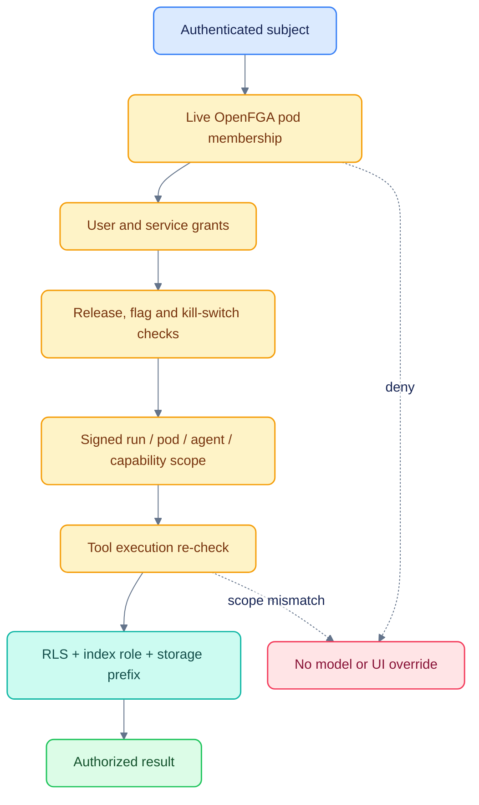

# Security and trust boundaries

[Documentation](README.md) · [Architecture](ARCHITECTURE.md) · [Deviations](DEVIATIONS.md)

PodOS is a development proof of concept. The design enforces pod isolation at
multiple layers; it does not establish that this checkout is production hardened.

## A request can only narrow authority

## Enforced controls

- OpenFGA resolves membership and grants for agents, capabilities, datasets,
  features and pod actions. A failure to resolve does not grant access.
- PostgreSQL applies forced RLS with a non-owner runtime role and a transaction-local
  pod setting. Owner credentials belong only to setup/migrations.
- OpenSearch and MinIO receive separately provisioned pod credentials. Naming an
  index or prefix is not the sole protection.
- Internal agents receive audience-restricted, short-lived delegations. Tool calls
  must match the delegated pod, run, service and permitted capabilities.
- Downloads use short-lived subject/pod/artifact-bound links and recheck membership
  on redemption. SSE rechecks membership and terminates on revocation.
- Access/release changes and denials have audit records. Notification previews are
  generic rather than private research text.
- OpenUI uses a curated component set. Markdown images, arbitrary URL actions and
  tool-backed UI queries are not an allowed exfiltration channel.

See the executable checks in `tests/test_t1_isolation.py`, `test_t3_capabilities.py`,
`test_t5_releases.py`, `test_t7_authz.py` and the OpenFGA model suite.

## Internal versus external agents

Internal services may receive approved pod research context and tool delegation.
External deployments receive the user's question, an external conversation key
and any configured transport authentication. They do not receive internal pod
research, a delegation token or the internal API URL. Attaching a call does not
send its private transcript to an external agent. A question the user writes may
itself contain sensitive text; the external-agent boundary does not redact it.
For an explicit “ask this agent for this” handoff, the immediately relevant
user-authored question can accompany the correction. Assistant answers and
attached case/call context are excluded. Automatic transport fallback stays
between internal agents; external failures do not fall through to an unrelated
research agent, and research failures do not fall through to a third-party service.

## Development credentials and artifacts

`docker-compose.yml`, `settings.py` and `config/workload_secrets.dev.json` contain
intentional local-only fixture credentials. They must be replaced before shared
use. Real provider keys, `.env`, generated `config/data_plane.dev.json`, databases,
logs, audio and experiment outputs are excluded from Git.

No live credential belongs in a screenshot, Markdown example, source URL or chat
message. Use a private secret mechanism for real deployments.

## Remaining deployment work

| Gap | Required direction |
|---|---|
| Mock login and HS256 development keys | Enterprise OIDC and workload identity; secret rotation |
| Local/demo certificates and service defaults | TLS, trusted CAs, network boundaries and managed secrets |
| In-process run execution and quotas | Durable execution and shared counters before multiple replicas |
| In-memory A2A task store | Persistent task store if agent task resumption is required |
| Model retention/approval | Approved endpoint and contractual controls for research/MNPI |
| Missing token/cost budgets | Provider usage accounting, quotas and spend enforcement |
| Financial/ASR correctness | Reviewed gold data, attribution evaluation and evidence validation |
| Installed Next.js security advisory | Resolve the reported dependency advisory before a shared deployment |
| Licensing/retention | Confirm rights for recordings, documents, derived content and retention |

These are known engineering and deployment gaps, not findings from a completed
penetration test or compliance audit. Application test success does not close them.
