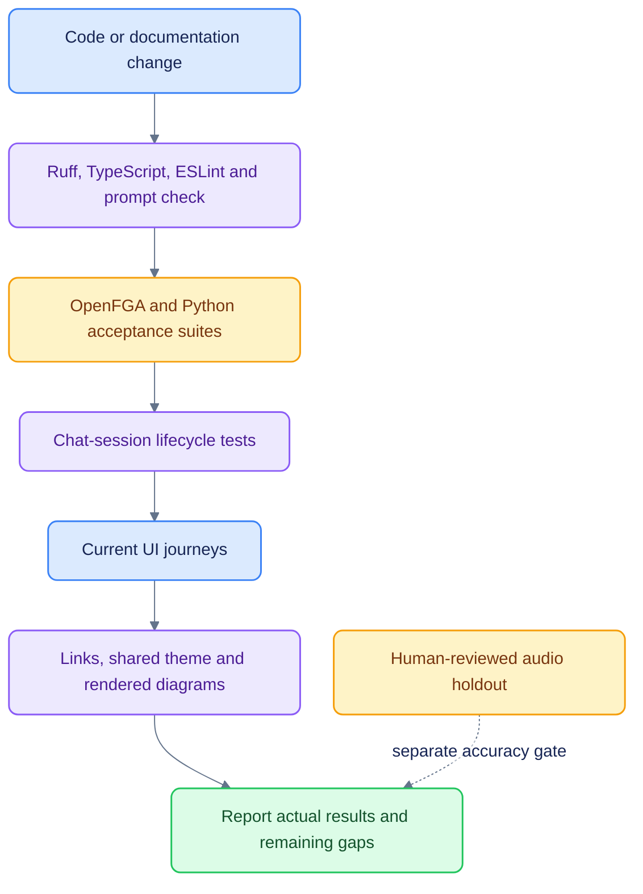

# Testing and validation

[Documentation](README.md) · [Operations](OPERATIONS.md) · [Accuracy research](CALLS_ACCURACY_RESEARCH.md)

Run from the application root. The acceptance harness starts real HTTP API/A2A/MCP
servers and uses the Docker data plane. It reseeds **`podos_test`** between tests,
with test search indexes, a test artifact bucket and a separate OpenFGA store.
Never replace those settings with a production connection string. Authorization
scenarios use a separate directory under `tests/fixtures/` in that test database;
those identities are never seeded into the two-account external demo.


## Core commands

```sh
make test
make lint
(cd apps/web && npx --yes tsx --test tests/chat-sessions.test.ts)
(cd apps/web && npm run build)
npm --prefix docs ci
npm --prefix docs run check
```

`make test` runs OpenFGA model checks, then `uv run pytest tests -q`. Live-model tests
are opt-in. Prefer collection/results from the current run over hard-coded historic
test totals. `make lint` also verifies that the generated OpenUI prompt matches its
component specification.

## Suite map

| Suite | Main responsibility |
|---|---|
| T1 isolation | Resource guessing, RLS, delegation, revocation and data-plane isolation |
| T2 agents | Eligibility, Auto/direct dispatch, discovery and fallback |
| T3 capabilities | Export authorization, scope and artifact handling |
| T4 background | Approvals, leases, retries, outbox and resume |
| T5 releases | Stages, cohorts, canary and emergency disable |
| T6 operational | Timeouts, limits, failures and recovery |
| T7 authorization | Live OpenFGA grants and access behavior |
| T8 events | Event fan-out, watchlists, source grants and webhooks |
| T9 briefing | Pod-scoped Today and feedback |
| T10 generative UI | OpenUI contract, safe component subset and sourced data |
| T11 external A2A | External transport and context boundary |
| T12 call chat | Call scope, persisted attachments, source snapshots and background runs |
| Calls evaluation | Scorer integrity, artifact hashes, consensus and repetition diagnostics |
| Titles / connectors | Title generation and SEC connector behavior |
| Web session tests | Concurrent runs, replay, dedupe, cancellation, cleanup and persisted recovery |

## Focused chat checks

```sh
uv run pytest tests/test_t12_call_chat.py tests/test_t2_agents.py tests/test_t8_events.py -q
(cd apps/web && npx --yes tsx --test tests/chat-sessions.test.ts)
```

For structured external results and saved activity:

```sh
uv run pytest tests/test_result_presentation.py tests/test_t11_external_a2a.py -q
(cd apps/web && npx tsx --test tests/chat-sessions.test.ts tests/result-cards.test.ts)
```

These cover typed court data, rejected unsafe links, malformed-result fallback,
duplicate artifact snapshots, server-owned source labels, persisted results and
activity, owner/pod isolation, and actual OpenUI rendering of nullable slot prices
and distances. Browser checks should confirm a real court result
renders a card, booking links retain the provider URL, **Activity** expands after
completion and reload, the full response remains available, and 390px layouts do
not overflow. Existing research charts/tables must continue to render.

The 23–24 October chat implementation pass recorded **28 backend tests** and
**five session tests** passing, plus lint, type checking, production build and
manual browser checks. These are scoped results, not the full repository total.

## Browser checks

Use a running stack and verify the current navigation: New chat, Today, Research,
Calls and Inbox, with Monitors/Activity inside Inbox. Critical flows include:

1. Select a call through `@`, use arrow keys/Enter, remove it and send a follow-up.
2. Open different calls with **Ask this call**; unsent drafts must not retain the
   previous company. A normal New chat must start empty.
3. Start an answer, navigate to Calls/Today, and observe its chat-list spinner.
4. Run a second chat concurrently; reopen and reload an active answer without a
   duplicate question or cancellation. Stop only through the explicit control.
5. Open inline evidence without changing routes. Inspect passage/speaker/time,
   listen from the timestamp, and test Escape plus focus restoration.
6. Repeat source inspection at 390px width; check sheet width and horizontal overflow.
7. Switch pods and exercise denied access through server endpoints as well as UI.

For playback stability, run `npx tsx --test tests/transcript-reader.test.ts` from
`apps/web`, then use a prepared call in the browser. Start audio and seek across
sentence ends, timing gaps and speaker changes with Follow audio off: document
scroll position, toolbar height and passage geometry must stay fixed. Observe
layout-shift entries after fonts/player load. Enable Follow audio and move to a
passage outside the viewport: one document scroll should reveal it. Further clock
updates within that passage must not recenter it. Wheel/touch/reading keys must
disable following. Check explicit current/search/chapter/citation navigation,
text selection, keyboard playback, tab overflow and responsive player controls.

The 24 October reader redesign passed ten web tests, full lint/type checking and
the production build. Browser checks kept document position, toolbar height and
passage geometry fixed across 16 real audio sentence/gap/seek transitions, with
zero reader layout-shift entries and no automatic document scrolls while follow
was off. Opt-in follow scrolled once for an offscreen passage and manual scrolling
disabled it. Search/filter/layouts, chapter navigation, keyboard sentence playback,
seek/speed, all tabs, player continuity across navigation, cited-sentence links and
reduced motion passed. CoreWeave and Aurora were checked, with no horizontal
overflow at 320, 390, 768, 1024, 1280, 1440 and 1920px. The desktop chapter rail was
320px wide with visible overflow rather than a separate scrolling viewport.

`make e2e` points to the **legacy** `scripts/e2e_demo.mjs` walkthrough. It still
references removed Agents/Admin routes and the removed cross-pod suggestion. It is
not the current UI acceptance gate until that script is migrated. Its saved
screenshots are historical artifacts, not a fresh pass.

## Opt-in live checks

`tests/test_llm_live.py` and `podos_evals.scenarios` require model credentials and
explicit environment configuration. They may use a paid provider and are not
needed for deterministic correctness checks. Read their environment guards before
enabling them; do not count skipped tests as passes.

## Documentation checks

The 24 October documentation pass checked 28 Markdown files, 149 local links and
34 themed diagrams; every diagram rendered successfully.

The documentation checker validates repository-local links, section anchors,
shared Mermaid configuration and semantic color classes, then renders every
Mermaid block with the pinned CLI. Outputs go to ignored `var/docs/`. Read
[Documentation style](DOCUMENTATION_STYLE.md) for the palette and maintenance flow.

## Accuracy is a separate result

WER is `(substitutions + deletions + insertions) / reference words`. Aggregation
sums counts before division. Normalization policy, corpus, source hashes and
review status must accompany a score. A third-party transcript comparison is not
human-gold acoustic accuracy. See [Calls](CALLS.md) for the actual references and
[the measured experiments](CALLS_ACCURACY_RESEARCH.md) for results.
