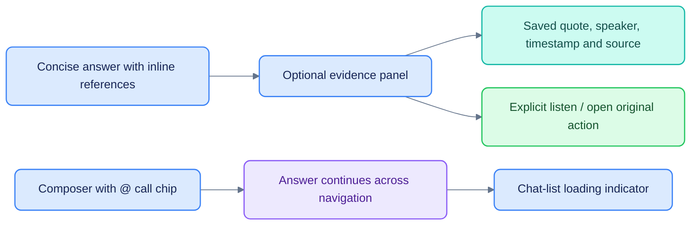

# UI/UX review

[Documentation](README.md) · [Web developer guide](../apps/web/README.md) · [Chat evidence](CHAT_EVIDENCE_IMPLEMENTATION.md)

Reviewed against current routes on 24 October 2026.

A short record of the interface decisions behind the Workspace, so they are reviewable and reversible.
The design system is one file of tokens (`apps/web/app/globals.css` + the ink scale in
`apps/web/app/openrouter.css`); the rest is components reading those tokens.

## Theme: light — Linear structure, Grok ink, ChatGPT canvas

The workspace was first built in an OpenRouter-style light theme, then a Linear-style dark one. It is now a
**light** theme that blends three references: **Linear's** structure, density, Inter typography and indigo
accents; **Grok's** stark near-black ink; and **ChatGPT's** clean white canvas with soft neutral fills. The
result is a white canvas, 8% black hairlines, near-black (`#0d0d0d`) primary actions and text, and indigo
(`#5e6ad2`) kept for focus/selection so brand and interaction stay distinct.

The palette is **ink-relative**: every grey is the ink colour at an opacity, and every hue's 800–1000 steps
are that hue mixed with ink. The theme is therefore a single decision — `--color-ink` (now `#0d0d0d`), so
greys read dark-on-light and hue steps come out as deep, readable tints. Changing the ink recomputes the derived scale. A dark theme additionally needs
background-token changes and contrast/interaction verification; it is not implemented
by changing the ink alone.

| Token | Value | Role |
|---|---|---|
| `--background` / `--canvas` | `#ffffff` | app canvas (ChatGPT-white) |
| `--card` | `#ffffff` | panels and cards |
| `--popover` | `#ffffff` | menus and popovers |
| `--foreground` | `#0d0d0d` | primary text (Grok near-black ink) |
| `--muted-foreground` | `#6e6e80` | secondary text |
| `--subtle` | `#71717a` | tertiary micro-labels |
| `--secondary` / `--muted` | `#f2f2f2` / `#f4f4f5` | soft neutral fills |
| `--border` | `#00000014` | hairline dividers and card edges (8% black) |
| `--primary` | `#0d0d0d` | primary actions (near-black buttons/badges) |
| `--accent` / `--ring` | `#5e6ad212` / `#5e6ad2` | hover/selection wash / focus (Linear indigo) |
| `--link` | `#4f5bc4` | text links |
| `--input` | `#8a8a8a` | form-control border (see WCAG note) |

Typography: **Inter Variable** (`next/font`) at weights 400 / 510 / 590 / 680 with `cv01` + `ss03`
enabled, matching Linear; Geist Mono for code.

## Contrast (WCAG 2.1)

Text needs 4.5:1; non-text UI (form borders, status dots) needs 1.4.11's 3:1. Measured on the live light
theme (dark ink on white):

| Pair | Ratio |
|---|---|
| foreground on background | 19.4 |
| muted-foreground on background / card | 5.0 |
| subtle on background | 4.8 |
| link on background | 5.8 |
| primary-foreground on primary (buttons) | 19.4 |
| input border on background (non-text) | 3.5 |
| positive / warning on background | 5.1 / 4.9 |

The input border is intentionally heavier than a divider: a form control is identified by its border, so it
must clear 3:1, while `.border` stays at 8% black for decorative hairlines. Status dots use the 600–900
steps of their hue, never a pale tint, and colour is always paired with a label.

## Icons and colour semantics

- **Status is never colour alone**: every dot, badge and tone also carries a word ("Available", "Preview",
  "External", "Needs approval"…).
- **One hue, one meaning**: agents keep a stable colour + icon (`AGENT` map, `components/common.tsx`), so
  the same agent is recognisable in the sidebar, the run view and the catalogue.
- **Blue is reserved for status/attention**, so ticker chips moved to grey and the neutral "Auto" mode chip
  to grey to match `AGENT["auto-router"].tone`.
- **Icons match their noun**: Equity Research → `ChartLine`, Activity → `Activity`, approvals →
  `BadgeCheck`, with 14–15 px stroke icons in the sidebar to match Linear's density.

## Linear sidebar techniques

- Collapsible rail (`⌘B`), workspace/pod switcher at the top with hover-revealed actions.
- 28 px rows, 13 px labels, 15 px icons; hover is a 5% black wash, the active row is 8% black with
  primary text and icon.
- Sections (`Chats`) collapse, and long lists group by recency.
- A `⌘K` command menu mirrors the nav, with `G`-then-key jumps.

## Sources, transcripts and background answers

Reader mode groups transcript text into readable paragraphs while preserving sentence
IDs for search, highlighting and citations; Lines remains available. The existing
global player is shared across routes. The source footer starts with four entries,
with an explicit expansion for heavily cited answers.

An inline citation opens a docked desktop inspector or full-width mobile sheet.
Evidence is saved source text, not an internal reasoning trace. Current surrounding
transcript text is separately disclosed. Machine transcripts are labeled accurately;
source/hash availability does not justify a Verified badge.

`@` filters pod-visible calls and supports keyboard selection. A selected reference
appears inside the composer and on the sent message. Fresh handoff draft identities
prevent stale company/question context. Navigation does not cancel generation;
the sidebar reflects local/server active state and reloads replay persisted events.

The active navigation is New chat, Today, Research, Calls and Inbox. Monitors and
Activity live inside Inbox; agents are selected in chat or command search. The old
Agents/Admin web screens and their screenshot affordances are historical.

## External A2A agent in the UI

External agent activity can include progress and self-reported verification. These
are agent reports, not independent validation. Public-source citations use the same
evidence inspector and an explicit Open original link when a usable HTTP(S) URL
exists. A missing URL is not converted into a private pod document link.

The external transport receives the question and an opaque conversation ID, without
internal pod evidence or delegation. See [Agent integration](AGENTS.md).

## Known limitations

- Decorative `--border` hairlines (8% black) and outline buttons are intentionally below 3:1; they are not
  the sole means of identifying a control.
- `components/ui/*` are vendor shadcn primitives; their `dark:` variants rely on the root `.dark` class.
  `app/layout.tsx` sets no `.dark` class since the app is light-only, so those variants stay inert. The
  palette is ink-relative, but a usable dark theme still requires contrast and component verification.

- The token contrast figures above are prior spot measurements, not a completed
  accessibility certification. New layouts need keyboard, focus, screen-reader,
  touch-target and mobile checks.
- Source inspection has browser spot checks at desktop and 390px width; a formal
  user study comparing verification effort/error detection has not been run.
