# Implementation agent brief

> Historical implementation handoff. Preserve the original requirements below,
> but use the [documentation index](../README.md), [current status](../MILESTONES.md)
> and [current architecture](../ARCHITECTURE.md) to continue work. The source UI,
> authorization provider and feature inventory have evolved since this handoff.

```mermaid
---
config:
  theme: "base"
  themeVariables:
    fontFamily: "Arial, Helvetica, sans-serif"
    fontSize: "15px"
    primaryColor: "#dbeafe"
    primaryTextColor: "#172554"
    primaryBorderColor: "#3b82f6"
    secondaryColor: "#ccfbf1"
    secondaryTextColor: "#134e4a"
    secondaryBorderColor: "#14b8a6"
    tertiaryColor: "#ede9fe"
    tertiaryTextColor: "#4c1d95"
    tertiaryBorderColor: "#8b5cf6"
    lineColor: "#64748b"
    textColor: "#0f172a"
    mainBkg: "#eff6ff"
    clusterBkg: "#f8fafc"
    clusterBorder: "#cbd5e1"
    edgeLabelBackground: "#ffffff"
    actorBkg: "#ede9fe"
    actorBorder: "#8b5cf6"
    actorTextColor: "#4c1d95"
    actorLineColor: "#94a3b8"
    signalColor: "#475569"
    signalTextColor: "#0f172a"
    noteBkgColor: "#fef3c7"
    noteBorderColor: "#f59e0b"
    noteTextColor: "#78350f"
    activationBkgColor: "#ccfbf1"
    activationBorderColor: "#14b8a6"
  flowchart:
    curve: "basis"
    htmlLabels: false
    nodeSpacing: 30
    rankSpacing: 45
  sequence:
    mirrorActors: false
    showSequenceNumbers: true
  fontFamily: "Arial, Helvetica, sans-serif"
---
flowchart LR
    accTitle: Continuing from the historical handoff
    accDescr: Use the original requirements with the current implementation record, then make and validate scoped changes without claiming unmeasured production gates.
Original["Original handoff requirements"]:::neutral --> Actual["Current implementation and status"]:::service
    Actual --> Change["Scoped change to working code"]:::interface
    Change --> Validate["Authorization, lifecycle and documentation checks"]:::guard
    Validate --> Record["Record evidence and remaining gaps"]:::success
    %% podos-theme:start
    classDef interface fill:#dbeafe,stroke:#3b82f6,color:#172554,stroke-width:1.5px,rx:8px,ry:8px
    classDef service fill:#ede9fe,stroke:#8b5cf6,color:#4c1d95,stroke-width:1.5px,rx:8px,ry:8px
    classDef store fill:#ccfbf1,stroke:#14b8a6,color:#134e4a,stroke-width:1.5px,rx:8px,ry:8px
    classDef guard fill:#fef3c7,stroke:#f59e0b,color:#78350f,stroke-width:1.5px,rx:8px,ry:8px
    classDef success fill:#dcfce7,stroke:#22c55e,color:#14532d,stroke-width:1.5px,rx:8px,ry:8px
    classDef risk fill:#ffe4e6,stroke:#f43f5e,color:#881337,stroke-width:1.5px,rx:8px,ry:8px
    classDef neutral fill:#f1f5f9,stroke:#94a3b8,color:#334155,stroke-width:1.5px,rx:8px,ry:8px
    %% podos-theme:end
```

**Read `ARCHITECTURE.md` completely before writing any implementation code.** This is a technical design proposal, not an existing system. Design decisions and safeguards in the architecture are binding for the proof of concept unless tests demonstrate a better equivalent.

## Mission

Build a portfolio-grade demonstration of a centrally managed AI-native workspace for a multi-manager investment fund, containing **two PM pods** with demonstrably isolated research, agent sessions, artifacts, inbox items and background workflows, plus shared agent/capability implementations and staged pod-based releases.

## Technical defaults

- React/Next.js/TypeScript with `assistant-ui` (MIT) for chat primitives.
- FastAPI/Python with Pydantic 2 and PostgreSQL; typed policy and execution adapters.
- Existing Google ADK agents exposed through A2A; for tests, provide deterministic mock agents so CI does not require external LLM credentials.
- AG-UI compatible SSE for streaming; test actual pinned adapter versions before committing to the wiring.
- Per-pod OpenSearch indexes and object-storage prefixes. Use local test substitutes where needed, but preserve access contracts.
- OpenFeature Python SDK with a simple, versioned JSON policy provider for the demo.
- PostgreSQL outbox + durable worker as the initial async design; reserve interface for Temporal.
- Do not copy or vendor heavy external engines, proprietary examples or enterprise-licensed directories.

## Mandatory work order

1. Create monorepo folder structure, Python/TS package management, formatters, tests and local Compose.
2. Define `PodContext`, `AgentManifest`, `CapabilityManifest`, `ReleasePolicy`, `WorkItem`, `AgentEvent`, `ArtifactRef` with versioned contracts.
3. Implement authenticated/trusted active pod resolution, a policy decision interface and the Postgres schema/RLS.
4. Seed Pods Alpha and Beta with separate documents, users and objects. Implement cross-pod attack tests **before UI**.
5. Add registry + release projections; verify direct and Auto visibility/invocation checks.
6. Implement one direct ADK/A2A agent and Auto orchestration with response streaming and persisted chat.
7. Implement one document capability and pod-private artifact delivery.
8. Implement one event-driven monitor, durable work item, inbox, approval and worker resumption.
9. Implement Admin pod pilot rollout of Agent B and emergency disable; test feature rollout separately from auth.
10. Record a reproducible demo script and pass the acceptance suite from the architecture document.

## Anti-goals

Do not start by introducing OpenFGA, Novu, Temporal, a gateway cluster, a custom K8s operator, multiple frontend chat frameworks, extra LLMs, or an AI coding agent swarm. Those are deferred dependencies until evidence shows a concrete need. No trade execution. No cross-pod knowledge aggregation. No user-supplied context that can alter authorisation.

## Definition of done

- Single workspace with Ask, Agents, Research Vault, Monitor, Inbox, My Work, and protected Admin routes.
- Pods Alpha/Beta have independent histories, private OpenSearch indexes, artifacts, monitors, approval tasks and source credentials.
- Shared agent implementation can serve both pods but receives distinct verified contexts and data resources.
- User can choose an allowed agent or Auto; unauthorised direct and Auto invocation fail.
- Generate a pod-private PowerPoint artifact through shared capability with permission check and a governed download URL.
- Background monitor runs with browser closed, creates a work item, notifies the intended pod recipient and pauses for approval; it resumes once after valid approval even if the worker restarts.
- Agent B can be enabled for Alpha and not Beta, with independent flags for catalogue, direct, Auto and proactive execution.
- Tests cover cross-pod negative cases, revocation, replay, event deduplication, failed agents, rollout stability and emergency disable.

## Reporting cadence for the agent

For each milestone provide: files added/changed, commands executed, tests run with results, open risks, deviations from the architecture and next milestone. Do not claim completion from scaffolding or mocked UI states alone.
