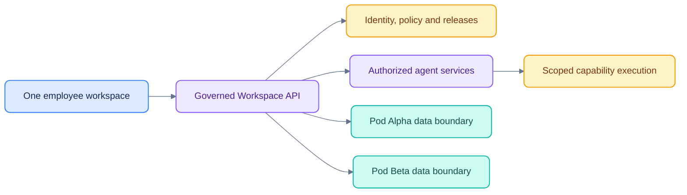

# PodOS: AI-Native Research Workspace for Multi-Manager Funds

> Historical source architecture. Requirements and targets below are preserved;
> they are not a statement that every component is shipped. Read the
> [current architecture](../../ARCHITECTURE.md) for implementation and deployment limits.
> Diagrams were restyled as editable Mermaid on 24 October 2026.

**Implementation-ready architecture and technical design**\
**Version:** 1.0 | **Date:** 10 October 2026 | **Status:** Proposed, not implemented\
**Primary stack:** Python, FastAPI, Google ADK, A2A, MCP, Next.js, TypeScript, PostgreSQL, OpenSearch, Kubernetes\
**Audience:** Implementing coding agent, platform engineers, security engineers, PM/pod stakeholders

> **Execution instruction:** Implement the P0 vertical slice before adding optional infrastructure. Do not copy and deploy entire open-source platforms. Use documented MIT/Apache-2.0 packages when appropriate, build a thin integration layer around them, and keep complex infrastructure engines external behind adapters. Treat security invariants and acceptance tests below as binding requirements.

## 0. Executive design decision

Build **one employee-facing AI workspace and one centrally governed AI control plane** that serves multiple **isolated PM pods**. Agents can be selected directly or dynamically routed by an Auto orchestrator. They can also initiate asynchronous research, monitoring alerts, work items and human approval requests. Central services publish reusable agent implementations, tools and document-generation capabilities. Pod research, memory, artifacts, credentials and work items remain private unless an explicit policy grants sharing.

Use a **modular-monolith Workspace API** initially, plus independently deployed ADK/A2A domain agents and workers. This gives one coherent codebase for product semantics without reimplementing specialised gateways, authorisation engines or workflow runtimes. It also allows later replacement of the JSON policy provider with OpenFGA and OpenFeature/flagd; a simple outbox/worker with Temporal; and a basic notification fanout with Novu.

### Binding principles

1. **Isolation follows data and execution, not UI navigation.** A pod switch cannot confer access. Every read, retrieval, task, approval, tool call, cache and download is checked server-side against a validated pod context.
2. **Reusable implementation, isolated state.** Two pods may call the same agent image, but never share private prompts, memory, credentials, indexes or artifacts.
3. **Agents and capabilities are independent.** Agents reason and coordinate; capabilities are reusable executable operations. Neither an agent entitlement nor capability entitlement implies the other.
4. **Rollout is distinct from authorisation.** Flags can narrow availability but must never grant otherwise missing permissions.
5. **Tasks are first-class.** Background work and inbox items remain valid when browser sessions or agent processes terminate.
6. **Deterministic business operations stay deterministic.** Use LLM reasoning where needed, typed APIs for document output and state-changing actions, and explicit approval for sensitive operations.
7. **Design contracts before vendor choices.** Stable REST/events/policy interfaces permit later use of OpenFGA, flagd, Temporal, Novu or agentgateway without a workspace rewrite.
8. **Scope first releases to research.** No automated trading, unrestricted cross-pod search, or uncontrolled external communications.

### Assumptions and sizing

- Portfolio/reference implementation: **two pods**, each with a PM and analysts, demonstrating actual isolation.
- Production aspiration: multiple independently operated investment pods using a centrally run platform; platform must be capable of scaling to **15,000 provisioned users** if required. This is a design scenario, not an assumed fund headcount or concurrent-session estimate.
- Authenticated firm-managed identity (e.g. OIDC/Entra), managed K8s, object storage, PostgreSQL, approved model endpoints and Python ADK agents are available or mockable.
- Real concurrency, workload shape, data-vendor licences, recovery-time objectives and region constraints are **TBD and must be measured** before production capacity design.
- Initial external system integrations use mock research/filing/market data. Production licensed feeds require licence and redistribution reviews.

## 1. Product surface and user journeys

### 1.1 Personas

| Persona | Needs | Default permissions |
|---|---|---|
| Portfolio manager | Private research, thesis continuity, catalysts, analyst/agent delegation, sign-offs | Manage pod workspace; view pod work; scoped approval |
| Pod analyst | Investigate securities, analyse documents, create artifacts, monitor names | Create/review pod research; call approved agents/capabilities |
| Central platform engineer | Publish services, operate SLOs, rollout versions | See operational metadata; **not** private research by default |
| Risk/compliance | Governed exposure and policy oversight | Only explicitly approved datasets and purposes; audit trail |
| Agent/domain owner | Publish and support agent/capability versions | Version/configure owned service, no blanket pod data access |

### 1.2 Employee-facing navigation

**Ask**: ChatGPT-like thread history, selected pod indicator, `Auto` plus authorised agents, attachment controls, streaming intermediate progress, rich results and export actions.\
**Research Vault**: Pod-owned projects, companies, investment theses, notes, filings, financial models, generated artifacts, lineage and document search.\
**Monitor**: Saved queries/watchlists/catalysts, schedules, subscriptions, alert thresholds and alert quality feedback.\
**Inbox**: Assigned, actionable agent-originated items (approval, review, exception, completed report). Supports read/archive/snooze and deep links to evidence.\
**My Work**: Running, scheduled, waiting, failed and completed workflows with restart/retry/cancel where permitted.\
**Agents**: Curated agent directory with capabilities, owner, versions, status, access/availability indicators and launch action.\
**Admin**: Separate protected route for registry publication, group/pod eligibility, rollout/canary management, incident disable and operational overview.

A **pod context switcher** is available only for users with membership in multiple pods. Switching reloads data, agent options, conversations and inbox. It invalidates old resource handles and never leaks summaries from the prior pod.

### 1.3 Primary journeys

**J1: Direct request.** Analyst selects Pod Alpha -> Research Agent -> asks about Company X -> authorised pod retrieval -> streamed answer with sources -> persists to pod thread; optionally exports to Word.

**J2: Auto routing.** Analyst selects Auto -> platform obtains authorised agents for active pod -> orchestrator delegates to a Research Agent -> returns typed result. If no eligible agent exists, fail gracefully; never fall back to a forbidden agent.

**J3: Pod-initiated monitored work.** Analyst subscribes to an issuer/filing trigger -> authorised background workflow runs -> finding persisted in Research Vault -> inbox item delivered only to selected recipients. Low-priority duplicates are digested or suppressed.

**J4: Human approval.** An agent prepares a model or report requiring sign-off -> work item `WAITING_FOR_HUMAN` -> PM reviews sources -> server verifies eligibility and work-item version -> approval recorded -> workflow resumes exactly once.

**J5: New agent release.** Central agent owner registers Agent B v1 -> passes publication checks -> pilots with Pod Alpha (direct selection only) -> Auto routing separately enabled -> expands to other pods. Emergency disable stops new invocations independently of rollback of code.

**J6: Pod transfer.** Analyst leaves Pod Alpha -> IAM membership revoked -> old pod conversations, caches, artifact links and scheduled jobs no longer accessible. Work ownership can be explicitly reassigned without copying private content.

## 2. System architecture


### 2.1 Logical components

| Component | Owns | Does **not** own |
|---|---|---|
| Next.js Workspace | UI, browser state, components, accessible actions | Permission enforcement, credentials, agent secrets |
| FastAPI Workspace API | Identity context, catalogue projections, threads, work items, approvals, release decisions, API contracts | Agent reasoning, market-data vendor secrets in browser |
| Registry & Release module | Agent/capability manifests, approval states, cohort configuration, versions | Per-request LLM routing decisions |
| Policy Decision adapter | `can_view`, `can_invoke`, `can_execute`, `can_read`, `can_approve` | UI display only; model-selected authorization |
| Auto Router (ADK) | Choose from **pre-filtered** eligible agents; coordinate compound tasks | Registry lifecycle, source-of-truth permissions |
| ADK/A2A domain services | Specialist reasoning, retrieval, structured research output | Firm-wide user directory or universal tool authority |
| Capability service | Deterministic operations and typed artifacts (DOCX, PPTX, PDF, exports) | Business research reasoning unless specifically required |
| Workflow adapter / workers | Jobs, retry/resume, schedules, approval waiting, task state | Agent catalogue and entitlement decisions |
| Inbox / notification module | Work-item projection, subscriptions, fanout preferences, delivery | Authoritative business transaction execution |
| Pod data plane | Private search indexes, storage prefixes, encrypted cache, scoped agent memory | Cross-pod data sharing by default |
| Enterprise controls | SSO/IAM, K8s/network boundaries, secrets, gateway, vendor approvals | User-facing workflow orchestration |

### 2.2 Protocol boundaries

- **Browser <-> Workspace API:** HTTPS/JSON, SSE for streamed events; OIDC session. WebSockets only if genuine bidirectional requirements arise.
- **Workspace <-> ADK frontend interaction:** AG-UI compatible stream where supported; pin and test a known-good adapter. It is an interaction protocol, not a security boundary.
- **Agent <-> remote agent:** A2A. The registry records endpoints/Agent Cards; agent caller receives a scoped, service-authenticated delegation.
- **Agent <-> tool/capability:** MCP or typed internal HTTPS. A2A Agent Card skills describe ability; MCP `tools/list` describes executable tools. A business capability registry maps one or more tools to a governed function.
- **Proactive events:** Signed/authenticated internal HTTPS or broker messages, canonical work-event envelope, transactional persistence.
- **Optional rich UI:** Render pre-registered React components using validated structured payloads. Evaluate A2UI later for heterogeneous teams; MCP Apps only for separately packaged, reviewed web applications.

**Important ADK implementation note:** The official ADK `to_a2a()` example creates in-memory session/task stores by default. Replace these with production-persistent, appropriately scoped stores and explicit authentication; do not mistake a demo wrapper for a durable platform.

## 3. Tenant isolation and security architecture

### 3.1 Security context

A trusted `ExecutionContext` is created at the BFF/API boundary from the verified user session, the selected pod (validated against current membership), platform roles and release revision. **Never trust** client headers, model output, A2A Agent Card fields or tool parameters as proof of pod membership.

Fields: `subject_id`, `active_pod_id`, `session_id`, `roles`, `permissions_revision`, `release_revision`, `request_id`, `trace_id`, `data_classification`, `purpose`, `delegation_depth`, `expiry`. Transmit a signed and audience-restricted subset when delegating; use workload identities and narrow-lived credentials. A2A calls must not become arbitrary lateral movement across pods.

### 3.2 Isolation matrix

| Resource | MVP isolation | Stronger production option | Mandatory verification |
|---|---|---|---|
| Conversation / inbox / agent runs | PostgreSQL `pod_id`, RLS, server-side checks | Dedicated DB/roles for high-sensitivity pods | Direct ID guessing and cross-pod joins fail |
| Research retrieval | Per-pod OpenSearch indexes and index-scoped roles | Dedicated search domains | Query/index override cannot escape pod |
| Files / artifacts | Pod-scoped object prefixes and service IAM; short-lived signed links | Dedicated bucket/account | Link expires; recipient reauthorised before issuance |
| LLM context and memory | Separate pod/user/session namespace and TTL | Dedicated inference for restricted work | Prompt and session cannot inherit old pod |
| Job queues / scheduler | Namespaced task payloads + worker policy checks | Dedicated workers/namespaces | Retry never runs in wrong pod |
| Secrets | Per-agent/pod service identities + secret access | Separate secret stores | No universal platform credentials in agent code |
| Caches | Keys include pod, user/role, version, classification | Disable shared semantic cache on private content | Cache-poison / cross-tenant tests |
| Notifications | Pod recipients, classification-aware previews | Dedicated channels for restricted workloads | No confidential details in generic push/email body |
| Logs / telemetry | Sanitised metadata, restricted trace access | Tenant-specific log stores | No prompt contents in shared diagnostics |
| K8s workloads | Namespaces + network policies + workload identity + quotas | Dedicated nodes or clusters for especially sensitive pods | Network denial and service-account tests |

RLS is defence in depth, not a replacement for correct app authorisation. PostgreSQL table owners and `BYPASSRLS` roles may bypass policies; use least-privilege runtime roles and `FORCE ROW LEVEL SECURITY` where appropriate. OpenSearch document-level security restricts reads but **not writes**, so prefer separate pod indexes with index-level write controls for proprietary research.

### 3.3 Sharing outside a pod

No implicit cross-pod visibility. A `ShareRequest` explicitly identifies **source artifact, recipient pod/group, purpose, classification, expiry, approver and audit record**. Sharing creates a governed recipient-scoped view or approved copy; it must not silently enable entire source-vault or memory access. Central Risk receives only entitled oversight datasets, not arbitrary PM chat transcripts.

### 3.4 Threat cases that must be tested

- Prompt injection instructing a Research Agent to search another pod.
- Switching pods while retaining an open SSE stream, cached React state or stale download URL.
- Guessing work item, thread, file or approval IDs from another pod.
- Agent-to-agent delegation with amplified service credentials or mismatched pod context.
- Reused authorization decisions after membership revocation, changes to rollout policy or agent status.
- Search-tool parameter injection changing index or filter.
- Cross-pod exposure through retrieval snippets, caches, exported PowerPoint files, notification previews, errors, logs or telemetry.
- Forged proactive events and replayed approval requests.
- Malicious or compromised registered A2A endpoint/Agent Card.

## 4. Core domain model: agents, capabilities, policy, releases

### 4.1 Definitions

**Agent**: Named independently versioned reasoning service or local ADK component with capabilities and owner.\
**Capability**: User-visible business function (`document.export.docx`, `document.export.pptx`, `research.monitor.create`) that may map to an MCP tool, Python function, internal API or workflow.\
**Tool**: Concrete executable endpoint/function used by an agent or Workspace API.\
**Skill**: Instruction/template/knowledge package improving agent performance.\
**Agent deployment**: Immutable code/config/Agent Card version resolving to an environment-specific endpoint.\
**Release**: Who can discover/invoke a version and for which actions.\
**Entitlement**: What the subject has a right to do, independent of rollout.\
**Work item**: Durable user-facing action or information object, optionally linked to an agent workflow.

### 4.2 Effective permission algorithm

For an agent-initiated capability invocation:

```
allow = verified_user_is_active_pod_member
    AND resource_belongs_to_active_pod_or_explicitly_shared
    AND agent_is_published_and_healthy
    AND user_can_invoke_agent
    AND agent_supports_capability
    AND user_can_execute_capability
    AND agent_service_is_allowed_to_call_capability
    AND release_flag_enabled_for_user_and_pod
    AND resource_classification_and_purpose_policy_allows
    AND NOT emergency_disabled
```

Direct workspace exports may omit the agent-invocation term; they never omit capability, resource and rollout checks. Re-check on **every action**, at dispatch and when redeeming/download artifacts. Frontend hiding is never enforcement.

### 4.3 Registry manifest shape

Use the `contracts/agent-manifest.schema.json` and `contracts/capability-manifest.schema.json` in the handoff bundle. The registry separates **source manifest**, **publication approval**, **environment endpoint** and **release policy**. Agent Cards are imported/mapped, not stored as the sole security record.

Publication lifecycle: `DRAFT -> VALIDATING -> APPROVED -> PILOT -> GA -> DEPRECATED -> RETIRED`. Preserve immutable audit events; registry changes do not edit earlier conversations. An agent may be GA globally but disabled for a pod.

### 4.4 Capability execution contract

Examples: `document.export.docx` and `document.export.pptx`. Agent result -> typed `DocumentSpec` -> template/renderer -> antivirus/content scan as required -> pod-private object storage -> artifact metadata -> authorised download. Do not route binary file bodies through the model context. Use Python `python-docx` and `python-pptx` (MIT) for the POC. All output files inherit the source content's classification and pod.

Capability discovery is explicit. A user entitled to three agents and two capabilities does **not** cause existing agents to automatically discover both tools. The Workspace API/routing layer creates the relevant tool bindings per invocation, or exposes a bounded `search_capabilities`/`invoke_capability` tool; the runtime must validate the same entitlement at execution.

## 5. Routing and conversation lifecycle

```mermaid
---
config:
  theme: "base"
  themeVariables:
    fontFamily: "Arial, Helvetica, sans-serif"
    fontSize: "15px"
    primaryColor: "#dbeafe"
    primaryTextColor: "#172554"
    primaryBorderColor: "#3b82f6"
    secondaryColor: "#ccfbf1"
    secondaryTextColor: "#134e4a"
    secondaryBorderColor: "#14b8a6"
    tertiaryColor: "#ede9fe"
    tertiaryTextColor: "#4c1d95"
    tertiaryBorderColor: "#8b5cf6"
    lineColor: "#64748b"
    textColor: "#0f172a"
    mainBkg: "#eff6ff"
    clusterBkg: "#f8fafc"
    clusterBorder: "#cbd5e1"
    edgeLabelBackground: "#ffffff"
    actorBkg: "#ede9fe"
    actorBorder: "#8b5cf6"
    actorTextColor: "#4c1d95"
    actorLineColor: "#94a3b8"
    signalColor: "#475569"
    signalTextColor: "#0f172a"
    noteBkgColor: "#fef3c7"
    noteBorderColor: "#f59e0b"
    noteTextColor: "#78350f"
    activationBkgColor: "#ccfbf1"
    activationBorderColor: "#14b8a6"
  flowchart:
    curve: "basis"
    htmlLabels: false
    nodeSpacing: 30
    rankSpacing: 45
  sequence:
    mirrorActors: false
    showSequenceNumbers: true
  fontFamily: "Arial, Helvetica, sans-serif"
---
flowchart LR
    accTitle: Original synchronous design
    accDescr: The target synchronous path authorizes before dispatch and scoped tool execution, then persists and streams the result.
Request["User request"]:::interface --> Auth["Membership and entitlement"]:::guard
    Auth --> Release["Release eligibility"]:::guard
    Release --> Route["Direct or Auto dispatch"]:::service
    Route --> Tool["Scoped tool execution"]:::guard
    Tool --> Persist["Persist and stream result"]:::store
    %% podos-theme:start
    classDef interface fill:#dbeafe,stroke:#3b82f6,color:#172554,stroke-width:1.5px,rx:8px,ry:8px
    classDef service fill:#ede9fe,stroke:#8b5cf6,color:#4c1d95,stroke-width:1.5px,rx:8px,ry:8px
    classDef store fill:#ccfbf1,stroke:#14b8a6,color:#134e4a,stroke-width:1.5px,rx:8px,ry:8px
    classDef guard fill:#fef3c7,stroke:#f59e0b,color:#78350f,stroke-width:1.5px,rx:8px,ry:8px
    classDef success fill:#dcfce7,stroke:#22c55e,color:#14532d,stroke-width:1.5px,rx:8px,ry:8px
    classDef risk fill:#ffe4e6,stroke:#f43f5e,color:#881337,stroke-width:1.5px,rx:8px,ry:8px
    classDef neutral fill:#f1f5f9,stroke:#94a3b8,color:#334155,stroke-width:1.5px,rx:8px,ry:8px
    %% podos-theme:end
```


### 5.1 Direct mode

1. `GET /v1/pods/{pod}/agents` returns the server-filtered catalogue.
2. User selects an agent; `POST /v1/threads/{thread_id}/runs` submits `agent_id` and request.
3. API resolves membership, agent/capability entitlement, release state and immutable deployment version.
4. API creates an `agent_run`, dispatches via A2A adapter/gateway, streams a normalised event channel and persists final message/artifact refs.
5. Domain agent receives only allowed toolsets and pod-scoped data handles.

### 5.2 Auto mode

1. Resolve verified context and filter eligible agents before reasoning.
2. Use capability descriptions to produce a **small candidate set**, not the entire enterprise registry in prompt context.
3. Orchestrator selects an agent or composes a bounded workflow, recording selected agent/version and rationale metadata without leaking confidential prompts.
4. Dispatch repeats policy check even if routing already filtered it.
5. Maintain deterministic fallback if agent unavailable or if no eligible candidates exist. Do not broaden privileges when fallback happens.

**Execution isolation:** Agent selection does not imply moving private data to a remote service. Only approved A2A endpoints with the right pod/purpose context may receive sensitive inputs. Circuit breakers, request timeouts and bounded tool-call budgets prevent endless delegation loops.

### 5.3 Thread state

`thread -> messages -> runs -> agent_events -> artifacts`, all scoped to `pod_id`. Thread creation binds immutable pod ownership. Optional cross-pod sharing is a separate operation, not an edit of `pod_id`. Idempotent request keys prevent duplicate concurrent message sends. Store domain-appropriate metadata and classification on every artifact.

## 6. Agent-initiated work: jobs, inbox, notifications, approvals

```mermaid
---
config:
  theme: "base"
  themeVariables:
    fontFamily: "Arial, Helvetica, sans-serif"
    fontSize: "15px"
    primaryColor: "#dbeafe"
    primaryTextColor: "#172554"
    primaryBorderColor: "#3b82f6"
    secondaryColor: "#ccfbf1"
    secondaryTextColor: "#134e4a"
    secondaryBorderColor: "#14b8a6"
    tertiaryColor: "#ede9fe"
    tertiaryTextColor: "#4c1d95"
    tertiaryBorderColor: "#8b5cf6"
    lineColor: "#64748b"
    textColor: "#0f172a"
    mainBkg: "#eff6ff"
    clusterBkg: "#f8fafc"
    clusterBorder: "#cbd5e1"
    edgeLabelBackground: "#ffffff"
    actorBkg: "#ede9fe"
    actorBorder: "#8b5cf6"
    actorTextColor: "#4c1d95"
    actorLineColor: "#94a3b8"
    signalColor: "#475569"
    signalTextColor: "#0f172a"
    noteBkgColor: "#fef3c7"
    noteBorderColor: "#f59e0b"
    noteTextColor: "#78350f"
    activationBkgColor: "#ccfbf1"
    activationBorderColor: "#14b8a6"
  flowchart:
    curve: "basis"
    htmlLabels: false
    nodeSpacing: 30
    rankSpacing: 45
  sequence:
    mirrorActors: false
    showSequenceNumbers: true
  fontFamily: "Arial, Helvetica, sans-serif"
---
flowchart LR
    accTitle: Original asynchronous design
    accDescr: The target asynchronous path creates scoped work, obtains an authorized human decision and resumes idempotently.
Event["Scheduled or source event"]:::neutral --> Work["Pod-scoped work item"]:::store
    Work --> Notify["Inbox notification"]:::interface
    Notify --> Approve["Human authorization and version check"]:::guard
    Approve --> Resume["Idempotent resume"]:::service
    Resume --> Result["Private artifact and completion"]:::success
    %% podos-theme:start
    classDef interface fill:#dbeafe,stroke:#3b82f6,color:#172554,stroke-width:1.5px,rx:8px,ry:8px
    classDef service fill:#ede9fe,stroke:#8b5cf6,color:#4c1d95,stroke-width:1.5px,rx:8px,ry:8px
    classDef store fill:#ccfbf1,stroke:#14b8a6,color:#134e4a,stroke-width:1.5px,rx:8px,ry:8px
    classDef guard fill:#fef3c7,stroke:#f59e0b,color:#78350f,stroke-width:1.5px,rx:8px,ry:8px
    classDef success fill:#dcfce7,stroke:#22c55e,color:#14532d,stroke-width:1.5px,rx:8px,ry:8px
    classDef risk fill:#ffe4e6,stroke:#f43f5e,color:#881337,stroke-width:1.5px,rx:8px,ry:8px
    classDef neutral fill:#f1f5f9,stroke:#94a3b8,color:#334155,stroke-width:1.5px,rx:8px,ry:8px
    %% podos-theme:end
```


### 6.1 Separate the concepts

- **Inbox item**: Durable human-facing object; may be actionable or informative.
- **Notification delivery**: Channel-specific attempt to tell someone an inbox item changed; not system of record.
- **Work/run**: Execution lifecycle, potentially spanning hours/days.
- **Mailbox**: Generic asynchronous addressing/delivery between actors; **out of scope** until demonstrated need beyond existing broker/A2A and work-item model.
- **Monitor**: User- or pod-configured scheduled/event-triggered subscription that may create background runs and resulting inbox items.

### 6.2 Canonical workflow states

`CREATED -> QUEUED -> RUNNING -> WAITING_FOR_HUMAN -> RUNNING -> COMPLETED`\
Additional terminal/exception states: `FAILED`, `CANCELLED`, `EXPIRED`, `REJECTED`, with controlled retries from eligible states. State transitions must be validated transactionally; use optimistic concurrency (`version`), not UI-local state.

Work item and workflow states are related but not identical. A completed agent run can create an unread informational inbox item. A `WAITING_FOR_HUMAN` workflow creates one or more actionable items. Notification delivery success does not imply inbox completion.

### 6.3 Agent event ingress

`POST /v1/internal/agent-events` accepts a validated, authenticated event. Fields: `event_id`, `schema_version`, `pod_id`, `agent_id`, `run_id`, `correlation_id`, `type`, `classification`, `recipient_refs`, `subject_resource`, `payload`, `created_at`. The server derives/verifies pod + agent from workload identity and registry; reject mismatches. The JSON schema is in `contracts/agent-event.schema.json`.

**Transactional outbox**: Persist event/work item/outbox entry in one DB transaction. A worker claims outbox rows (`FOR UPDATE SKIP LOCKED`), attempts delivery, records attempt count, retries with backoff and sends poison messages to a dead-letter queue. Idempotency key uniqueness prevents duplicate inbox items.

### 6.4 Approval protocol

- Agent requests approval with typed `action`, target resource, proposed changes, evidence refs and allowed approver role.
- Backend records `WAITING_FOR_HUMAN`; generates pod-private inbox item.
- Approval is a **versioned command** (`work_item_id`, `expected_version`, `decision`, `idempotency_key`); backend checks membership, approval rights, pending status and expiry.
- Atomic compare-and-set transitions item; call workflow resume **once**, with idempotent downstream operation.
- If permissions are revoked or workflow expires, deny the action and emit an auditable status event.

**For POC**: Postgres outbox + durable workers is acceptable if restarts/retries and approval waiting are tested. **Adopt Temporal** when multi-day multi-step execution and workflow version migration make custom state management costly. Temporal Python `Signals/Updates`, `wait_condition` and Activities support the required pattern. Avoid calling ADK/model/tool side effects from deterministic workflow code.

### 6.5 Notifications

Initial channels: in-app inbox and optionally corporate Teams/email via approved adapters. Minimal fields: category, priority, pod, subject ref, recipients, read/archived state, dedup key, scheduled delivery and classification. Default low-severity signals to digests; cap alert volume and suppress duplicate catalysts. Never put restricted thesis/position details into generic mobile/email previews.

Novu's MIT-core offers embeddable inbox, preferences, workflows, digests and channel adapters but requires its own service for full functionality. Use it when multi-channel fanout and preferences justify operations. Do not import enterprise-licensed directories into the codebase.

## 7. Research-specific domain design

### 7.1 Research case model

A `research_case` links investment thesis, securities/LEIs, sources with timestamps, analyst ownership, question threads, structured findings, model outputs, decisions, artifacts and monitoring subscriptions. It is the durable organisation structure; the chat thread is just one view. A `research_case_version` captures changes to assumptions so later generated reports can be reproduced.

### 7.2 Monitors

Monitor definitions include `pod_id`, `owner`, `universe`, `event_types` (filings, earnings, price/corporate events), `schedule`, `source_licence`, `threshold_rules`, `agent_id`, `delivery_preferences`, `enabled`. Scheduled runs resolve current entitlements and vendor licence before executing; a stale grant is not perpetually cached. All results link to a source/version/time and receive a classification.

### 7.3 Research data and model constraints

No unlicensed external feed redistribution. Firm-approved market/reference data may be broadly available; private research and predictions remain pod-scoped. Financial numerical outputs include calculation lineage and assumptions. No investment execution or unrestricted order placement in P0/P1. Do not place MNPI or firm-sensitive research in third-party hosted model endpoints without the firm's explicit approved data-processing controls.

## 8. Versioned APIs, events and schema

### 8.1 API conventions

Prefix `/v1`; JSON/UTC ISO-8601; UUIDv7 or UUIDs where supported; `X-Request-ID`, `Idempotency-Key` for writes; pagination using opaque cursor; ETag or `version` for mutating work items; problem-details errors. Enforce pod membership on every resource path regardless of redundant `pod_id` fields. Avoid global list endpoints that could disclose other pod resources.

| Endpoint | Method | Function |
|---|---|---|
| `/v1/me/pods` | GET | Enumerate pods from verified membership |
| `/v1/pods/{pod_id}/agents` | GET | Eligible agent catalogue and action availability |
| `/v1/pods/{pod_id}/capabilities` | GET | Eligible executable capabilities |
| `/v1/pods/{pod_id}/threads` | POST/GET | Create/list pod threads |
| `/v1/threads/{thread_id}/runs` | POST | Direct or Auto invocation; returns run ID |
| `/v1/runs/{run_id}/events` | GET (SSE) | Stream normalised run events |
| `/v1/pods/{pod_id}/research-cases` | GET/POST | Research Vault projects |
| `/v1/pods/{pod_id}/work-items` | GET | Inbox and actionable work |
| `/v1/work-items/{id}/decisions` | POST | Approved/denied/needs changes, transactional |
| `/v1/pods/{pod_id}/monitors` | GET/POST | Monitored research subscriptions |
| `/v1/artifacts/{id}/download` | POST | Authorised short-lived download link |
| `/v1/internal/agent-events` | POST | Authenticated proactive event ingestion |
| `/v1/admin/agents` | POST/GET | Publish/review agent catalogue |
| `/v1/admin/releases/{id}` | GET/PATCH | Release, cohort, version, emergency off |
| `/v1/admin/releases/{id}/preview` | POST | Dry-run effective eligibility for sample identities |

### 8.2 SSE normalisation

Client stream `event` types: `run.started`, `message.delta`, `agent.selected`, `tool.started`, `tool.completed`, `artifact.created`, `approval.requested`, `run.completed`, `run.failed`. All events include `run_id`, monotonic `sequence`, `timestamp`, `pod_id` (server side only where possible). Replay uses `Last-Event-ID` plus a retained run-event log if resumable browser connection is required. Never trust SSE or UI-originated state transitions as business authorisation.

### 8.3 Example run request

```json
{
  "mode": "auto",
  "message": "Compare this filing with our investment thesis and prepare a 5-slide summary",
  "research_case_id": "case_alpha_001",
  "allowed_output_capabilities": ["document.export.pptx"],
  "client_request_id": "01JZEXAMPLE0001"
}
```

`allowed_output_capabilities` is a **client preference**, not a grant; backend independently computes the permitted intersection.

### 8.4 Example work-item decision

```json
{
  "decision": "approve",
  "expected_version": 7,
  "idempotency_key": "01JZEXAMPLE0002",
  "comment": "Reviewed against cited source and approved"
}
```

### 8.5 Data model

Core tables: `pods`, `agent_definitions`, `agent_deployments`, `agent_capability_support`, `capability_definitions`, `release_policies`, `research_cases`, `threads`, `messages`, `agent_runs`, `run_events`, `work_items`, `work_item_events`, `approval_decisions`, `monitors`, `artifacts`, `notification_preferences`, `notification_deliveries`, `outbox_events`. All pod-content tables have non-null `pod_id`; FK relationships include ownership constraints (composite keys or validated constraints) to avoid accidental cross-pod references. A starter schema is in `sql/001_initial.sql`.

## 9. Rollout and lifecycle design

### 9.1 Orthogonal release controls

- `catalogue_visible`
- `direct_invoke`
- `auto_route`
- `capability_enabled.<capability_id>`
- `background_execution`
- `proactive_alerts`
- `deployment_version` / runtime traffic weights
- `emergency_disabled`

A flag can only **reduce** the entitled surface. Publication grants discoverability to candidate users, not runtime permission. Distinguish **feature rollout** (who is enabled) from **runtime canary** (which code version serves a request).

### 9.2 Stable cohorts

For pilot pods prefer **explicit pod allowlists**. For employee-level experiments inside approved pods, use a stable cryptographic hash over `release_key + pod_id + user_id + rollout_salt` mapped to 0..9999. Do not use Python's process-randomised `hash()`; never change the salt without a deliberate rebucketing operation. Percentages apply only after IAM entitlements and pod eligibility. Cohort membership is sticky per experiment; persist release revision used in each run.

### 9.3 Rollout state machine

`DRAFT -> SHADOW (no end-user results) -> POD_PILOT_DIRECT -> POD_PILOT_AUTO -> MULTIPOD -> GA` with `PAUSED`, `DISABLED`, `ROLLED_BACK` at any stage. Require recorded approver, change ticket, metric gates, policy revision and immutable audit event. Shadow traffic must not execute side-effecting tools or expose private payload to unauthorised destinations.

### 9.4 Example sequence

1. Agent A GA for Pods Alpha/Beta, existing conversations pinned to compatible version.
2. Register Agent B version 1.0 with owner, Agent Card, signature/digest, health and approved tools.
3. Pilot direct selection only in Alpha; `auto_route=false` and proactive alerts disabled.
4. Enable Auto for Alpha after pass criteria; continue measuring false routing and task failures.
5. Expand Pod Beta via pod-specific flag, not a frontend redeployment.
6. Canary v1.1 to 10% **of Alpha's allowed new runs**; fall back to v1.0 with compatible contracts.
7. Emergency disable blocks **new** B invocations. Existing runs follow documented continue/cancel/migrate policy, not silent arbitrary termination.

**15,000-seat scenario:** Capability changes and agent releases apply without redeploying the UI or reissuing all user accounts. Capacity sizing requires concurrency and traffic distribution, not the provisioned seat count alone.

### 9.5 Open-source mechanism

Implement OpenFeature client early with a JSON or Postgres provider; enable flagd (Apache-2.0) once live config, deterministic targeting and remote evaluation operationally matter. OpenFGA (Apache-2.0) or equivalent firm IAM becomes valuable when pod shares and resource relationships exceed simple user/group membership. Avoid building a homemade authorisation rule language.

## 10. Deployment topology and operations

### 10.1 Suggested K8s deployment units

- `workspace-web`: stateless Next.js serving employee UI.
- `workspace-api`: autoscaled stateless FastAPI instances; read-only policy cache with invalidation, pooled Postgres connection.
- `workspace-worker`: outbox consumption and background jobs; independently scalable queue consumers.
- `agent-orchestrator`: ADK Auto router; stateless application backed by durable conversation/run storage.
- `agent-research`, `agent-kyc`, etc.: independently deployed A2A services, isolated workload identities.
- `capability-documents`: document renderer with restricted filesystem/network; malware scan, pod-private object storage.
- Managed services: PostgreSQL, OpenSearch indexes, object store, enterprise SSO, model gateway and broker if required.

K8s namespaces alone are not sufficient for strong multi-tenancy. Enforce namespace resource quotas, NetworkPolicies, Pod Security settings, workload IAM, controlled egress, secret separation and appropriate dedicated execution boundaries for restricted work.

### 10.2 Resilience

- Timeouts at workspace, A2A, tool and model boundaries; bounded delegation depth and tool-call budget.
- Outbox workers at-least-once delivery plus idempotent handlers; no claim of exactly-once network effects.
- Dead-letter handling, replay controls and manual intervention for stuck workflows.
- Circuit breakers for unhealthy external agents; no automatic cross-pod fallback.
- Schema migration strategy with backwards-compatible expansion/contraction.
- Distinguish model transient errors from auth/entitlement failures, which must fail closed.
- Enforce per-pod quotas: concurrency, requests/minute, tokens and cost; include central fair-share policies to avoid one pod starving another.
- Establish RPO/RTO, retention, legal hold and disaster recovery after measured workload and governance requirements are known.

### 10.3 Operating dashboards

Release performance per pod/version; run statuses; queued/expired work; policy-denial counts; A2A latency and errors; notification backlog; cost by pod, model and capability; emergency-disable state. Do not show private prompt content to central operators by default. Tracing and eval systems intentionally out of implementation scope but integration points must accept trace IDs and safe metadata.

## 11. Open-source decision matrix and licences

The goal is to **borrow small composable primitives and standards** and use existing services only when reproducing them would be costly or risky.

| Repository / standard | Licence (verified scope) | Extract/use now | Avoid or defer |
|---|---|---|---|
| `assistant-ui/assistant-ui` | MIT | React thread/composer/message components; AG-UI/ADK adapters | Optional managed Assistant Cloud |
| `ag-ui-protocol/ag-ui` | MIT (core SDKs) | Typed streaming event contract and adapter | Custom browser protocol if standard adapter works |
| `google/adk-python` | Apache-2.0 | Existing orchestrator/agents and A2A adapter | In-memory demo session/task persistence in production |
| `agentregistry-dev/agentregistry` | Apache-2.0 | Manifest, artefact lifecycle, publication/discovery patterns | Full registry service until needed |
| `open-feature/python-sdk`, `flagd` | Apache-2.0 | SDK now; deterministic rollout semantics; provider boundary | flagd daemon until live operations require it |
| `openfga/openfga` | Apache-2.0 | Relationship model, `check` abstraction | Engine initially if IAM covers pod/group access |
| `agentgateway/agentgateway` | Apache-2.0 | Network policy/gateway architecture; integrate if firm gateway insufficient | Forking Rust proxy internals |
| `novuhq/novu` | MIT **core only** | Inbox UX patterns, preference/digest concepts | Commercial enterprise folders, full Novu runtime initially |
| `temporalio/temporal` | MIT | Durable workflow semantics, Python activities/signals interface | Deploying whole engine before workflow need is validated |
| `CopilotKit/CopilotKit` | MIT core repo, check file path | Interaction/HITL/controlled UI reference | **Do not copy CopilotKit Showcase**; separate source-available restrictive licence |
| `python-docx`, `python-pptx` | MIT | Document export implementations | Custom OOXML writers |
| `OpenSearch` | Apache-2.0 | Pod-specific retrieval indexes | DLS as only write-isolation control |

**Licence hygiene:** inventory exact dependency versions and paths; preserve MIT copyrights and Apache-2.0 licence/NOTICE obligations. Open-core packages and examples can have different restrictions than a top-level repository. In particular, CopilotKit `showcase/` has a restrictive source-available licence; it must **not** be used as copyable source for a commercial system without separate permission.

### Recommended minimum deployable set

- Next.js + assistant-ui + one AG-UI adapter, or direct ADK adapter if verified to fit.
- FastAPI modular Workspace API and PostgreSQL.
- Existing ADK/A2A agents with durable stores and service authentication.
- IAM-sourced pod membership; verified context; JSON-backed *versioned* policy for POC, or approved firm policy service for production.
- OpenFeature SDK for release decisions.
- Pod-specific OpenSearch indexes and artifact storage.
- Postgres outbox plus durable worker for first monitored workflow; migrate to Temporal if required.

**No mandatory Novu/OpenFGA/agentgateway/Temporal service in the first portfolio slice.** This is intentional. They remain valid interfaces, not compulsory deployments.

## 12. Nonfunctional and performance requirements

| Area | Initial acceptance target | Production qualification |
|---|---|---|
| Isolation | 0 successful cross-pod reads/invocations in complete automated adversarial suite | Independently reviewed threat model and red-team scenarios |
| Availability | Local/dev restart does not lose persisted threads, work items or pending approvals | Define uptime/SLO and multi-zone HA based on business need |
| Streaming | Progressive response visible to client; cancel/timeout supported | Measure p50/p95 TTFB, token latency and max active streams |
| Approvals | Idempotent; stale/replayed commands rejected | Audit retention, delegation rules and escalations |
| Notifications | Reliable persisted inbox independent of delivery provider | Multichannel policies, digests, delivery SLO |
| Rollouts | Per-pod feature controls work without UI redeploy; kill switch fail closed | Progressive rollback automation, audit/change management |
| Resources | No unbounded agent calls; pod concurrency & token budgets enforced | Load test from observed traffic, not user-count extrapolation |
| Data governance | Source attribution, classification and retention metadata | Legal/records/data vendor approval |

No fixed throughput or latency numbers are asserted before load testing. Seed performance budgets during P1 and refine with production-like workloads.

## 13. Required acceptance tests

### T1 - Pod isolation

- Alpha analyst cannot list, fetch, search or export Beta threads, sources, files, artifacts, memory, inbox or approvals.
- Direct ID guessing fails even when IDs are valid.
- Switching active pod mid-stream terminates/rebinds the stream with no leakage.
- Gateway and A2A tool calls preserve Alpha scope, and injected Beta index/ID overrides are rejected.
- Revoked pod membership invalidates outstanding capability download and approval actions.

### T2 - Direct and Auto agent access

- User sees only entitled/rolled-out agents; direct invoke of hidden agent returns deny.
- Auto never selects an excluded agent, even under prompt injection.
- New A2A agent becomes discoverable without an orchestrator code redeploy.
- Agent down/unhealthy yields bounded failure, not a cross-pod fallback.

### T3 - Capabilities

- User entitled to Research Agent but not PowerPoint cannot execute PPT export directly **or through the agent**.
- Another pod with PPT entitlement can execute the shared renderer and receives only its own artifact.
- Replayed capability requests are idempotent and preserve classification and provenance.

### T4 - Background and inbox

- Scheduled research continues after browser closes.
- Worker restart does not lose work or create duplicate inbox items.
- Approve/reject actions are idempotent; stale version / wrong approver / expired action rejected.
- Sensitive alerts only show generic previews outside the private authenticated workspace.

### T5 - Releases

- Agent B visible to Alpha only; Beta remains on Agent A.
- Direct and Auto flags can change independently without redeploying the workspace.
- Runtime v1/v2 canary selection is deterministic for defined cohort and only applies to new runs.
- Emergency disable blocks all new Agent B and capability execution irrespective of UI cache.

### T6 - Operational behaviour

- Downstream A2A timeout, invalid Agent Card, poison event, failed artifact storage and broken email provider each have bounded, testable failure modes.
- Per-pod rate/cost limits and no-user-permissions fail closed.
- Basic accessibility: keyboard navigation, focus, screen reader labels, reduced motion and error feedback.

## 14. Phased implementation plan and agent handoff

**P0: Skeleton and trust boundary (2-4 AI-assisted engineering days)**\
Repo and local Compose; SSO/mock OIDC adapter; pod context; PostgreSQL migrations; RLS; typed domain models; policy interface and JSON provider; seed Alpha/Beta. Deliver tests T1 before UI work.

**P1: Conversational workspace and catalogue (4-7 days)**\
Next.js + assistant-ui; Ask, Agents, thread persistence; direct and Auto with two ADK/A2A specialists; adapter and streaming; bounded discovery; T2.

**P2: Capabilities, research vault and export (4-7 days)**\
Shared DOCX/PPTX rendering; typed artifact contracts; per-pod OpenSearch indexes and storage; research cases; T3.

**P3: Async monitor, inbox and approvals (5-8 days)**\
Event ingress, durable outbox worker, monitor schedules, inbox, task lifecycle, user/pod subscriptions, approval/resume; T4.

**P4: Agent release console and canary (3-6 days)**\
Agent publishing, pod-targeted release configs, direct/Auto and capability flags, deterministic cohorts, version pins, emergency off, admin UI; T5.

**P5: Hardening and demonstration (4-8 days)**\
Pod isolation adversarial suite, graceful failure injections, quotas, log redaction, operational docs and demo video; T6.

**Overall:** approximately **4-7 weeks of focused work** for a realistic portfolio-grade integrated POC with an experienced engineer and coding agents, assuming infrastructure and sample data are available. This is not a production security sign-off or a promised delivery schedule for a hedge fund; deployment controls, integrations and organisational approval will add significant time.

### Implementation rules for the receiving coding agent

- **Do not rewrite Google ADK or build a new LLM gateway.** Integrate existing agents via stable adapters.
- **Do not adopt every listed infrastructure service.** Build against interfaces first; choose the minimum runtime based on acceptance tests.
- Define data ownership and auth checks **before** CRUD endpoints, frontend components or prompts.
- For every new feature, add a negative cross-pod test and a capability/rollout denial test.
- Prefer explicit typed Python Pydantic schemas, TypeScript/Zod contracts, generated OpenAPI clients and SQL migrations over untyped dictionaries.
- Reuse MIT/Apache-2.0 packages directly; do not paste source from restrictive directories.
- Pin versions, validate package licences and check current documentation at implementation time.
- Do not ask a model to grant access, select tenant context or approve a privileged action.
- Keep UI design modular and responsive; support high-density PM workflows without copying a generic chat UI as the whole product.
- Surface each milestone with a reproducible demo and a passing test matrix.

### First agent task

1. Create the proposed monorepo skeleton (`apps/web`, `apps/api`, `workers`, `agents`, `packages/contracts`, `infra`, `tests`).
2. Implement trusted pod context, JSON-based policy adapter, PostgreSQL schema and RLS.
3. Seed Alpha/Beta with one analyst each, one shared agent definition and distinct private documents.
4. Write and execute tests that prove Alpha cannot read Beta data via REST, retrieval, artifact access, run events or an A2A invocation.
5. Only then implement `GET /agents`, direct run, Auto run, frontend chat, background work and the release console in order.

## 15. Open decisions with preferred defaults

| Decision to validate | Default | Why |
|---|---|---|
| Real fund pod count and size | Demonstrate 2; model arbitrary N | Avoid unsupported assumptions |
| Authorisation runtime | Firm IAM + local JSON policy for prototype | Simple; plan migration to FGA for relationships |
| Agent registry | Workspace DB projection + manifest import | Avoid another control plane early |
| Remote agent communication | A2A with service-authenticated delegation | Domain ownership and deploy independence |
| Chat frontend | assistant-ui + AG-UI/ADK adapter | Mature embeddable React components |
| Background jobs | Durable outbox + worker initially | Simple; Temporal boundary reserved |
| Notification channel | In-app first, Teams/email optional | Reduce alert noise and complexity |
| Query and research retention | Pod-configurable, minimum necessary | Requires governance review |
| Pod data isolation | RLS + per-pod search index + scoped object storage | Stronger than UI-only partitioning |
| Rich UI | Approved React components and typed payloads | Safe/consistent; later A2UI/MCP Apps if justified |
| Trading execution | Out of scope | Separate approvals/risk/execution design needed |

## 16. Verified references and licence sources

1. Google ADK Python and A2A: https://github.com/google/adk-python ; https://github.com/google/adk-docs/blob/main/docs/a2a/quickstart-exposing.md ; https://github.com/google/adk-docs/blob/main/docs/a2a/quickstart-consuming.md
2. assistant-ui and supported integration packages: https://github.com/assistant-ui/assistant-ui
3. AG-UI SDK: https://github.com/ag-ui-protocol/ag-ui ; https://github.com/ag-ui-protocol/ag-ui/blob/main/sdks/python/README.md
4. agentregistry: https://github.com/agentregistry-dev/agentregistry
5. agentgateway: https://github.com/agentgateway/agentgateway
6. OpenFGA: https://github.com/openfga/openfga
7. OpenFeature Python SDK / provider: https://openfeature.dev/docs/reference/sdks/server/python/ ; https://openfeature.dev/docs/reference/concepts/provider/
8. flagd: https://github.com/open-feature/flagd
9. Novu core and licence separation: https://github.com/novuhq/novu
10. Temporal MIT and Python message passing: https://github.com/temporalio/temporal ; https://github.com/temporalio/documentation/blob/main/docs/develop/python/workflows/message-passing.mdx
11. CopilotKit core MIT versus restrictive showcase: https://github.com/CopilotKit/CopilotKit/blob/main/LICENSE ; https://github.com/CopilotKit/CopilotKit/blob/main/showcase/LICENSE
12. PostgreSQL RLS: https://www.postgresql.org/docs/18/ddl-rowsecurity.html
13. OpenSearch document-level security limitation: https://docs.opensearch.org/latest/security/access-control/document-level-security/
14. Python document generation: https://github.com/python-openxml/python-docx ; https://github.com/scanny/python-pptx

---

**Definition of done:** A local or test-environment system with two demonstrably isolated PM pods, a unified workspace, direct and Auto A2A agent conversations, centrally managed capabilities, a functional monitor/inbox/approval loop, and pod-specific safe canary rollout of Agent B, backed by the stated tests and reproducible deployment scripts.
