# PodOS

A research workspace for investment teams, with pod-isolated data, governed agents,
earnings-call transcripts and source inspection. **This is a working proof of concept.**
Production ingestion, independently reviewed transcription accuracy and verified
financial calculations remain incomplete.

[Get started](docs/GETTING_STARTED.md) · [Documentation](docs/README.md) ·
[Architecture](docs/ARCHITECTURE.md) · [Demo](docs/DEMO.md) · [Status](docs/MILESTONES.md)

```mermaid
---
config:
  theme: "base"
  themeVariables:
    fontFamily: "Arial, Helvetica, sans-serif"
    fontSize: "15px"
    primaryColor: "#dbeafe"
    primaryTextColor: "#172554"
    primaryBorderColor: "#3b82f6"
    secondaryColor: "#ccfbf1"
    secondaryTextColor: "#134e4a"
    secondaryBorderColor: "#14b8a6"
    tertiaryColor: "#ede9fe"
    tertiaryTextColor: "#4c1d95"
    tertiaryBorderColor: "#8b5cf6"
    lineColor: "#64748b"
    textColor: "#0f172a"
    mainBkg: "#eff6ff"
    clusterBkg: "#f8fafc"
    clusterBorder: "#cbd5e1"
    edgeLabelBackground: "#ffffff"
    actorBkg: "#ede9fe"
    actorBorder: "#8b5cf6"
    actorTextColor: "#4c1d95"
    actorLineColor: "#94a3b8"
    signalColor: "#475569"
    signalTextColor: "#0f172a"
    noteBkgColor: "#fef3c7"
    noteBorderColor: "#f59e0b"
    noteTextColor: "#78350f"
    activationBkgColor: "#ccfbf1"
    activationBorderColor: "#14b8a6"
  flowchart:
    curve: "basis"
    htmlLabels: false
    nodeSpacing: 30
    rankSpacing: 45
  sequence:
    mirrorActors: false
    showSequenceNumbers: true
  fontFamily: "Arial, Helvetica, sans-serif"
---
flowchart LR
    accTitle: PodOS overview
    accDescr: The workspace calls the governed API, which authorizes agents and pod-scoped data before returning an answer with sources.
User["Analyst or portfolio manager"]:::interface --> Web["Research workspace"]:::interface
    Web --> API["Workspace API"]:::service
    API --> Policy["Identity, OpenFGA and releases"]:::guard
    Policy --> Agents["Authorized ADK / A2A agents"]:::service
    API --> Data["Pod-scoped research and artifacts"]:::store
    Agents --> Evidence["Answer with inspectable sources"]:::success
    Evidence --> Web
    %% podos-theme:start
    classDef interface fill:#dbeafe,stroke:#3b82f6,color:#172554,stroke-width:1.5px,rx:8px,ry:8px
    classDef service fill:#ede9fe,stroke:#8b5cf6,color:#4c1d95,stroke-width:1.5px,rx:8px,ry:8px
    classDef store fill:#ccfbf1,stroke:#14b8a6,color:#134e4a,stroke-width:1.5px,rx:8px,ry:8px
    classDef guard fill:#fef3c7,stroke:#f59e0b,color:#78350f,stroke-width:1.5px,rx:8px,ry:8px
    classDef success fill:#dcfce7,stroke:#22c55e,color:#14532d,stroke-width:1.5px,rx:8px,ry:8px
    classDef risk fill:#ffe4e6,stroke:#f43f5e,color:#881337,stroke-width:1.5px,rx:8px,ry:8px
    classDef neutral fill:#f1f5f9,stroke:#94a3b8,color:#334155,stroke-width:1.5px,rx:8px,ry:8px
    %% podos-theme:end
```


## What you can use

| Area | Current experience |
|---|---|
| Today | Pod-specific changes, approvals, completed work and question handoffs |
| Chat | Auto or direct agent selection, streamed answers, source cards, artifacts and OpenUI charts |
| Calls | Two locally prepared interviews, transcript Reader/Lines, chapters, Q&A, insights and a global player |
| Evidence | Inline citations open a desktop panel or mobile sheet with saved passages and original-source links |
| References | Type `@` in the composer to attach one call; sent messages retain that reference |
| Background answers | Leave the page while an answer runs; chat rows show a spinner and active runs reconnect after reload |
| Research | Pod-owned cases, notes, documents, search and exports |
| Inbox | Approvals, alerts and reports, with Monitors and Activity tabs |
| Governance | API-managed registry, releases, access grants, audit and operational controls |

The current frontend has no standalone Agents or Admin page. Select agents from
chat or the command menu; administer the control plane through the API. Older
screenshots and the original handoff describe an earlier UI.

## Start locally

From this workspace's Git root:

```sh
cd tmp/podos
make setup
make dev
```

Open [localhost:3400](http://localhost:3400). Setup requires Docker Compose, `uv`,
Python 3.12, Node.js and npm. It starts and seeds development/test services; see
[the setup guide](docs/GETTING_STARTED.md) before resetting an existing database.

No model key is required for deterministic agents. For live model reasoning,
configure the gitignored `.env` as described in [Configuration](docs/CONFIGURATION.md).
Call audio and experiment data under `var/` are local artifacts and are not included
in a clean checkout; the core research workspace still starts without them.

## Runtime map

| Component | Implementation | Local port |
|---|---|---:|
| Web | Next.js, React, shadcn/Base UI, assistant-ui, SWR and OpenUI | 3400 |
| API | FastAPI; trusted context, governance, threads, runs and SSE | 8400 |
| Agents | Google ADK behind A2A; Auto, equity research, two filing versions, catalyst and demo ESG | 8411–8416 |
| Worker | Outbox delivery, monitor scheduling, connector polling and event routing | — |
| Connector | Mock or live SEC EDGAR over MCP | 8421 |
| Workspace eval server | Optional MCP surface for one signed-in identity | 8431 |
| PostgreSQL 17 | Records, run events and forced row-level security | 55432 |
| OpenSearch | Index-scoped pod credentials | 59200 |
| MinIO | Pod-prefix artifact storage; console on 59101 | 59100 |
| OpenFGA | Relationship-based authorization | 58080 |
| Mailpit | SMTP sink; mailbox UI on 58025 | 51025 |

Ports and image versions are defined in [docker-compose.yml](docker-compose.yml)
and [scripts/dev.sh](scripts/dev.sh); they are local development defaults.

## Verification

```sh
make test                     # OpenFGA model checks and Python acceptance tests
make lint                     # Ruff, generated OpenUI prompt, TypeScript and ESLint
(cd apps/web && npx --yes tsx --test tests/chat-sessions.test.ts)
(cd apps/web && npm run build)
npm --prefix docs ci
npm --prefix docs run check    # local links, shared theme and Mermaid rendering
```

See [Testing](docs/TESTING.md) for data dependencies, opt-in live tests and the
limits of the older browser walkthrough. A passing application test is not a
transcription accuracy, financial correctness or production-readiness certificate.

## Repository guide

| Directory | Responsibility |
|---|---|
| `apps/web` | Workspace routes, chat state, citations, transcripts and global playback |
| `apps/api/podos_api` | Authorization, governance, storage, orchestration and API routes |
| `agents/podos_agents` | ADK agents, governed tool loop, model access and A2A serving |
| `connectors/podos_connectors` | SEC EDGAR MCP server |
| `workers/podos_worker` | Background worker entry point |
| `evals/podos_evals` | MCP workspace facade and opt-in simulated-user evaluations |
| `packages/contracts` | Pydantic and JSON Schema contracts |
| `infra` | PostgreSQL migrations and OpenFGA model/checks |
| `config` | Development registry, release, policy, access and fictional research fixtures |
| `scripts` | Setup, reset, offline call experiments and documentation checks |
| `docs` | Current guides, measured research, roadmap and historical handoff |

## Boundaries worth understanding

- The API resolves live membership and entitlements through OpenFGA. RLS, search
  roles and artifact-prefix permissions enforce pod scope independently.
- Agents receive signed, run-scoped delegations. Release flags only narrow access.
- External A2A deployments receive the question and an external conversation key,
  without internal delegation or pod research context. Details: [Agent integration](docs/AGENTS.md).
- Citation snapshots establish traceability. They do not prove a claim, quote or
  financial calculation correct.
- Existing transcript scores measure disagreement with cached third-party text.
  There is no independently audio-reviewed golden corpus and no demonstrated
  sub-4% WER result. See [Calls and evaluation](docs/CALLS.md).

See [Security](docs/SECURITY.md), [Operations](docs/OPERATIONS.md) and
[Deviations](docs/DEVIATIONS.md) before considering a shared or production deployment.
