# Documentation

Reviewed against the implementation on **24 October 2026**. Start with the guides
below; historical design material and dated experiments are labeled separately.

## Choose a path

| You want to… | Read |
|---|---|
| Install and run the workspace | [Getting started](GETTING_STARTED.md) |
| Configure services or model access | [Configuration](CONFIGURATION.md) |
| Understand state, data and protocol boundaries | [Architecture](ARCHITECTURE.md) |
| Review pod isolation and remaining deployment risks | [Security](SECURITY.md) |
| Run checks and understand what they establish | [Testing](TESTING.md) |
| Operate, recover or troubleshoot the local stack | [Operations](OPERATIONS.md) |
| Integrate a governed or external agent | [Agent integration](AGENTS.md) |
| Explore transcripts, ASR tooling and the WER reference | [Calls](CALLS.md) |
| Understand citations, composer references and background answers | [Chat implementation](CHAT_EVIDENCE_IMPLEMENTATION.md) |
| Walk through the current UI | [Demo](DEMO.md) |
| See implemented features and gaps | [Milestones](MILESTONES.md), [deviations](DEVIATIONS.md) |
| Maintain this documentation and its colors | [Documentation style](DOCUMENTATION_STYLE.md) |
| Work on the frontend | [Web developer guide](../apps/web/README.md) |

```mermaid
---
config:
  theme: "base"
  themeVariables:
    fontFamily: "Arial, Helvetica, sans-serif"
    fontSize: "15px"
    primaryColor: "#dbeafe"
    primaryTextColor: "#172554"
    primaryBorderColor: "#3b82f6"
    secondaryColor: "#ccfbf1"
    secondaryTextColor: "#134e4a"
    secondaryBorderColor: "#14b8a6"
    tertiaryColor: "#ede9fe"
    tertiaryTextColor: "#4c1d95"
    tertiaryBorderColor: "#8b5cf6"
    lineColor: "#64748b"
    textColor: "#0f172a"
    mainBkg: "#eff6ff"
    clusterBkg: "#f8fafc"
    clusterBorder: "#cbd5e1"
    edgeLabelBackground: "#ffffff"
    actorBkg: "#ede9fe"
    actorBorder: "#8b5cf6"
    actorTextColor: "#4c1d95"
    actorLineColor: "#94a3b8"
    signalColor: "#475569"
    signalTextColor: "#0f172a"
    noteBkgColor: "#fef3c7"
    noteBorderColor: "#f59e0b"
    noteTextColor: "#78350f"
    activationBkgColor: "#ccfbf1"
    activationBorderColor: "#14b8a6"
  flowchart:
    curve: "basis"
    htmlLabels: false
    nodeSpacing: 30
    rankSpacing: 45
  sequence:
    mirrorActors: false
    showSequenceNumbers: true
  fontFamily: "Arial, Helvetica, sans-serif"
---
flowchart LR
    accTitle: Documentation reading path
    accDescr: Start with setup, understand the trust boundaries, choose a feature, and validate changes before operating the platform.
Start["New contributor"]:::interface --> Setup["Setup and configuration"]:::service
    Setup --> Architecture["Architecture and security"]:::guard
    Architecture --> Work["Chat, Calls, agents or proactive work"]:::service
    Work --> Checks["Tests and diagram validation"]:::success
    Checks --> Operations["Operations and measured limitations"]:::store
    %% podos-theme:start
    classDef interface fill:#dbeafe,stroke:#3b82f6,color:#172554,stroke-width:1.5px,rx:8px,ry:8px
    classDef service fill:#ede9fe,stroke:#8b5cf6,color:#4c1d95,stroke-width:1.5px,rx:8px,ry:8px
    classDef store fill:#ccfbf1,stroke:#14b8a6,color:#134e4a,stroke-width:1.5px,rx:8px,ry:8px
    classDef guard fill:#fef3c7,stroke:#f59e0b,color:#78350f,stroke-width:1.5px,rx:8px,ry:8px
    classDef success fill:#dcfce7,stroke:#22c55e,color:#14532d,stroke-width:1.5px,rx:8px,ry:8px
    classDef risk fill:#ffe4e6,stroke:#f43f5e,color:#881337,stroke-width:1.5px,rx:8px,ry:8px
    classDef neutral fill:#f1f5f9,stroke:#94a3b8,color:#334155,stroke-width:1.5px,rx:8px,ry:8px
    %% podos-theme:end
```

## Product and measured research

| Document | Scope and status |
|---|---|
| [Product research](PRODUCT_RESEARCH.md) | Dated market research and hypotheses; not customer validation |
| [Proactive plan](PLAN_PROACTIVE.md) | Phase A backend delivery plus planned later phases |
| [Calls implementation audit](CALLS_IMPLEMENTATION_AUDIT.md) | Partial coverage of the earnings plan; no industry-parity claim |
| [Accuracy research](CALLS_ACCURACY_RESEARCH.md) | Reproducible local comparisons; third-party references are not human gold |
| [Accuracy results](CALLS_ACCURACY_RESULTS.json) | Compact experiment export; does not include large local artifacts |
| [Citation UX evaluation](CALLS_CITATION_UX_EVALUATION.md) | Kepler comparison, pre-change findings and a proposed usability evaluation |
| [UI review](UI_REVIEW.md) | Current interface decisions, evidence interaction and accessibility limits |

## Historical design and assets

[Original architecture](handoff/ARCHITECTURE.md) and [agent handoff](handoff/AGENT_HANDOFF.md)
preserve the initial specification. Their proposed screens, rollout steps and
acceptance targets are not proof that those features currently exist.

The [screenshots](screenshots/) record an older UI. The [evidence prototype](prototypes/transcript-evidence-inspector.html)
is a design artifact; the working panel is in `components/ask/evidence.tsx`.
Original Graphviz diagrams remain under `handoff/diagrams/` for reference.

Current implementation guides take precedence for setup and UI navigation. Dated
research retains its original measurement policy; do not turn an experiment into
a production claim by changing its label.
